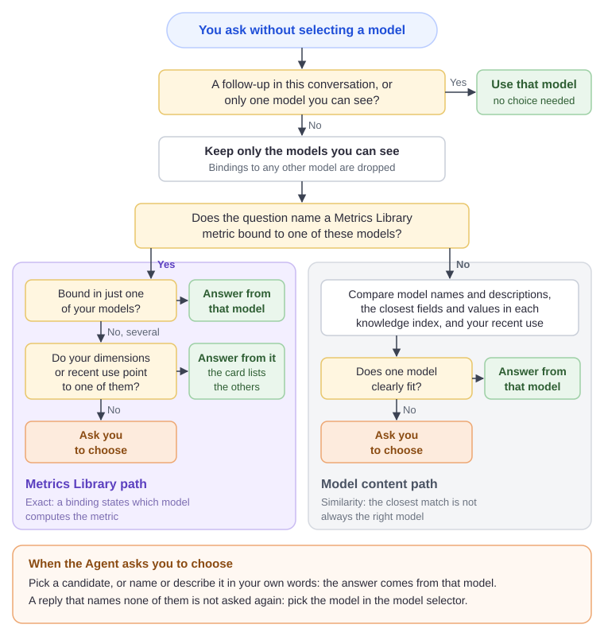

# Asking Without Choosing a Model

With **Auto-select model** in the AI Assistant, or an MCP call without a model, the Agent first has to decide which analysis model answers your question. Everything after that, from reading the fields to running the query, happens inside that one model. A wrong choice at this step cannot be repaired by a better question later in the conversation.

::: tip In short
- A metric from **Metrics Library** in your question decides the model through its **binding**. This is the only governed, exact signal the Agent has.
- Without a bound metric, the Agent compares the models' names, descriptions and knowledge indexes. That is a similarity judgement, and it is where wrong or hesitant choices come from.
- When the evidence does not settle it, the Agent asks you. It never picks by list order.
:::

This page explains the steps, then what each role can do. For the composer, the answer card and the buttons, see [AI Assistant](/documentation/AI-Agent/AI-Chat/#_2-choose-the-analysis-model-or-let-the-agent-choose).

## 1. What happens before the first answer

### Two cases are settled without any judgement

| Case | Result |
| --- | --- |
| The question continues an earlier analysis in the conversation | It stays on that analysis's model. The Agent never switches models in the middle of a conversation. |
| You can see only one analysis model | That model is used. |

Everything below applies to the first question of a conversation when you can see two or more models.

### The steps

1. **List the models you can see.** Only analysis models you have permission to read are considered. A metric binding that points to a model you cannot see is discarded at this point, and that model's name never appears in a question, an option or an answer.
2. **Find the metrics your question names.** The Agent looks for metric names and synonyms in the wording of your question. Case, spaces and punctuation are ignored, but the name or synonym has to be there. It also reads an overview of the library (up to 60 metrics with their synonyms and models), so a question that uses other words or another language can still be matched to a metric by meaning.
3. **If a matched metric is bound to a model you can see**, the bindings decide:
   - Bound in one of your models: that model.
   - Bound in several of your models: see the table below.
4. **If no matched metric is bound to a model you can see**, the Agent judges the models by their content:
   - each model's name and description;
   - from each model's knowledge index, the fields (up to 5) and member values (up to 3) closest to the wording of your question;
   - the models you asked about most in the last seven days (up to 3).

   It waits up to 8 seconds for the indexes. A model without an index, or one that does not respond in time, is judged by its name and description alone.
5. **Answer or ask.** The Agent either names one model or asks you to choose among 2 to 8 candidates.

### A metric bound in several models

| What separates the models | Result |
| --- | --- |
| **Dimension fit**: the dimensions, filters or grain in your question fit what one binding records and not the others | Answers from that model; the card lists the others. |
| **Recent use**: you asked about one of them in the last seven days and not the others | Answers from that model; the card lists the others. |
| **Binding quality**: one binding is certified and matches its definition, the others are draft, not compared, drifted or out of date | Asks you. |
| **Language**: your language matches one model's naming | Asks you. |
| Nothing | Asks you. |

Only the first two let the Agent answer without asking. A better-governed binding or a matching language never decides for you; the Agent asks instead.

### When it asks

The question names the candidates and what tells them apart, taken from their names and descriptions. Click one, or type your answer in your own words, such as the model's name or what it covers. If your reply does not identify one of the candidates, the Agent does not ask a second time: it shows "Which model to use is still unclear. Pick one from the model selector and ask again."

Fields and values found in the knowledge indexes can inform the choice, but they are never quoted in the question, because an index may contain objects that you are not allowed to see.

## 2. Why Metrics Library decides most of the choice

A binding says, in Datafor's own governed records, *this model computes this metric*. Everything else the Agent can use is circumstantial:

| | Question names a bound metric | Question names no bound metric |
| --- | --- | --- |
| **Evidence** | The binding, maintained by a model author | Names, descriptions and index search results |
| **Nature** | Exact: the model computes the metric, or it does not | Similarity: the closest field is not necessarily the right one |
| **Two similar models** | Separated by dimensions, recent use or a question to you | Often indistinguishable, so the Agent asks |
| **Basis on the answer card** | "the governed metric … is bound to this model" | "the models' fields, descriptions and your recent use" |
| **Consistent across users and weeks** | Yes, as long as the bindings do not change | Can vary with recent use and with what is indexed |

Two consequences follow:

- **A binding outranks everything else.** When a matched metric is bound to one of your models, the knowledge indexes are not consulted at all. A correct binding makes the choice fast and stable; a stray binding in a test model is just as decisive.
- **An unbound wording falls back to guesswork.** If people ask "GMV" and the library only knows "Gross Merchandise Value", the overview may still match it by meaning, but in a large library a metric outside the overview can only be found through its name or a synonym in the question.

## 3. Set up Metrics Library for questions without a model

For metric owners and model authors. Every item here changes which model answers.

1. **Register the metrics people actually ask about.** Start with the 5 to 15 that are reported to management or often disputed. If your models already define them, **Generate from a model** creates the metrics and the bindings in one step; see [Generate metrics from an analysis model](/documentation/Metrics-Library/Metrics-Library/#_3-generate-metrics-from-an-analysis-model).
2. **Make synonyms match how people type.** Add abbreviations ("GM%", "AOV"), everyday words, and the languages your users ask in. A synonym found in the question gives the Agent the full metric record, including its applicable dimensions and each binding; a metric matched only through the overview carries far less.
3. **Never give two metrics the same synonym.** Both metrics then reach the model choice, possibly pointing to different models, and the Agent later has to ask which metric you meant.
4. **Bind the metric in the model that should answer for it, and save the model.** A binding takes effect only when the model is saved. A binding shown as **Not registered** on the **Metric bindings** tab (common after importing a model) is invisible to the Agent until the model is saved again.
5. **Do not bind metrics in test, copy or sandbox models.** Each binding is a candidate. A user who can see both the production model and its copy will be asked which one to use, or answered from the copy because it was used recently. If a copy must keep its bindings, remove users' access to it.
6. **When one metric really lives in several models, make the difference visible.** Typical cases are one model per business unit or region, or a detailed model and a summary model. The Agent can tell them apart only by what is recorded:
   - each model's **Description** states its scope, for example the business unit, the period covered and the level of detail;
   - **Effective grain** on a binding states the grain the value is valid at, when that is genuinely restricted;
   - **Applicable dimensions** on the metric names the dimension concepts it is meaningful on.

   Without these, every user is asked each time, which is the correct behaviour when nothing separates the models.
7. **Certify and compare.** Binding quality never makes the Agent choose on its own, but a draft, drifted or out-of-date binding adds governance notes to every answer that uses it. See [Review definition consistency](/documentation/Metrics-Library/Metrics-Library/#_5-review-definition-consistency).

Changes to the library reach the Agent within about a minute. They do not require rebuilding any knowledge index.

::: warning Metric definitions are readable by everyone
Every signed-in user can read metric names, synonyms and definitions; the Agent shows them when asked. Bindings to models a user cannot see are removed before the Agent reads them, but the metric itself is not hidden. Do not put confidential information in a definition.
:::

## 4. When the question names no metric

Not every question names a governed metric, and not every model has bindings. For these questions the choice rests on the models' content. Model authors and administrators can make it reliable:

| What to do | Why |
| --- | --- |
| Write a model **Description** that states the subject, scope, period and level of detail, for example "Outbound shipments by carrier and warehouse, 2023 to date, one row per shipment" | The Agent reads the name and the first 400 characters of the description of every candidate model. A model without a description competes on its name alone. |
| Keep the knowledge index built for every model users ask about | A model without an index is judged by its name and description only, and is never favoured by field or member matches. See [Preparing Data for AI](/documentation/AI-Agent/Preparing-Data-for-AI/). |
| Use business captions and aliases on measures, levels and members | The index search compares your wording with them. `AMT_1` matches nothing anyone types. |
| Tell look-alike models apart in their descriptions, or limit who can see them | Copies and language twins have the same fields; the index cannot separate them, so the Agent asks. |
| Keep the number of models each user sees reasonable | The Agent considers at most 64 models per question, ordered by your recent use and the metrics your question reaches; beyond that, a model can be chosen only from the model selector. |

## 5. How to ask without choosing a model

For business users.

- **Use the metric's official name or a synonym.** If you do not know them, open the metric list from the welcome screen or ask "How is gross margin rate defined?"
- **Name the dimension or filter that matters.** "Gross margin rate by warehouse" can separate a logistics model from a retail model that binds the same metric; "gross margin rate" alone may not.
- **Keep one subject per conversation.** Follow-ups stay on the conversation's model. For a metric that lives in another model, click **New Chat**, or use `Answer with "Y" instead` on the answer card.
- **Answer the model question in one reply.** Click the candidate, or type its name or what it covers.
- **Select the model when you know it.** Choosing the model takes several seconds on the first question of a conversation, and a selected model is never second-guessed.
- **Read the basis line on the first answer.** It tells you why that model was used; see the next section.

The same question can be answered directly one week and prompt a choice another. Recent use covers only the last seven days, so the result depends on what you have been asking, not on chance.

## 6. Read the basis line, and what to fix

The card above the first answer states the model and the basis. Each basis points to something you can check.

| Basis line | What it tells you | If the model is wrong |
| --- | --- | --- |
| the governed metric "…" is bound to this model | A binding decided. | The binding is in the wrong model, or a test copy carries it. Fix the binding (model author). |
| the models' fields, descriptions and your recent use | No bound metric was found in your question. | If the question named a registered metric: add the wording as a synonym, or bind the metric in a model you can see (metric owner, model author). Otherwise improve the model descriptions (model author). |
| the only analysis model you can see | You have access to one model. | Ask an administrator for access to the model you need. |
| your choice | You picked it when asked. | Use `Answer with "Y" instead`, or pick another model in the selector. |
| the model of the analysis this continues | A follow-up stayed on the conversation's model. | Click **New Chat** for a different subject. |

`Also bound in: Y` means the metric is bound in other models you can see, and the Agent chose by dimension fit or recent use. If that happens often for the same metric, describe the models' differences (section 3, item 6).

## 7. Troubleshooting

| Symptom | Likely cause | What to do | Who |
| --- | --- | --- | --- |
| The Agent asks which model to use every time a metric is named | The metric is bound in several models you can see and nothing recorded separates them | Remove bindings from test and copy models, or their access; describe the models' scope; name the distinguishing dimension in the question | Model author, administrator, user |
| Answered from the wrong model, basis "governed metric" | A binding in the wrong model | Rebind the metric in the right model and save both models | Model author |
| Answered from the wrong model, basis "fields, descriptions" | The question's wording did not reach a bound metric, and another model looked closer | Add the wording as a synonym; bind the metric; improve the model descriptions | Metric owner, model author |
| A registered metric is never used to choose | No synonym in the question; bound only in models the user cannot see; model not saved after binding (**Not registered**) | Add synonyms; check the user's model access; save the model | Metric owner, model author, administrator |
| Two users asking the same question get different models | They can see different models, or have used different models recently | Expected. Bind and describe the models so the choice does not depend on recent use | Model author |
| The Agent asks about models that obviously do not fit | The question names no metric, and the models have no description or no knowledge index | Write descriptions; build the indexes | Model author, administrator |
| "No analysis model could be chosen …" or "Which model to use is still unclear …" | The evidence named no model, or the reply to the model question named none of the candidates | Pick the model in the selector | User |
| A follow-up about a different metric gets a poor answer | The conversation stays on its first model | Click **New Chat** | User |

For the other messages, see [When no model can be chosen](/documentation/AI-Agent/AI-Chat/#when-no-model-can-be-chosen).

## 8. AI clients over MCP

`ask_datafor` without a `model` follows the same steps under the token owner's permissions. The response names the model in `data.resolved_model`; a choice comes back as `clarification_needed` with the candidates as options. A follow-up that passes the previous step's `analysis_context_id` stays on that model. The client's own AI does not see the knowledge index evidence. See [Connect AI Clients](/documentation/AI-Agent/Connect-AI-Clients/).

## 9. Numbers at a glance

| Item | Value |
| --- | --- |
| Models considered per question | Up to 64 you can see |
| Library overview read for matching by meaning | Up to 60 metrics: those your wording reaches, then those bound to your models, then the rest |
| Model description read | First 400 characters |
| Index evidence per model | Up to 5 fields and 3 member values; waits up to 8 seconds |
| Recent use | Your 3 most-asked models of the last 7 days |
| Candidates when asking | 2 to 8 |
| Times the Agent asks which model, per question | Once |
| Metrics Library changes take effect | Within about a minute |

## Related topics

- [AI Assistant](/documentation/AI-Agent/AI-Chat/)
- [Understanding Metrics Library](/documentation/Metrics-Library/Understanding-Metrics-Library/)
- [Metrics Library](/documentation/Metrics-Library/Metrics-Library/)
- [Business Semantics for AI](/documentation/Model/Business-Semantics-for-AI/)
- [Preparing Data for AI](/documentation/AI-Agent/Preparing-Data-for-AI/)
- [Improving AI Agent Answers](/documentation/AI-Agent/Improving-Answer-Quality/)
