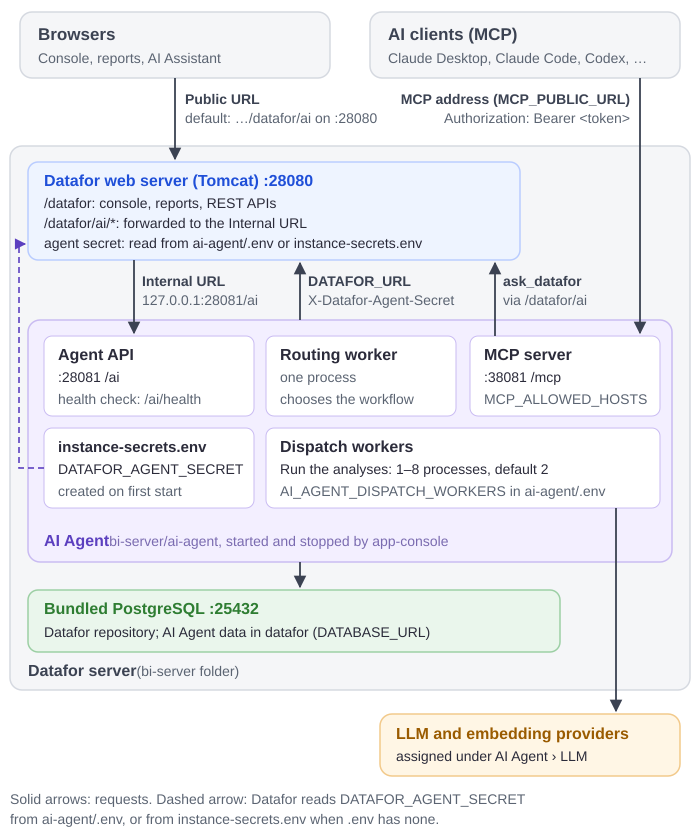

# AI Agent Shared Secret

Datafor returns the full configuration of an LLM configured in Datafor, including its provider API key, only to administrators and to callers that present the **shared secret** in the `X-Datafor-Agent-Secret` request header. Everyone else, including users who are allowed to use that model, gets a copy without `api_key`, `apiKey` and `extra_params` (which can hold custom authentication headers).

The AI Agent reads model configurations with the signed-in user's session. It therefore needs the same secret as the Datafor server: without a matching value, features that use an LLM configured in Datafor fail for users who are not administrators.

The value is called `DATAFOR_AGENT_SECRET` on both sides. This guide applies to Datafor 10.01 and later. In 10.00 Datafor kept its copy in `<agent-secret>` in the modeler's `settings.xml`; 10.01 no longer reads that element (see [Upgrading from 10.00](#_7-upgrading-from-10-00)).

## 1. Who is affected

The questions you ask on the **AI Agent** page use the model profiles assigned to the Agent stages on the **LLM** page (see [LLM Configuration](/documentation/AI-Agent/LLM-Configuration/)) and do not depend on the secret. Some features fall back to an LLM configured in Datafor when their Agent stage has no assignment, and only those need it:

- AI insight on dashboards (stage **Dashboard Review**);
- the model's welcome brief and sample questions (stages **Model Brief** and **Question Suggestions**), including the MCP tool `generate_sample_questions`;
- metadata trimming for large models.

Administrators are never affected. Keep the secret in place even when every stage is assigned, so that a later change to the assignments does not break these features for other users.

Signs that the secret is missing or does not match:

- Administrators can use these features, other users get model errors.
- The AI Agent logs in `ai-agent/logs` contain `get_llm_config_by_id: Datafor withheld the api_key of LLM <id>`. The same line also appears when the LLM configuration in Datafor simply has no API key.
- The Datafor log `tomcat/logs/pentaho.log` contains `AI service secret is not configured`. Datafor logs this once per start, the first time it finds no value in any of the places listed in section 2. A value that differs from the AI Agent's produces no Datafor warning.

## 2. Where each side finds the value

**Datafor** uses the first of these that holds a non-empty value:

1. the JVM option `-Ddatafor.agent.secret=<value>`;
2. the environment variable `DATAFOR_AGENT_SECRET` of the Datafor process;
3. `DATAFOR_AGENT_SECRET` in `bi-server/ai-agent/.env`;
4. `DATAFOR_AGENT_SECRET` in `bi-server/ai-agent/instance-secrets.env`.

Datafor looks only in the `ai-agent` folder directly beside its `pentaho-solutions` folder, which is where the installation package puts the AI Agent. It reads the two files each time it needs the value, so a new value in them takes effect without restarting Datafor. A JVM option or environment variable takes effect only after Datafor restarts.

**The AI Agent** uses a non-empty `DATAFOR_AGENT_SECRET` from its `.env` if there is one, otherwise the one in `instance-secrets.env`. That is the same order as items 3 and 4 above, so in a co-located installation both sides always agree, as long as nothing is set on the Datafor side (items 1 and 2).

The secret is kept outside Datafor's plugin folders, so installing a plugin update or an update package that replaces the modeler's `settings.xml` does not affect it.

## 3. Co-located installation: nothing to set up

In the standard layout, with the AI Agent in `bi-server/ai-agent`, the AI Agent's launcher creates the value and Datafor reads it from the same file. Nothing has to be copied.

- **First start.** The launcher (`app-console.bat` or `app-console.sh` in the AI Agent folder; on Windows also run by `bi-server/start-server.bat` and `bi-server/ai-start.bat`) generates a random value of 43 characters and stores it in `instance-secrets.env`. It prints `generated … DATAFOR_AGENT_SECRET in instance-secrets.env` (Windows) or `Generated in instance-secrets.env: … DATAFOR_AGENT_SECRET` (Linux); the line may list other per-installation secrets too. Later starts reuse the value.
- **Start it with the launcher.** If the AI Agent executables are started another way, for example registered directly as services, no value is generated.
- **Run Datafor under the same account as the AI Agent launcher.** The launcher makes `instance-secrets.env` readable only by the account that created it (on Linux `chmod 600`; on Windows that account, Administrators and SYSTEM). If Datafor runs as another account it cannot read the file, and users who are not administrators get model errors. Either run both under one account, or give Datafor the value as an environment variable as in section 4.

Keep the value in one place:

- Do not set `DATAFOR_AGENT_SECRET` on the Datafor side as an environment variable or JVM option in a co-located installation. Those take precedence over the files, and the AI Agent never sees them. If you need one, give it exactly the same value.
- Do not define `DATAFOR_AGENT_SECRET` in both `ai-agent/.env` and `instance-secrets.env`. If the two differ, both sides use the `.env` value and the launcher prints on every start: `DATAFOR_AGENT_SECRET in .env differs from the one in instance-secrets.env; this service and Datafor use the .env value. Keep it in one of the two files only.`

::: warning
`instance-secrets.env` also holds the key that encrypts the model API keys stored by the AI Agent. Never delete or replace the whole file, keep it across upgrades and include it in backups.
:::

## 4. Split deployment: give Datafor the value

When the AI Agent runs on another server, or in a folder other than `bi-server/ai-agent`, Datafor cannot read its files. Give Datafor the AI Agent's value as an environment variable or a JVM option.

### Copy the value from the AI Agent server

1. Start the AI Agent once with `app-console.bat start` (Windows) or `./app-console.sh start` (Linux), so that the value exists.
2. In the AI Agent folder, check `.env` first. If it has a `DATAFOR_AGENT_SECRET=` line with a value, that value is the one in use.
3. Otherwise open `instance-secrets.env` and copy the text after `DATAFOR_AGENT_SECRET=`.

If neither file has it, the AI Agent is older than 10.00 or was not started with its launcher.

Treat the value like a password. Move it over a secure channel, and do not paste it into email, chat or support tickets.

### Set it on the Datafor server

Use one of these for the account or service that runs Datafor:

| Where Datafor runs | Set | Survives a Datafor update package? |
| --- | --- | --- |
| Linux or Windows, started by a service or your own script | Environment variable `DATAFOR_AGENT_SECRET` in the service definition (for example `Environment=` in a systemd unit) or in the system environment | Yes |
| Docker | `-e DATAFOR_AGENT_SECRET=<value>` on `docker run`, or `environment:` in Compose | Yes |
| Any, by JVM option | `-Ddatafor.agent.secret=<value>` added to `CATALINA_OPTS` in `start-server.sh` or `start-server.bat` | No: an update package replaces `start-server.*` and `set-env.*`. Add it again after each update. |

Then restart Datafor. Prefer the environment variable: it survives updates and does not show up in the process list the way a JVM option does.

## 5. Verify and change the secret

### Verify

1. **Compare the values.** The AI Agent's value is a non-empty `DATAFOR_AGENT_SECRET` in its `.env` if there is one, otherwise the one in `instance-secrets.env`. Datafor's value is the first one found in the order of section 2. They must be identical. Do not share them while comparing.
2. **Split deployment:** check that Datafor has been restarted since you set the environment variable or JVM option.
3. **Optional functional test.** It proves something only if a feature actually falls back to an LLM configured in Datafor, that is, if one of the stages in section 1 has no assignment. Asking questions on the **AI Agent** page never uses the secret. As a user who is not an administrator, use such a feature, then check that the AI Agent logs have no new `Datafor withheld the api_key` line.

### Change it

Features for users who are not administrators fail until both sides match again, so use a low-traffic window.

1. Delete the `DATAFOR_AGENT_SECRET` line from `instance-secrets.env`, and make sure `.env` does not define the key; otherwise no new value is generated. Leave the other lines of the file alone.
2. Restart the AI Agent with `app-console.bat restart` or `./app-console.sh restart`. Use `restart` without a target, so that the MCP server restarts too; `app-console restart agent` leaves the MCP server running with the old value.
3. **Co-located:** nothing else. Datafor reads the new value from the file at its next request.
   **Split deployment:** set the new value on the Datafor server as in section 4 and restart Datafor.

## 6. Moving the AI Agent

- **One value per installation.** Do not copy `instance-secrets.env` or its values from one installation to another.
- **Moving the AI Agent next to Datafor** (into `bi-server/ai-agent`): Datafor reads the files from then on. Remove the environment variable or JVM option you set for the split deployment, or keep it equal to the AI Agent's value, because it takes precedence over the files.
- **Moving the AI Agent to another server:** set the value on the Datafor server as in section 4.

## 7. Upgrading from 10.00

Upgrade the Datafor modeler plugin and the AI Agent together. A 10.00 modeler still reads only `settings.xml`, which the 10.01 launcher no longer writes.

| Your 10.00 setup | After the upgrade |
| --- | --- |
| Co-located, value written by the launcher | Nothing to do. The value is already in `instance-secrets.env`, which Datafor now reads. This includes a value the 10.00 launcher took over from a hand-edited `settings.xml`. |
| Split deployment, `<agent-secret>` set by hand in `settings.xml` | **Action needed.** 10.01 ignores the element. Set the same value as an environment variable or JVM option (section 4) and restart Datafor, or users who are not administrators get model errors. |
| Split deployment, environment variable or JVM option | Nothing to do. |

An `<agent-secret>` element left in `settings.xml` is ignored; you can delete it.

## 8. Troubleshooting

| Symptom | What to check |
| --- | --- |
| Administrators are fine, other users get model errors, and the AI Agent log has `Datafor withheld the api_key` | Compare the values as in section 5. Common causes: a Datafor environment variable or JVM option left over from an earlier setup overrides the files; `.env` and `instance-secrets.env` differ; Datafor runs under an account that cannot read `instance-secrets.env`. If the values match, check that the LLM configuration in Datafor has an API key. |
| Other users started failing right after the upgrade to 10.01 (split deployment) | The value was in `settings.xml`, which 10.01 no longer reads. Set it as an environment variable (section 4) and restart Datafor. |
| `tomcat/logs/pentaho.log` has `AI service secret is not configured` | Datafor found no value. Co-located: check that `bi-server/ai-agent/instance-secrets.env` exists (start the AI Agent once with its launcher) and that the Datafor account can read it. Split: section 4. |

For the AI Agent connection settings of a separately installed AI Agent, see [How to Enable the AI Feature](/documentation/AI-Agent/AI-Feature/).
