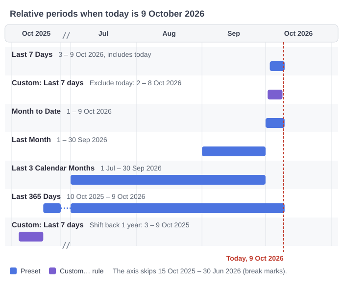
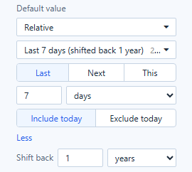
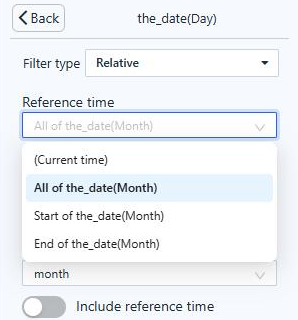
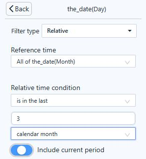

# Relative Date Filtering

A relative period, such as *Last Month* or *Year to Date*, is computed from the viewer's current date each time the report opens or refreshes, so the report never needs a manually updated date.

You can use relative periods in three places:

| Where | Setting | Use it for |
| --- | --- | --- |
| **Date** component | **Default value → Relative** | A date range or period that readers can still change. |
| **Dropdown**, **List box**, **Button group**, **Radio/Checkbox** on a year, quarter, month, week or day field | **Default value → Relative** | Preselecting the current, previous or latest period in a member list. |
| [Component filter](/documentation/Analysis/Component-Level-Filtering/#relative-dates) | **Data → Filters → +**, then **Filter type → Relative** | A fixed rule on one chart, such as *the last 12 months*, counted from today or from the period chosen in a Date component. See [Relative component filters](#relative-component-filters). |

## Presets

Each preset name means one exact range:

| Group | Presets (range selection) |
| --- | --- |
| Current period | Today, Week to Date, Month to Date, Quarter to Date, Year to Date, This Year to Last Month |
| Recent | Yesterday, Last 7 Days, Last 15 Days, Last 30 Days, Last Month, Last 2 Months, Last 6 Months, Last 365 Days |
| Calendar months and years | This Month, This Quarter, This Year to This Month, Last 2/3/6/12/24/36 Calendar Months, This Year, Last Year, Last 2/3/10 Years |

- **Last N days, months or years** include today: on 9 October 2026, *Last 7 Days* is 3–9 October and *Last 365 Days* is 10 October 2025 – 9 October 2026.
- **Last N Calendar Months** are whole calendar months, while *Last 365 Days* is a rolling window; *Month to Date* is the current month up to today. Check the range shown next to each preset.
- The list in the Date component shows the range each preset resolves to today, so you can check it before saving.

## Custom rules

At the end of every relative list, **Custom…** builds a rule from parts:

- **Direction**: **Last**, **Next** or **This** for a range; **Current**, **Back** or **Ahead** for a single period.
- **Number and unit**: 1–9999 days, weeks, months, quarters or years, never finer than the field.
- **Rolling** (exactly N units back from today) or **Calendar** (whole units); not offered for days, which always count back from today. For **This**: **To date** or **Whole period**.
- **Include today** / **Exclude today** (or the current week, month… for calendar units).
- **More → Shift back**: move the whole range back, for example *the last 7 days, one year ago*.

Examples:

| Question | Rule |
| --- | --- |
| The last three full months | Last · 3 · months · Calendar · Exclude current month |
| The same month last year | Back · 12 · months (single period) |
| The last 7 days a year ago | Last · 7 · days · Include today · Shift back 1 year |

## Relative component filters

A **Relative** component filter (**Data → Filters → +**, then **Filter type → Relative**) keeps a period counted from a reference: today, or the period chosen in a **Date** component on the same page. Choose a **Relative time condition** (**is in the last**, **is in this**, **is in the next**), a number and a unit, then click **Apply**.

### Reference time

| Reference time | The reference is |
| --- | --- |
| **(Current time)** | Today. With the hour, minute or second unit, the current hour, minute or second. |
| A single-period **Date** component | The period selected in it: a day, or a whole week, month, quarter or year at the component's granularity. |
| **All of** a range **Date** component | The whole selected range, for example 1–31 August. This is the default for a range Date. |
| **Start of** / **End of** a range **Date** component | Only the first or the last period of the range. |

Readers change the result by changing the Date component; the chart's rule stays the same. Older reports that referenced a range Date without choosing its start or end show **All of** it.

### How the period is counted

| Condition | Result |
| --- | --- |
| **is in the last** N units | The N units just before the reference. |
| **is in the last** N units, **Include reference time** | N units that end with the end of the reference. |
| **is in the next** N units | The N units just after the reference. |
| **is in the next** N units, **Include reference time** | N units that start with the start of the reference. |
| **is in this** unit | The whole week, month, quarter or year that contains the reference. |
| **is in the last** N *calendar* units | N whole units before the one that contains the reference. With **Include current period**: N whole units ending with the current one, up to the end of the reference. |
| **is in the next** N *calendar* units | N whole units after the one that contains the reference. With **Include current period**: from the start of the reference to the end of the (N−1)th unit after it. |

**Include reference time** never adds a period: the window is always N units long and only moves to end or start with the reference. Calendar units offer **Include current period** instead.

With **(Current time)** on 30 October 2026:

| Rule | Period |
| --- | --- |
| Last 7 days | 23–29 October |
| Last 7 days, Include reference time | 24–30 October |
| Last 1 month | 30 September – 29 October |
| Last 1 month, Include reference time | 1–30 October |
| Last 3 calendar months | July – September |
| Last 3 calendar months, Include current period | 1 August – 30 October |

- A Date component at **Month** granularity with August selected and a **Day** range Date set to 1–31 August give the same results.
- Month ends are counted from the day itself, as in the presets: *Next 1 month* from 29 January 2024 is 30 January – 29 February.
- The number of units is at least 1.

## Things to check

- **No data yet.** A relative period after the last loaded date returns no data. In a list filter the period is shown in red with a strikethrough and still applied; charts say *No data under the current filters*, and **View conditions** shows the range.
- **Weeks** start on the day set in **Settings › General › System configuration › Modeling › First day of the week**.
- **Older reports**: *Last 7 Days* and the other *Last N* presets cover one day less than before 10.00, and *Last Year*, *Last Month*, *Last Quarter*, *This Year to Last Month* and *Year to Date* were corrected for edge cases.
- **Older relative component filters** may return a slightly different period: *Include reference time* now covers exactly N units (one day fewer than before); a calendar unit is no longer moved by an include setting that was hidden for calendar units; a count of 0 counts as 1; and *last N hours* relative to the current time ends at the current hour instead of at midnight.
- **Time zones**: fixed dates of a Date component are saved as calendar dates, so readers in other time zones see the same dates. Dates in reports saved earlier are converted when the report opens; save the report once to store them in the new format.
- **URL values win**: a default passed in the URL replaces the relative default on the first load.
- **List filters** and single-period **Date** components that filter by a field also offer **Latest period**, the most recent period that has data. It does not move with today's date; see [Latest period in list filters](/documentation/Visualization/List-Box/#latest-period) and [in the Date component](/documentation/Visualization/Datepicker/#latest-period).

Related: [Date](/documentation/Visualization/Datepicker/) · [Dropdown, List Box, Button Group and Radio/Checkbox](/documentation/Visualization/List-Box/) · [Time Semantics and Default Time Settings](/documentation/Model/Time-Dimensions-and-Time-Intelligence/)
