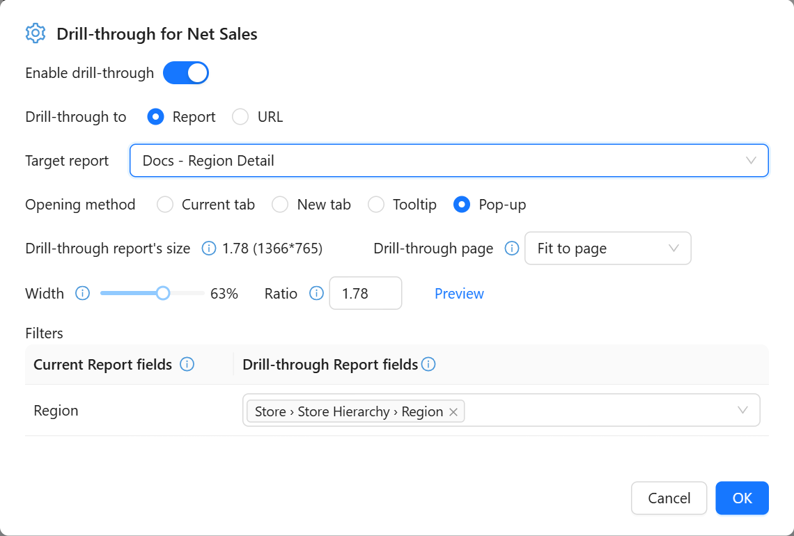
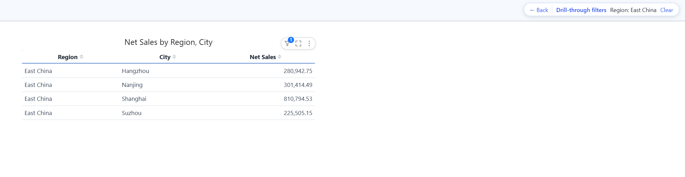

# Drill through

Drill through opens a detail report or a web address from a value the reader clicks, and passes the clicked member along: click *East China* in a summary and the store report opens filtered to East China.

## Set it up

1. Select the component, hover the measure field in **Data** (for example Net Sales) and choose **⋮ → Drill through**.
2. Turn on **Enable drill-through**.
3. Choose **Drill-through to**: **Report** (pick a dashboard report or a paginated report under **Target report**) or **URL** (enter the **Address**). With a paginated report the fields are mapped to its parameters instead; see [Drill Through to a Paginated Report](/documentation/Paginated-Reports/Drill-Through-and-Embedding/).
4. Choose the **Opening method**: **Current tab**, **New tab**, **Tooltip** or **Pop-up**. For **Tooltip** and **Pop-up** also set the **Drill-through page**, the **Width** (share of the window) and the **Ratio**. The ratio is filled in from the target report's size (shown as **Drill-through report's size**); **Preview** shows the result.
5. Check the **Filters** table. When you choose the target report, each field of this report is mapped to the field with the same name in the target, so in most cases there is nothing to do. Target fields are labelled *Dimension › Hierarchy › Field* (with the model name in front when the target uses several models), so you can tell apart fields that share a name, such as Store in two hierarchies. A field you renamed in this report shows its model name after a dot, for example *Shop · Store*. Map or correct fields by hand where the names differ.
6. Click **OK**. **OK** stays disabled, or shows what is missing, until the setup is complete: *Select a visual report*, *Enter a URL* or *Ratio is required for pop-up and tooltip*.

After **OK** the chart switches to drill-through mode and Datafor says so: *Drill-through is on: click a data point to open the target report. Ctrl+click still cross-filters.* Clicks also drill through in the editor, so you can test the setup before you save. Test with two different members: if the target shows the same numbers for both, a field is not mapped.

A field left unmapped is not passed. Unmapped page filters are the usual reason why the target shows a total for all years while the clicked bar showed one year.

### URL placeholders

A URL **Address** can contain placeholders that are replaced when the reader clicks, URL-encoded:

| Placeholder | Replaced by |
| --- | --- |
| `{{Region}}` or `{{[Store].[region].[region]}}` | The display name of that field's member in the clicked row |
| `{{Store.name}}` or `{{[Store].[store_id].[store_id].name}}` | The member name (key) instead of the display name, for example `S10` rather than *Guangzhou Tianhe Store*. Use it when the target system expects an ID. |
| `{{Store.caption}}` | The display name, the same as without a suffix |
| `{{value}}` | The raw value of the clicked cell |
| `{{formatted}}` | The displayed value of the clicked cell |

Example: `https://crm.example.com/accounts?store={{[Store].[store_id].[store_id].name}}&year={{Year}}&sales={{value}}`.

- A field that is not in the clicked row, such as a year chosen in a page filter, takes the members selected in the page filter, separated by commas (`2025,2026`, sent as `2025%2C2026`).
- `{{value}}` and `{{formatted}}` are filled when the click comes from a Table or Pivot table cell.
- Missing values become empty. Only `http`, `https` and relative addresses are accepted.

## How readers use it

- **Tables and pivot tables**: click the cell.
- **Charts**: point to the chart and turn on the drill-through button in its toolbar (*Turn on drill through: click a data point to open the target report*), then click a data point. Only one of drill-down and drill-through is on at a time; with both off, a click filters other charts. **Ctrl+click** cross-filters even while drill-through is on.
- **Right-click → Drill through** opens the target from the data point menu, without turning anything on.
- In a chart with several measures, only the measures that have drill-through set up open a report; clicking another measure cross-filters as usual.

### On the target page

When the target opens in the **Current tab** or a **New tab**, it shows the passed values in a **Drill-through filters** bar at the top right, for example *Region: East China*. **Clear** removes them and shows the target unfiltered. A target in a **Tooltip** or **Pop-up** has no bar. In every opening method the values are listed under **Passed in → Passed from jump** in each component's **Conditions**.

- **Current tab**: the bar has **← Back**. It returns to the source report and restores the filter selections the reader had made there (Date components excepted).
- **Current tab** and **New tab**: the passed values are part of the target's address, so refreshing the page or copying its link keeps them.
- **Tooltip**: the box opens on the side with the most room and shrinks to fit the window.
- A pivot table click that opens a drill-through does not also filter other charts.

## Checks

- The reader needs permission to open the target report.
- An unchanged target after clicking two different members usually means a missing or wrong field mapping; the **Drill-through filters** bar, or **Conditions** on a target component, shows what actually arrived.
- [Drill down](/documentation/Analysis/Drill-down/) changes the level inside the same chart; drill through opens a different report.
