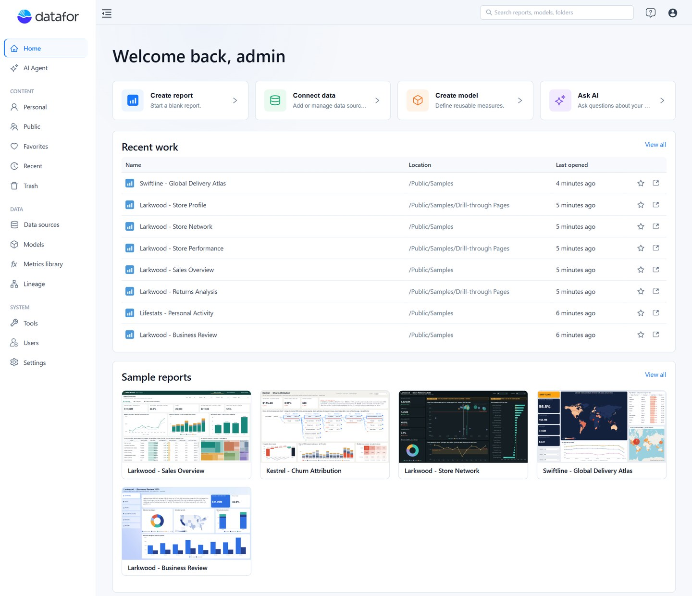
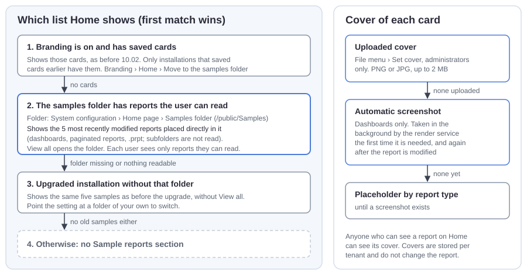
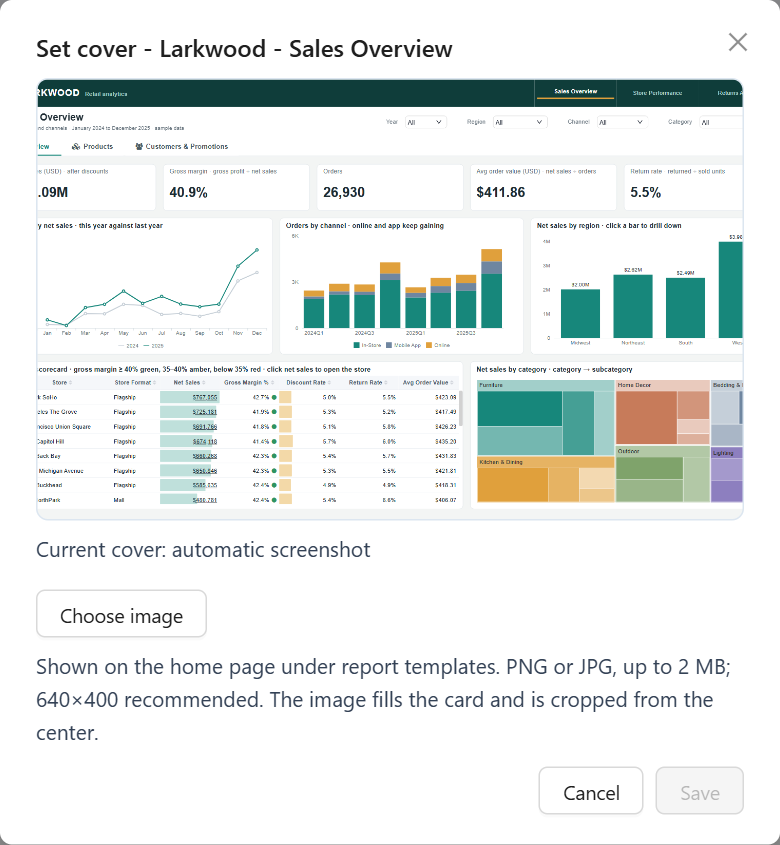

# Quick Tour of the Console

The console is where you find reports, ask the AI Agent, and manage data, models and the server. What you see depends on your permissions.

## Home

- Shortcuts: **Create report**, **Connect data**, **Create model**, and **Ask AI** when AI is enabled for you.
- **Recent work**: the last 8 reports and analysis models you opened, with their path; **View all** lists more.
- **Sample reports**: reports to look at or copy from; see below.

A report created from Home is saved in **Personal** unless you choose another folder. See [Create Your First Analysis Report](/documentation/Start/Create-Your-First-Analysis-Report/).

### Sample reports

**Sample reports** lists up to five reports from a *samples folder*, by default **Public › Samples**. **View all** opens the folder.

- Only reports placed directly in the folder are listed (dashboards, paginated reports and `.prpt` reports, not subfolders), newest **Last modified** first. To move a report to the front, open it and save it again, or copy a new report into the folder. Each user sees only the reports they can read.
- Administrators choose the folder in [System Configuration](/documentation/System/System-Configuration/#home-page). It must be under **Public**. A new installation sets **Public › Samples** to read-only for signed-in users and full control for administrators; a folder you pick keeps the permissions you give it.
- **Covers.** A dashboard's cover is a screenshot that Datafor takes in the background the first time Home needs it, and again after the report is modified; until it exists, a placeholder is shown and replaced about 15 seconds later. Paginated and `.prpt` reports show a placeholder unless an administrator uploads a cover. Automatic screenshots need the render service that is installed with the AI Agent.
- **Set cover.** In the samples folder, an administrator (including a tenant administrator) can open a report's **⋮** menu › **Set cover** and choose a PNG or JPG of up to 2 MB, 640 × 400 recommended. The image fills the card and is cropped from the center. An uploaded cover wins over the screenshot and is kept when the report changes. In the same dialog, **Restore automatic screenshot** (dashboards) previews the background screenshot and replaces the upload when you save; **Remove cover** (other reports) goes back to the placeholder when you save. If the screenshot cannot be taken, the uploaded cover is kept.

On an installation upgraded from before 10.02 there is no samples folder, so Home keeps showing the samples it showed before, without **View all**. To switch, create a folder under Public, put reports in it and choose it as the samples folder. If [Branding](/documentation/Console/Branding/#cards-saved-in-an-earlier-version) has saved report cards, Home shows the cards until they are moved to the samples folder.

## Left navigation

| Item | Use it to |
| --- | --- |
| **Home** | Start a task or resume recent work |
| **AI Agent** | Ask questions about your data in plain language. Shown when AI is enabled; users without AI permission see *Please contact your administrator to enable AI for this user*. See [AI Agent](/documentation/AI-Agent/AI-Chat/). |
| **Content › Personal**, **Public** | Your own folders and the shared folders you may open. **New** creates a folder, a dashboard **Report** or a [Paginated Report](/documentation/Paginated-Reports/Understanding-Paginated-Reports/); it is offered only in folders you can write to. |
| **Content › Favorites**, **Recent** | Items you starred, items you opened recently |
| **Content › Trash** | Deleted items you can restore |
| **Data › Data sources** | Database connections and uploaded files |
| **Data › Models** | Analysis models: fields, relationships, measures |
| **Data › Metrics library** | Agreed definitions of business metrics. See [Metrics Library](/documentation/Metrics-Library/Metrics-Library/). |
| **Data › Lineage** | Which reports use which models and data sources, broken links and unused models. Shown to users who can create content. See [The Lineage Page](/documentation/Lineage/Lineage-Page/). |
| **System › Tools** | Parameters, data dictionary, GeoJSON maps and other tools |
| **System › Users** | Users, roles and their permissions |
| **System › Settings** | Server administration. See [Settings Overview](/documentation/System/Settings-Overview/). |

The ☰ button at the top left collapses the navigation to icons. The search box at the top finds reports, models and folders by name. **?** at the top right opens help, and the avatar opens [My Account](/documentation/Console/My-Account/).

## Find a report

Open a folder and click a report to view it; click **Edit** in the report to change it. Use the breadcrumb to go up and the search box at the top to find a report, model or folder by name. When several items share a name, check the path.

Deleting a report needs the **Delete** or **Full control** permission on it; **Edit** alone is not enough. See [Permission Evaluation Overview](/documentation/System/Permission-Evaluation-Overview/).
