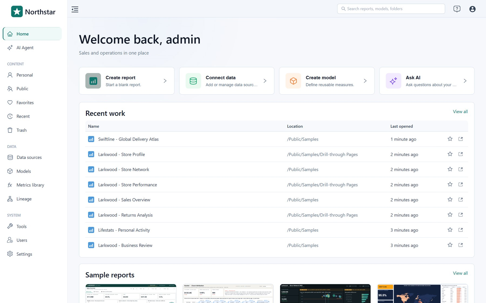
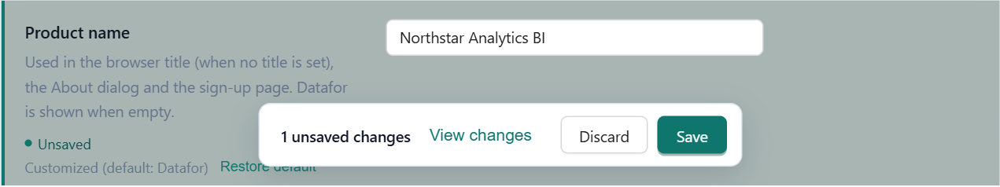
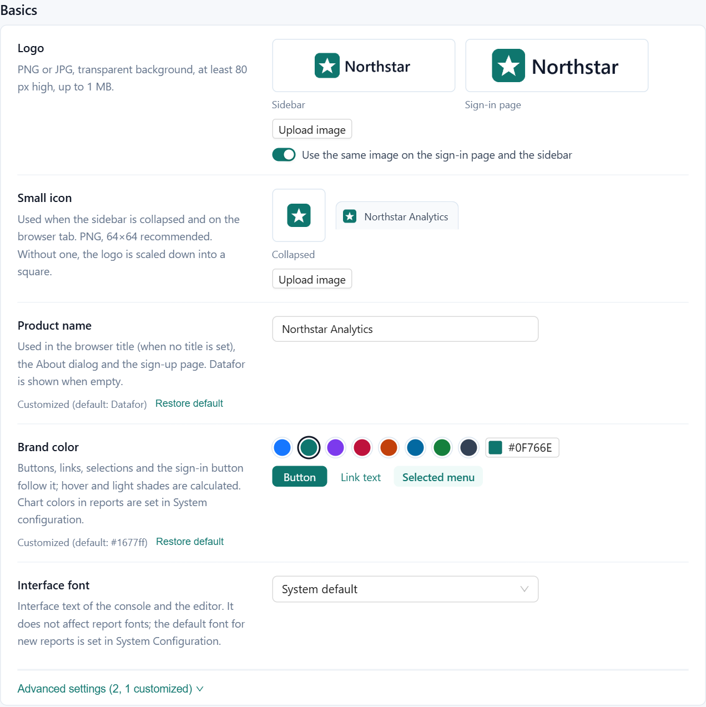
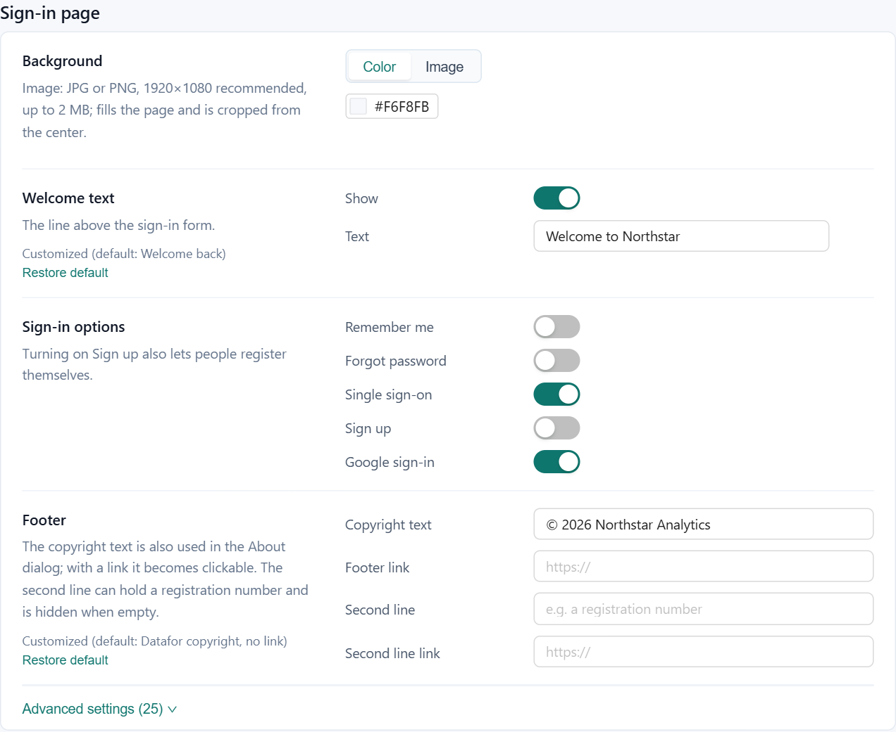
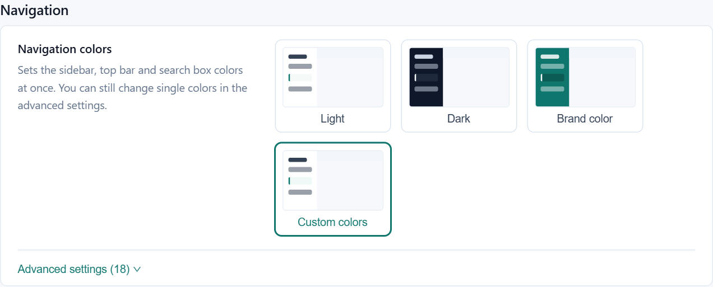
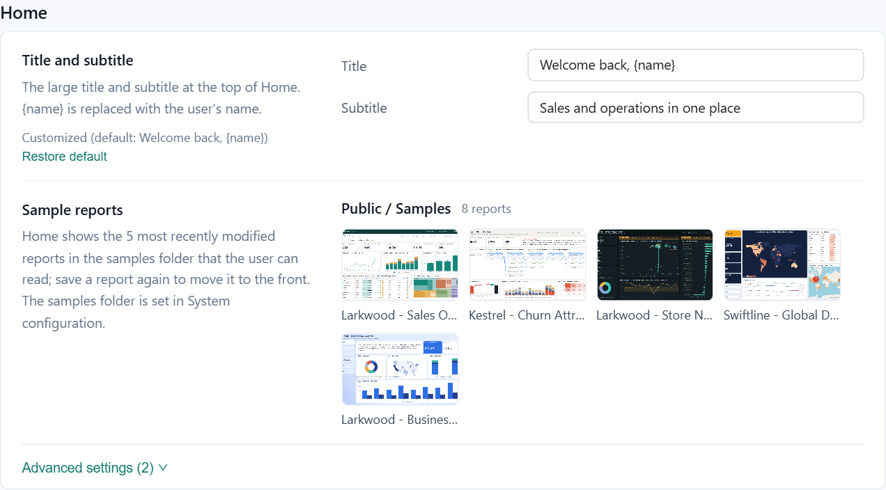

# Branding (White Label)

**Settings › General › Branding** replaces the Datafor logo, product name and colors that users see around their reports: the console, the sign-in page, the About dialog, and the emails and IM messages Datafor sends. Only administrators see the page. If it is missing, your license may not include branding.

Three settings under **Basics** give a complete brand: **Logo**, **Product name** and **Brand color**. Everything else has a default that matches the standard Datafor look and follows the brand color, so leave it alone unless you need it.

## Turn branding on

The first card, **Use custom branding**, decides whether anyone sees your settings:

- **On**: every user sees the branding on the page.
- **Off**: everyone sees the default Datafor look. Your settings and images are kept, so you can prepare a brand with the switch off and turn it on later.

The switch is saved together with the rest of the page. Changes apply as soon as you click **Save**: other users see them after they refresh the page, and you can check your own result in a new browser window. To check the sign-in page, open it in a private window, because a signed-in browser is sent straight to the console.

The message after saving tells you what happened: *Saved and turned on*, *Saved and turned off*, or *Saved. Custom branding is still off; turn on the switch at the top to apply it.*

## Find your way around the page

- The buttons under the title (**Basics**, **Sign-in page**, **Navigation**, **Home**, **About and help**) jump to a section; the page itself is one long form. **Search settings** finds any setting by name, including ones inside **Advanced settings**.
- Each section shows the common settings. **Advanced settings (*n*)** opens the detailed colors, font sizes and corner radii; the label says how many of them you have customized.
- A setting you changed shows **Customized (default: …)** and **Restore default**. Color settings you have not touched show **Follows brand color**.
- An edited row turns tinted and says **Unsaved**. A bar at the bottom counts the changes, with **View changes** (a list of each setting before and after), **Discard** and **Save**. Leaving the page with unsaved changes asks first.

**More** at the top right holds **Export**, **Import** and **Restore all defaults** (in a tenant: **Use platform branding**); see [Reuse or restore a configuration](#reuse-or-restore-a-configuration).

## Basics

| Setting | What it changes |
| --- | --- |
| **Logo** | The expanded sidebar and the sign-in page. The previews draw it on the real background so you can see whether it is too small or too faint. PNG or JPG with a transparent background, at least 80 px high, up to 1 MB; SVG is not accepted. Turn off **Use the same image on the sign-in page and the sidebar** to upload a second version, for example a light logo for a dark sidebar. |
| **Small icon** | The collapsed sidebar and the browser tab. PNG, 64 × 64 recommended. Without one, the logo is scaled down into a square. |
| **Product name** | Replaces "Datafor" where users and message recipients see it (see below). Empty means *Datafor*. |
| **Brand color** | Buttons, links, selected menu items and tabs, the sign-in button and input focus. Hover and light shades are calculated from it, and button text switches between white and dark by contrast. A very light color shows a warning that links may be hard to read. |
| **Interface font** | Text of the console and the report editor. It does not change fonts inside reports; the default font of new reports is in [System Configuration](/documentation/System/System-Configuration/). See [Fonts](/documentation/Console/Fonts/). |
| Advanced: **Browser title** | Title of the browser tab. Empty means the product name. With a report open, the tab shows *Report name - title*. |
| Advanced: **Browser icon** | A separate ICO or PNG (32 × 32 or 48 × 48) for the tab. Empty means the small icon. |

Every image slot has **Upload image** and **Remove**; removing returns to the default image. A file of the wrong type or size is refused with the reason under the slot.

### Where the product name appears

With branding on and a product name filled in, it replaces "Datafor" in:

- the browser tab (unless **Browser title** is set), the About dialog and the sign-up page title;
- the paginated report viewer's tab, which also takes your icon and interface font;
- pages ordinary users meet outside the console: linking an IM account, authorizing an AI client over MCP, and the personal access token description in **My account**;
- messages: email subjects, the footer of subscription and alert emails and IM messages, delivery channel test messages, the page that opens from an alert's *pause notifications* link, and the replies of the IM bot.

Subscription and paginated report emails also draw their buttons in the brand color. Settings pages that only administrators see keep the name Datafor.

## Sign-in page

| Setting | Notes |
| --- | --- |
| **Background** | A **Color**, or an **Image** (JPG or PNG, 1920 × 1080 recommended, up to 2 MB) that fills the page and is cropped from the center. Keep text out of the edges of the image. |
| **Welcome text** | The line above the sign-in form, with **Show**. |
| **Sign-in options** | **Remember me**, **Forgot password**, **Single sign-on**, **Sign up**, **Google sign-in**. **Sign up** also opens self-registration, so turn it on only if anyone who reaches the page may create an account. The single sign-on and Google buttons appear only for methods configured under [Single Sign-On](/documentation/System/Single-Sign-On/). |
| **Footer** | **Copyright text** (also used in the About dialog) with an optional **Footer link**, and a **Second line** with its own link, for example a website registration number. An empty second line is hidden. |

**Advanced settings** cover the welcome text style, the sign-in card (width, corner radius, shadow, background, border), input boxes, the sign-in button and the footer style. Their colors follow the brand color until you change them.

With branding on, the sign-up and forgot-password pages use the same logo, background, card and button colors, and the sign-in page uses your browser title, interface font and brand-colored links.

## Navigation

**Navigation colors** sets the sidebar, top bar and search box in one click: **Light**, **Dark** or **Brand color**. After picking one you can still change single colors in **Advanced settings (18)**: sidebar background, text, group titles, selected background and text, icons, hover text, font size, and the same for the top bar and search box. Once you change one of them the tile shows **Custom colors**.

A dark logo can disappear on a dark or brand-colored sidebar. Turn off **Use the same image** under **Basics** and upload a light version for the sidebar.

## Home

- **Title and subtitle** are the large heading at the top of Home and the line below it. `{name}` is replaced with the user's name. Their font sizes are under **Advanced settings**.
- **Sample reports** shows the samples folder, how many reports it has, and the five covers Home shows. The folder itself is chosen in **System configuration**; see [Sample reports on Home](/documentation/Console/Quick-Tour-of-the-Console/#sample-reports).

### Cards saved in an earlier version

Before 10.02, Home showed report cards configured here. If your configuration has such cards, Home keeps showing them and this section says *Home shows the n cards configured earlier*, with **Edit cards** (title, image, link, order and visibility as before) and **Move to the samples folder**.

**Move to the samples folder** lists each visible card and what will happen, then:

1. copies each card's report into the samples folder under the card title (a report already in the folder only gets its title and cover);
2. makes the card image the report's cover;
3. clears the cards and saves, so Home lists the folder from then on.

Afterwards Home shows the 5 most recently modified reports instead of your manual order, reports open in a console tab, hidden cards are not moved, and the copies are not synchronized with the originals. If any card fails, the cards are kept and the failures are listed; reports already copied stay in the folder.

## About and help

| Setting | Notes |
| --- | --- |
| **Show help menu** | The **?** at the right of the top bar, with **Documentation** and **About**. Hiding it does not restrict anything; give users another way to reach support. |
| **Show version in About** | The Datafor version number at the bottom of the About dialog. |
| **Documentation address** | Opened by **Documentation** in the help menu. It points to the Datafor documentation until you change it; **Hide Documentation** removes the item. |
| **Support email** | Shown in the About dialog; leave it empty to hide the line. It is the Datafor support address until you change it. |

With branding on, the About dialog shows the product name, the footer copyright text, the support email and, if switched on, the version.

## Tenants

A [tenant](/documentation/Multi-tenancy/Multi-tenancy/) that has never saved its own branding uses the platform's: the default tenant's whole configuration and images, including on the tenant's sign-in page. The page then says *This tenant uses the platform branding* and shows the platform values. Cards are not inherited; the tenant's Home uses its own samples folder.

When a tenant administrator saves the page, the tenant gets its own complete copy and no longer follows the platform, even for settings it did not change. **More › Use platform branding** deletes the tenant's own settings and images and goes back to the platform branding at once.

## Reuse or restore a configuration

- **Export** downloads the saved configuration and images as a ZIP. Unsaved edits are not included.
- **Import** reads the package first and shows what it replaces (*n settings, n images, n cards*); nothing changes until you confirm. Only branding packages are accepted, and unsaved edits on the page are lost. Packages exported by earlier versions can be imported.
- **Restore all defaults** returns every setting to the default Datafor look after a confirmation; the on/off switch and the cards stay as they are. Click **Save** to apply it.

For a single setting, use **Restore default** on its row.

### Configurations from earlier versions

Upgrading does not change how a branded installation looks. Colors you saved keep their values and are shown as **Customized**; they do not start following the brand color. Navigation shows **Colors from the earlier configuration** as the selected preset.

Settings that still hold the old version's default values are marked **Default from an earlier version**, and a banner counts them. **Review and update** lists each one with its current value and the new default; **Update** fills in the new defaults (colors then follow the brand color), and **Save** applies them.

With branding on, four things do change on upgrade: the About dialog shows your copyright text, the sign-up and forgot-password pages take the sign-in page styling, the sign-in page uses your browser title, and it uses your interface font and link color.

## Check before rollout

- Open the sign-in page in a private window: logo, background, footer link, focus and hover states.
- Expand and collapse the sidebar; check a selected and a hovered menu item.
- Open the About dialog and the help menu.
- Send yourself a test from a [delivery channel](/documentation/Subscriptions-and-Alerts/Delivery-Channels/) or a subscription to see the email with your name and button color.
- In a multi-tenant installation, open a tenant that has no branding of its own.

Branding changes the surroundings of reports only. Report colors and fonts are set per report and in [System Configuration](/documentation/System/System-Configuration/); embedding and sign-in need their own setup, see [SDK Embedding](/documentation/Embedded/SDK-Embedding/) and [SSO for Embedded Analytics](/documentation/Embedded/Signing-In-Users/).
