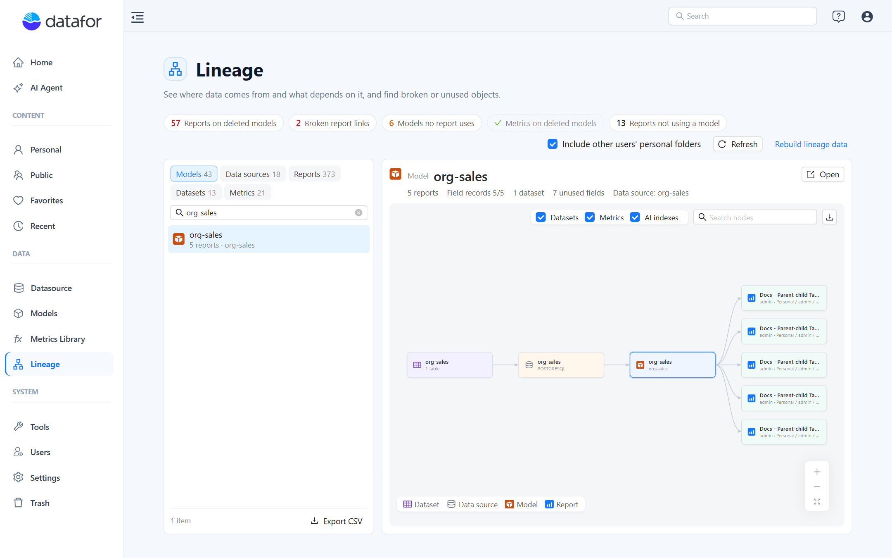
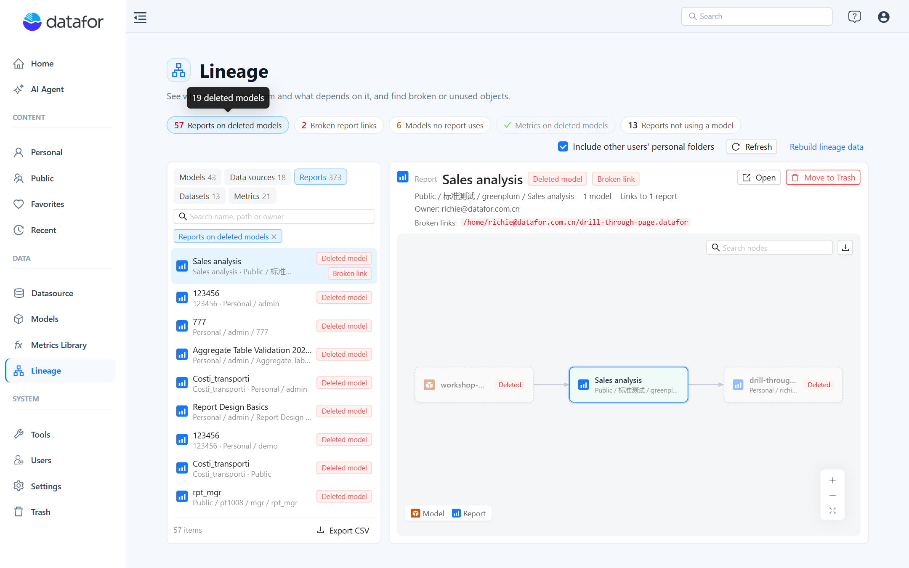
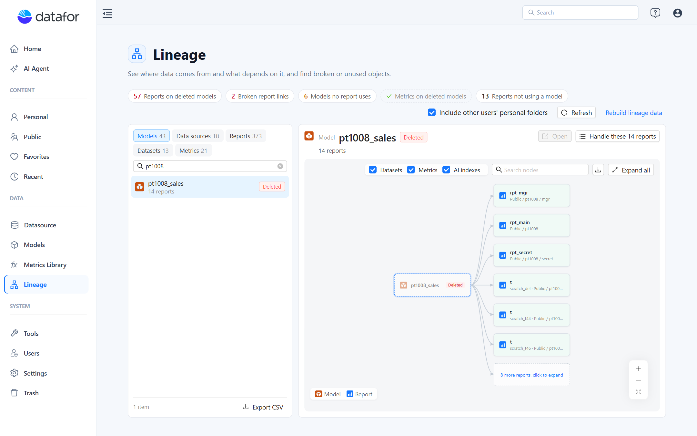
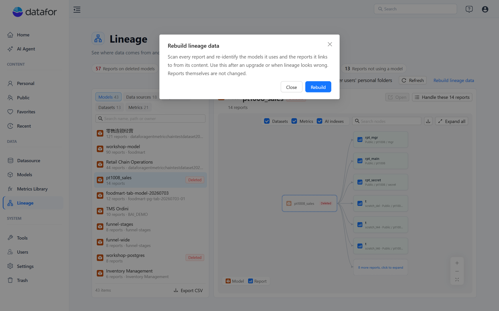

# The Lineage Page

Open **Data › Lineage** in the console. The page is for the people who look after models and data sources: it shows at a glance what is broken, what is unused, and what depends on what. It is available to users who can create content and to administrators.

The page has three parts:

1. **Health bar.** One chip per kind of problem, with a count. Click a chip to filter the list to the affected objects; click it again or the **×** on the filter tag to clear.
2. **Object lists.** Tabs for **Models**, **Data sources**, **Reports**, **Datasets** and **Metrics**, each with its count, a search box and **Export CSV**.
3. **Detail and focus graph.** The selected object's key figures, its actions, and a lineage graph centred on it.

## Health bar

| Chip | Meaning | Where it filters |
| --- | --- | --- |
| **Reports on deleted models** | Reports whose query uses a model that no longer exists. They open with errors. Hover for the number of deleted models involved. | Reports, label **Deleted model** |
| **Broken report links** | Drill-through or embedded-page links that point to a report that was deleted or moved without being saved again. Hover for the number of reports. | Reports, label **Broken link** |
| **Models no report uses** | Models that no visible report queries. Shown only to administrators with **Include other users' personal folders** on, because only then is the answer reliable. | Models, label **Unused** |
| **Metrics on deleted models** | Metrics Library metrics whose binding points to a deleted model. | Metrics, label **Deleted model** |
| **Reports not using a model** | Reports with no querying component: empty pages, navigation or embedding pages, text-only pages. This is information, not a problem, and the chip stays grey. | Reports, label **No model** |

A chip with a green check means that count is zero.

## Object lists

Every row shows the name and a second line with what matters for that kind of object:

| Tab | Second line | Labels |
| --- | --- | --- |
| **Models** | Number of reports, data source | **Deleted**, **No permission**, **Unused** |
| **Data sources** | Number of models and reports | **Deleted**, **No permission** |
| **Reports** | Folder path and owner (file name when two reports share a title) | **Deleted model**, **Broken link**, **No model** |
| **Datasets** | Number of tables and models | **Unused** |
| **Metrics** | Number of models, status | **Deleted model** |

Rows are sorted by how much depends on them (reports first), then by name; rows with problems sort first in the Reports and Metrics tabs. The search box matches name, path and owner. **Export CSV** writes the current list, with its filter and search applied, including the issue column.

Two controls above the lists change what the whole page covers:

- **Include other users' personal folders** (administrators only). On by default. Turn it off to see only Public and your own folder; the **Models no report uses** chip disappears, because it cannot be judged on a partial view.
- **Refresh** re-reads the snapshot. The page also refreshes itself after you move a report to Trash from it.

## Detail panel

Select a row to see its summary, for example for a model: *5 reports · Field records 5/5 · 1 dataset · 7 unused fields · Data source: org-sales*.

- **Field records n/m** says how many of the reports using this model have a field-level usage record (see [Understanding Lineage](/documentation/Lineage/Understanding-Lineage/#where-the-links-come-from)). When the two numbers differ, run **Rebuild lineage data** to complete them.
- **Unused fields** counts the measures, calculated members and attributes that no recorded report uses. The modeler shows which ones; see [Usage and Impact Analysis](/documentation/Lineage/Usage-and-Impact-Analysis/).
- A report shows its path, owner, the number of models, **Links to n reports**, **Linked from n reports**, and the **Broken links** paths in red.
- A data source shows its database type and the models, reports and datasets on it.

Actions in the panel:

| Button | On | What it does |
| --- | --- | --- |
| **Open** | Any existing object you may read | Opens the report, the model in the modeler, or the Datasource, Metrics Library or Datasets page in a new tab. Double-clicking a node in the graph does the same. |
| **Move to Trash** | Reports with a **Deleted model** or **Broken link** label | Moves the report to Trash after the usual confirmation. It can be restored from **Trash**. Needs delete permission on the file. |
| **Handle these n reports** | A deleted model that reports still use | Switches to the Reports tab filtered to that model, so you can open each report to repoint it or move it to Trash one by one. |

## Focus graph

The graph under the details is the same lineage graph as **View item lineage**, centred on the selected object: datasets and data sources to the left, models in the middle, reports and the reports they link to on the right. The checkboxes add or hide **Datasets**, **Metrics** and **AI indexes**; **Search nodes** highlights matches; **Expand all** opens collapsed groups; the download button saves the graph as a PNG. How to read it is described in [Viewing an Item's Lineage](/documentation/Lineage/Viewing-an-Items-Lineage/).

## Rebuild lineage data

**Rebuild lineage data** (administrators only) scans every report on the server and writes, for each, the models it uses, the fields behind its charts and the reports it links to. Run it:

- once after upgrading to 10.00 or later, so reports saved by older versions get a field-level record;
- when the page shows **Field records** below the number of reports for a model;
- when a lineage looks wrong, for example after restoring files from a backup.

The rebuild runs in the background and reports *Scanned n of m reports*; you can close the dialog and come back. Only one rebuild runs at a time. Reports that cannot be parsed are listed under **Unparsable reports** and can be exported as a list. Reports themselves are not modified, and the rebuild does not change permissions.

## Typical tasks

- **Before deleting or replacing a model:** select it, read the report count, then **Open** the reports that matter or use the model's graph to find their owners.
- **After a model was deleted by mistake:** click **Reports on deleted models**, select the model's reports and either restore the model from Trash or move the orphaned reports to Trash with **Handle these n reports**.
- **Cleaning up a server:** with **Include other users' personal folders** on, work through **Models no report uses** and the **Unused** datasets; export the Models tab to CSV to review the list with the model owners.
- **Fixing drill-through after a move:** click **Broken report links**, open each source report, repoint the drill-through and save it. Saving writes the new link.

## Related topics

- [Understanding Lineage](/documentation/Lineage/Understanding-Lineage/)
- [Viewing an Item's Lineage](/documentation/Lineage/Viewing-an-Items-Lineage/)
- [Usage and Impact Analysis](/documentation/Lineage/Usage-and-Impact-Analysis/)
