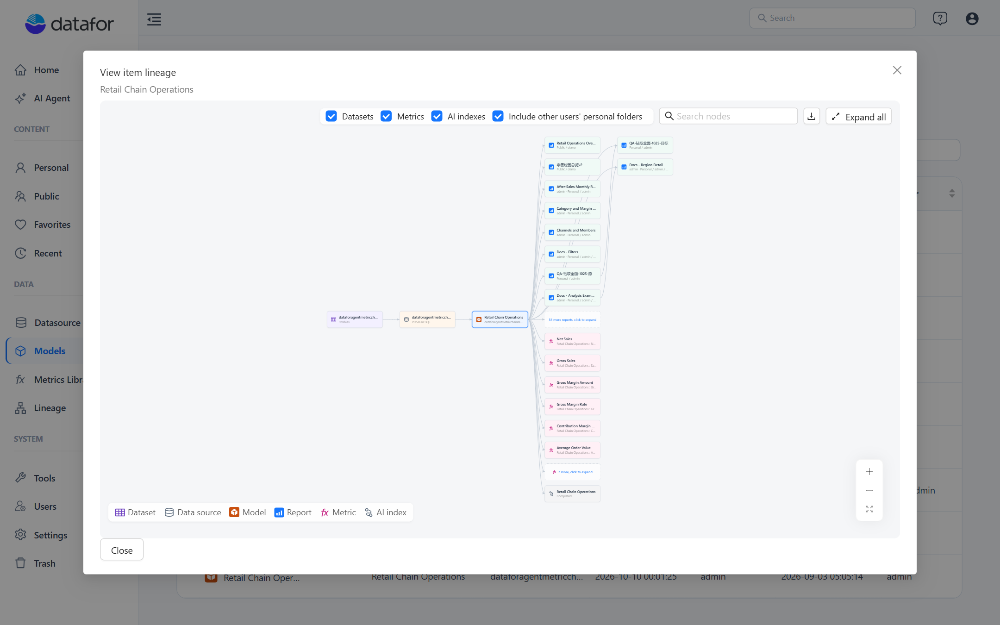
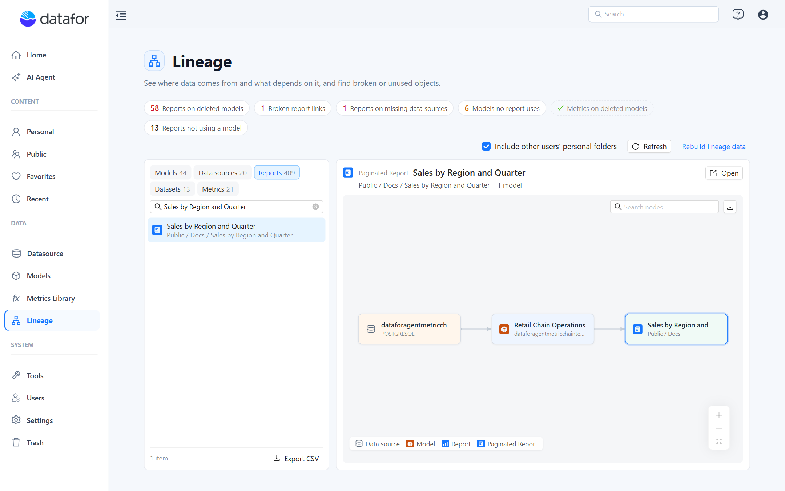

# Viewing an Item's Lineage

**View item lineage** draws the chain around one object: for a report, the models it queries and their data sources, plus the reports it opens; for a model, its data source and every report that uses it; for a data source, its models and their reports. Use it to find the model behind a chart, or the reports affected before you change or delete a model or a connection.

## Open it

| Starting point | Where | Graph centred on |
| --- | --- | --- |
| A report you are editing or viewing | Report toolbar menu › **Report lineage** (disabled until a new report is saved) | The report |
| A report in a folder | The file's actions menu › **View item lineage** (not offered on folders) | The report |
| An analysis model | **Models** › the model's actions menu › **View item lineage** | The model |
| A data source | **Datasource** › the connection's **Actions** menu › **View item lineage** | The data source |
| Any object | **Data › Lineage**, select it | The object, in the page's focus graph |

## Read the graph

The graph flows left to right in the order of the data: **Dataset → Data source → Model → Report → Linked report**. A paginated report with SQL datasets is also linked straight from its data source; that edge runs in the gap between the columns, past the model column, with **Metric** and **AI index** nodes under the model. Each node has the icon and colour of its type (see the legend at the bottom left); the object you started from has a highlighted border.

- **Hover** a node for its details: path and owner of a report, database type of a data source, tables and files of a dataset, status and version of a metric, vectors of an AI index.
- **Double-click** a node to open it: the report (a paginated report in its viewer), the model in the modeler, or the Datasource, Metrics Library or Datasets page.
- **Groups.** When a model has many reports, the column shows the first few and a *n more reports, click to expand* tile; click it to expand and *Collapse n reports* to fold them again. **Expand all** opens every group.
- **Labels.** **Deleted** marks an object that no longer exists (the model of an orphaned report, or the target of a broken link). **No permission** marks a model or data source you cannot read; the node stays in the graph so you can see the dependency, but its details are hidden. **Previously \<path\>** on a linked report means the link still points to the report's old path; it heals when the source report is saved again.
- **Linked reports** are the reports this report opens through drill-through or embeds as a page. They sit in an extra column to the right, so a chain of drill-throughs reads left to right.

## Toolbar

| Control | What it does |
| --- | --- |
| **Datasets**, **Metrics**, **AI indexes** | Show or hide those node types. The choice is remembered in your browser. |
| **Include other users' personal folders** | Administrators only: include reports in every user's personal folder, not only Public and your own. Also remembered. |
| **Search nodes** | Highlights the nodes whose name or path contains the text. |
| **Fit to view**, **+**, **−** | Zoom; the graph fits the window when it opens and when the window is resized. |
| **Export image (PNG)** | Saves the whole graph, including collapsed groups as they are, as a PNG named after the object. |
| **Expand all** / **Collapse all** | Opens or folds every report group. |

## What the graph includes

- Reports from **Public** and your own personal folder; administrators can include all personal folders. A model or data source can therefore be used by more reports than a non-administrator sees.
- Models you can read, plus models a visible report uses even when you cannot read them (**No permission**) or they were deleted (**Deleted**).
- Datasets whose connection you can read.
- Only components that run a query link a report to a model. A report that only contains text, images or buttons has no model and no lineage of its own.

## Related topics

- [Understanding Lineage](/documentation/Lineage/Understanding-Lineage/)
- [The Lineage Page](/documentation/Lineage/Lineage-Page/)
- [Usage and Impact Analysis](/documentation/Lineage/Usage-and-Impact-Analysis/)
- [Get lineage (API)](/api/Lineage/Get-lineage/)
