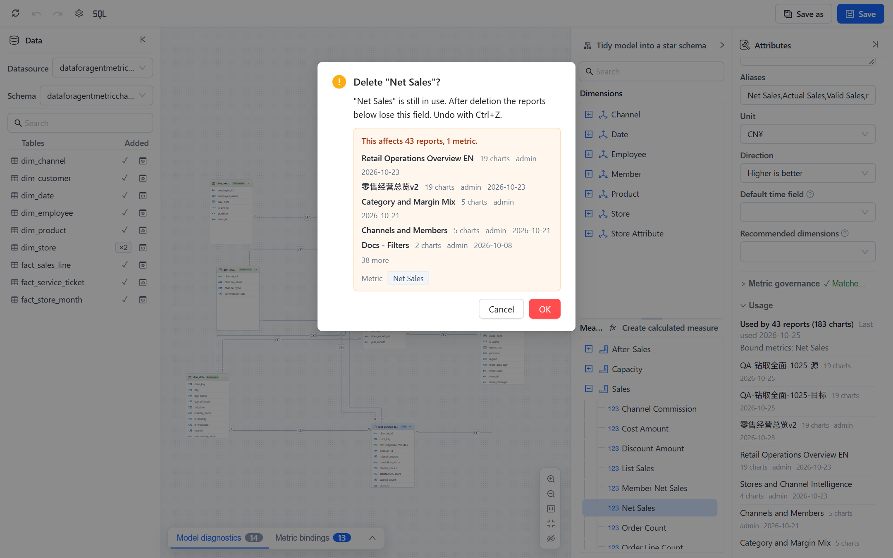

# Usage and Impact Analysis

Lineage at the level of objects tells you that a report uses a model. Usage goes one level down: which reports, and which charts in them, use *this* measure or *this* attribute, and what will break if you remove a table or a column. Datafor shows it in the confirmation of every delete or change that can break reports, and as a count of unused fields on the Lineage page.

Both are built from the field-level record that is written when a report is saved (10.01 and later) or by **Rebuild lineage data**. Reports without the record cannot be assessed; Datafor says so rather than guessing.

## Impact lists before you delete or change something

When you confirm an action that can break reports, the dialog shows the impact first. In the modeler the confirmation opens at once with *Checking which reports and metrics are affected…* and fills in the list when the check returns, so you can read it before you click **Delete**.

| Action | Where | Lists |
| --- | --- | --- |
| Delete a measure, calculated member or attribute | Modeler, tree context menu | Reports (with chart counts), bound metrics |
| Delete a table from the canvas | Modeler | Reports using any field of the table, metrics |
| Delete a model, including several at once | **Models** list | Reports, metrics |
| Change a model's data source | **Models › Change datasource** | Reports, in a compact form |
| Delete a data source | **Data sources** list | Models on it, their reports and metrics, paginated reports whose SQL datasets use it, datasets loaded into it |
| Delete a dataset file | **Data sources › File datasets** | Models that use its tables, their reports and metrics |

Each list shows up to five reports with chart count, owner and last change, then *n more*; metrics and models appear as chips. **View lineage** in the dialog opens the full graph. Two notes can follow the list:

- *n more reports use this model but have no field-level record, so their impact is unknown.* These reports were saved before 10.01 and not rebuilt; they may or may not use the field. Run **Rebuild lineage data** on the Lineage page and open the dialog again.
- *Based on the reports you can see.* You are not an administrator, so reports in other users' personal folders are missing from the count.

Instead of a list, the check can also end with *No reports or metrics are affected.*, or *Could not check which reports and metrics are affected. Make sure nothing depends on it before you continue.* when the lineage service did not answer. In the second case the delete still works; look the object up on the Lineage page first. The impact list informs; it does not block. In the modeler a delete can be undone with **Ctrl+Z** until you save.

## Finding fields no report uses

The Lineage page counts them per model: select a model and its summary says, for example, *7 unused fields* — measures, calculated members and attributes that no recorded report uses. The count is shown only to administrators looking at all folders, for the same reason as the **Unused** label: a field used in another user's personal folder must not look unused.

The modeler no longer lists usage per field (10.02 removed the **Usage** section of the property panel and the *not used by any report* diagnostic). To check one field before you remove it, start the delete: the confirmation lists the reports and metrics that use it, and **Cancel** leaves the model unchanged. If you delete it anyway, **Ctrl+Z** brings it back until you save.

## Limits

- Usage records list the fields a component queries: measures, hierarchy levels, filters, calculated members, and report-level calculated measures. Fields used only inside a calculated measure defined in the report are attributed to that calculated measure, not to the report directly.
- Static components (text, images, buttons) have no usage.
- Paginated reports count with the fields of their model datasets. The fields an SQL dataset reads are not traced to the model; deleting or changing a data source lists those paginated reports in its impact.
- Usage is cached per model for a short time and refreshed when the model or a report is saved; **Refresh** on the Lineage page forces it.

## Related topics

- [Understanding Lineage](/documentation/Lineage/Understanding-Lineage/)
- [The Lineage Page](/documentation/Lineage/Lineage-Page/)
- [Managing Analysis Models](/documentation/Model/Managing-Analysis-Models/)
- [Model Diagnostics](/documentation/Model/Model-Diagnostics/)
