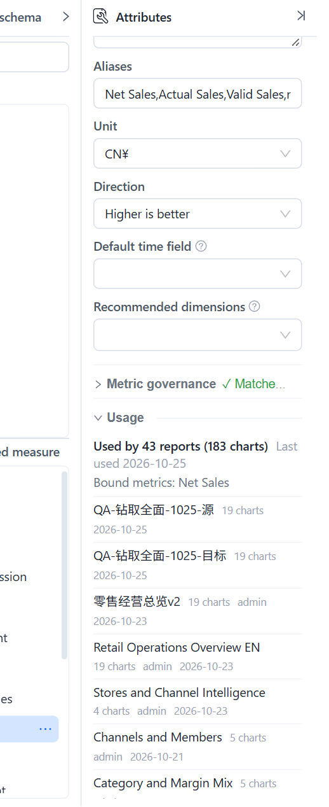
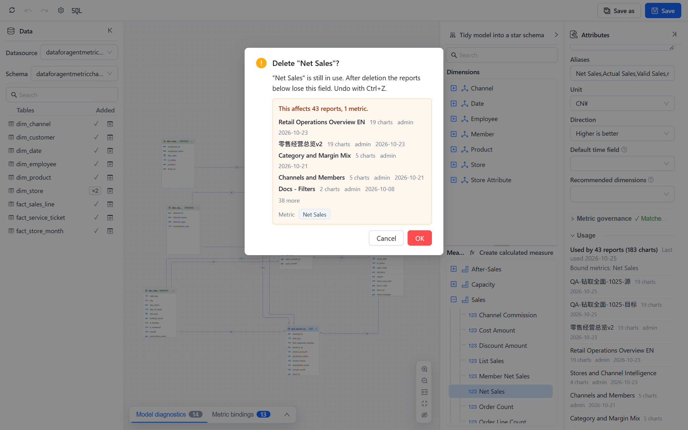

# Usage and Impact Analysis

Lineage at the level of objects tells you that a report uses a model. Usage goes one level down: which reports, and which charts in them, use *this* measure or *this* attribute, and what will break if you remove a table or a column. Datafor shows this in two places: the **Usage** section of the modeler's property panel, and the confirmation dialog of every delete or change that can break reports.

Both are built from the field-level record that is written when a report is saved (10.00 and later) or by **Rebuild lineage data**. Reports without the record cannot be assessed; Datafor says so rather than guessing.

## Usage in the modeler

Open a model and select a measure, calculated member, attribute or hierarchy level in the **Dimensions** or **Measures** tree, or a table or column on the canvas. The **Attributes** panel ends with a **Usage** section.

| Line | Meaning |
| --- | --- |
| **Used by 43 reports (183 charts)** | Reports that query this member directly, and the total number of components in them that do. |
| **Last used 2026-10-25** | The most recent save of any of those reports. |
| **n of them via calculated members** | Reports that do not use the measure itself but a calculated member built on it. Such reports are marked *via <member>* in the list. |
| **Bound metrics: …** | Metrics Library metrics bound to this measure. Deleting the measure breaks the binding. |
| **Not used by any report.** | No visible report with a usage record uses it. |
| Report list | Title, chart count, owner and date, newest first; **Open report** opens it in a new tab; **Show all n** expands the list. |

Notes on reading it:

- Usage is **based on the last saved model**. A member you added or renamed in this session shows *Save the model to see where it is used.*
- Selecting a **table** or a **column** adds up the usage of every measure and attribute built on it, which is what you need before dropping the column or detaching the table.
- Non-administrators see *Based on the reports you can see*: reports in other users' personal folders are not counted, so an empty list does not prove the member is unused.
- Renaming a measure changes its name in the model; reports keep working because they refer to the model's internal names, and usage follows.

## Impact lists before you delete or change something

When you confirm an action that can break reports, the dialog shows the impact first.

| Action | Where | Lists |
| --- | --- | --- |
| Delete a measure, calculated member or attribute | Modeler, tree context menu | Reports (with chart counts), bound metrics |
| Delete a table from the canvas | Modeler | Reports using any field of the table, metrics |
| Delete a model, including several at once | **Models** list | Reports, metrics |
| Change a model's data source | **Models › Change datasource** | Reports, in a compact form |
| Delete a data source | **Datasource** list | Models on it, their reports and metrics, datasets loaded into it |
| Delete a dataset file | **Datasource › Datasets** | Models that use its tables, their reports and metrics |

Each list shows up to five reports with chart count, owner and last change, then *n more*; metrics and models appear as chips. **View lineage** in the dialog opens the full graph. Two notes can follow the list:

- *n more reports use this model but have no field-level record, so their impact is unknown.* These reports were saved before 10.00 and not rebuilt; they may or may not use the field. Run **Rebuild lineage data** on the Lineage page and open the dialog again.
- *Based on the reports you can see.* You are not an administrator, so reports in other users' personal folders are missing from the count.

When nothing depends on the object, the dialog is the ordinary confirmation with no impact block. The impact list informs; it does not block. In the modeler a delete can be undone with **Ctrl+Z** until you save.

## Model diagnostics: "not used by any report"

**Model diagnostics** in the modeler lists, at **Info** level, measures and attributes that no report uses: *"Store Manager" is not used by any report.* Use it to trim a model before publishing it or to find fields that can be hidden. The rule runs only for administrators with the full view of reports, for the same reason as the **Unused** labels on the Lineage page. See [Model Diagnostics](/documentation/Model/Model-Diagnostics/).

## Limits

- Usage records list the fields a component queries: measures, hierarchy levels, filters, calculated members, and report-level calculated measures. Fields used only inside a calculated measure defined in the report are attributed to that calculated measure, not to the report directly.
- Static components (text, images, buttons) have no usage.
- Paginated reports are not part of usage records in this release.
- Usage is cached per model for a short time and refreshed when the model or a report is saved; **Refresh** on the Lineage page forces it.

## Related topics

- [Understanding Lineage](/documentation/Lineage/Understanding-Lineage/)
- [The Lineage Page](/documentation/Lineage/Lineage-Page/)
- [Managing Analysis Models](/documentation/Model/Managing-Analysis-Models/)
- [Model Diagnostics](/documentation/Model/Model-Diagnostics/)
