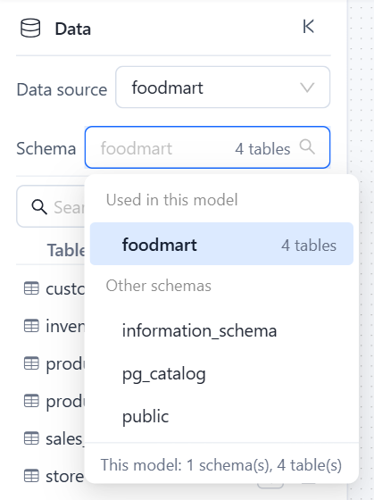
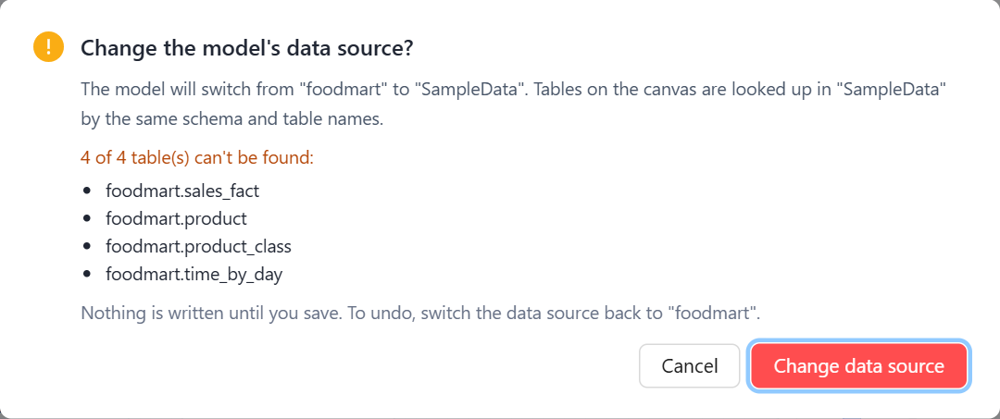
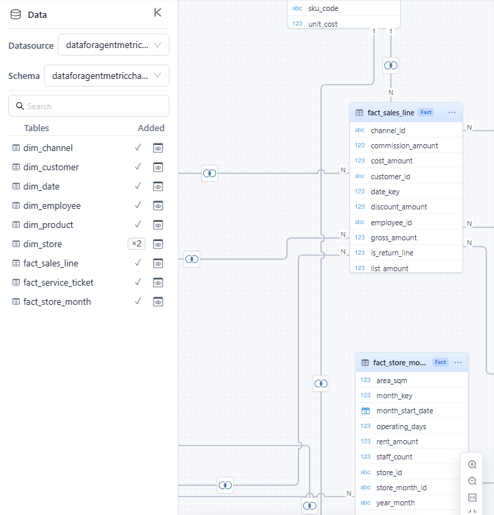
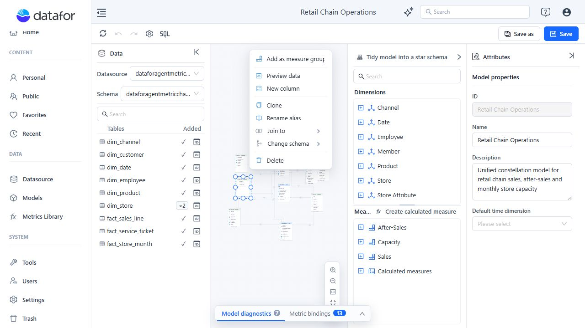

# Working with Tables and the Canvas

The Data panel controls which source objects enter the model. The canvas shows those objects and their relationships.

## Add and locate tables

1. Select a **Data source** and **Schema**.
2. Search for the required table.
3. Click its add control, double-click it, or drag it onto the canvas.

The **Schema** list shows how the model uses each schema. Schemas the model already has tables from come first under **Used in this model**, each with its table count (*3 tables*; a table added twice under two aliases counts once); the rest follow under **Other schemas**. The bottom line sums it up, for example *This model: 2 schema(s), 5 table(s)*, with a separate line for SQL views, which belong to no schema, and for tables that are not in this data source. Use it to see at a glance whether a model mixes schemas.

### Changing the data source

A model reads from one data source. When the canvas already has tables and you pick another **Data source**, Datafor first looks up every table in the new source by the same schema and table name and asks **Change the model's data source?**: all tables found, or *2 of 5 table(s) can't be found:* with their names, and how many SQL views will run on the new source instead. **Change data source** switches the model; **Cancel** keeps the current one.

 Nothing is written until you save, so switching back undoes it. With an empty canvas the data source changes without asking.

Tables that the new source does not have stay on the canvas and appear in [Model Diagnostics](/documentation/Model/Model-Diagnostics/) as errors. To point a saved model at a connection with another name but the same tables, you can also use **Change datasource** in the **Models** list.

A check mark means the table is already in the model. A count such as **×2** means that the same source table has been added with multiple aliases. Select the table entry to locate a specific alias on the canvas.

## Preview source data

Click the preview control in the Data panel, or select **Preview data** from a table menu. The preview displays the first 50 rows available to the current user.

Use the preview to verify:

- Join keys contain the expected values.
- Date and numeric columns have the expected source types.
- Candidate unique keys do not contain obvious duplicates or nulls.

## Use the table menu

Depending on the selected table, the menu can include:

| Action | Result |
| --- | --- |
| **Add as dimension** | Generates a Dimension from the table when one does not exist. |
| **Add as measure group** | Generates Measures from eligible numeric fields and adds Fact Count. |
| **Preview data** | Opens a sample of the source rows. |
| **New column** | Creates a row-level calculated column with a datasource SQL expression. |
| **Clone** | Adds another model instance of the same source table with a different alias. |
| **Rename alias** | Changes the model alias without renaming the source table. An empty alias or one that another table already uses is refused under the input (*Enter an alias*, *Alias exists*); spaces at either end are trimmed. |
| **Join to** | Starts a relationship with another table. |
| **Change schema** | Changes the schema stored for a physical table; the current schema is ticked. Verify that the same table and required fields exist in the target schema. |
| **Delete** | Removes the table and its dependent model objects. |

Changing schema takes effect without a confirmation dialog and does not verify table or field compatibility.

Deleting a table, from its menu or with the Delete key on the canvas, opens a **Delete table?** confirmation that lists what will be removed: the table and the number of relationships, Dimensions, and Measure Groups built on it. Below that, the reports and metrics that use the table are filled in once the check returns (see [Usage and Impact Analysis](/documentation/Lineage/Usage-and-Impact-Analysis/#impact-lists-before-you-delete-or-change-something)). Press Ctrl+Z to undo the deletion. Review calculated measures and enterprise metric bindings after deletion: Undo restores the editor state, but it does not restore changes already written to the external Metrics Library registry.

## Create or edit a SQL View

Click **SQL** in the toolbar, enter a **View Name** and a `SELECT` statement, click **Run** to see the fields and sample rows, then **OK** to add the view with a generated dimension and measure group. To change it, select **Edit** in the view's **⋯** menu: the view is updated in place and keeps its relationships and measures, and columns that the new SQL drops but the model still uses are listed before anything changes. See [Creating SQL Views](/documentation/Model/Creating-SQL-Views/).

## Select tables and fields on the canvas

Clicking on the canvas selects the model objects built on what you click, and the properties pane shows them:

| You click | Selected |
| --- | --- |
| A table card | The Dimension(s) and the Measure Group built on that table. |
| A field | The Attribute that uses it as key, caption or sort column, or the Measure built on it. A field that is both shows the Measure, with the dual-role hint. |
| A table or field that is not modeled | A read-only **Table properties** or **Field properties** pane with the **Table alias** and **Field**, and the note "This table is not modeled as a dimension or measure group." or "This field is not modeled as a dimension attribute or measure." An unmodeled field also highlights its table's objects in the model tree. |

Key columns show a grey **PK** badge after the field name ("Primary key (defined in the database)"). A darker line marks the end of a composite key.

## Navigate a large canvas

Use the controls in the lower-right corner to:

- Zoom in or out.
- Return to actual size.
- Fit the whole model into the available space.
- Show or hide the minimap.

Use the minimap to move quickly between distant parts of a large model.

## Tidy semantic roles

**Tidy model into a star schema** uses the currently configured relationship cardinalities and semantic objects to preview a cleanup:

- A fact-like table can lose its Dimension.
- A dimension-like table can lose its Measure Group.
- Ambiguous tables remain unchanged.

The operation does not retest key uniqueness, create relationships, choose join fields, or rearrange the canvas. It can remove bound Measures or leave calculated measures with missing references, so review every proposed removal and validate the result before saving.

If the cleanup removes bound Measures, the modeler requests that their enterprise metrics be unbound. Verify **Metric bindings** after applying or undoing the cleanup: Undo can restore the editor model, but it cannot restore external Metrics Library registry changes.

See [Tidy Model into a Star Schema](/documentation/Model/Tidy-Model-into-a-Star-Schema/) for the required pre-checks and post-apply validation.

## Related topics

- [Creating an Analysis Model](/documentation/Model/Creating-an-Analysis-Model/)
- [Creating SQL Views](/documentation/Model/Creating-SQL-Views/)
- [Establishing Table Relationships](/documentation/Model/Establishing-Table-Relationships/)
- [Advanced Relationship Modeling](/documentation/Model/Advanced-Relationship-Modeling/)
- [Tidy Model into a Star Schema](/documentation/Model/Tidy-Model-into-a-Star-Schema/)
- [Calculated Columns](/documentation/Model/Calculated-Field/)
- [Model Diagnostics](/documentation/Model/Model-Diagnostics/)
