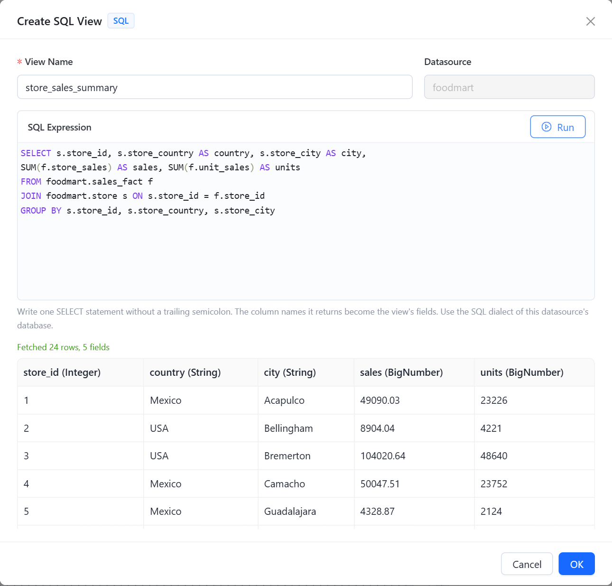
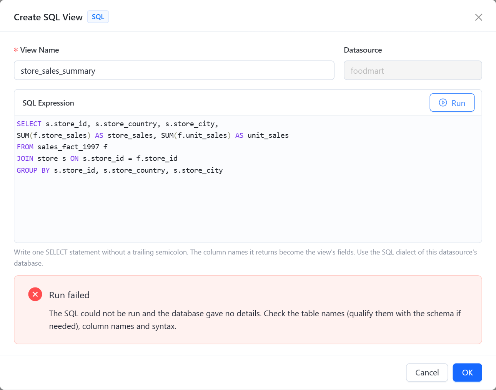
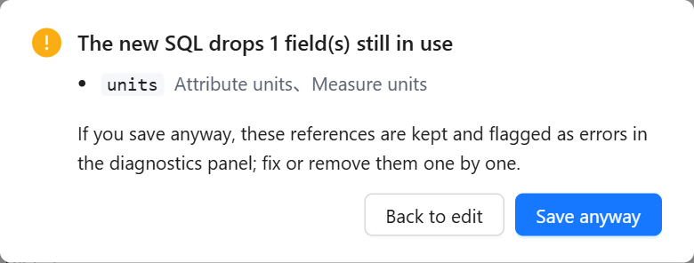

# Creating SQL Views

A SQL View adds a query result to an Analysis Model as a model table. Use one when the required row set or fields are easier to define in SQL than with a physical table and individual calculated columns. It is stored in the model definition; it does not create a view in the source database.

## Create a SQL View

1. In the modeler toolbar, click **SQL**. The **Create SQL View** dialog shows the model's **Datasource**; the SQL runs on that connection.
2. Enter a **View Name**. It must differ from every other table and SQL View in the model; a name in use is refused with *The name "…" is already used by another table*. The name is how the rest of the model refers to the view, so choose a stable one.
3. Enter one `SELECT` statement in **SQL Expression**, without a trailing semicolon, in the SQL dialect of the data source. Qualify table names with the schema when the connection does not default to it, for example `foodmart.sales_fact`. Give every computed column an alias (`SUM(f.unit_sales) AS units`): the column names become the view's fields.
4. Click **Run**. The dialog shows *Fetched n rows, n fields*, and a sample of up to 50 rows with each field's type in the column header. Check the field names and that numeric columns come back as numbers (Integer, BigNumber) rather than String.
5. Click **OK**. If you did not run the current SQL, **OK** runs it first and stops on an error. The view is added to the canvas with a **SQL** badge, together with a dimension and a measure group named after it.
6. Add relationships to other tables, and tidy the generated dimension and measures: the generated dimension has an attribute for every field, numeric ones included.
7. Click the modeler's **Save**. Until then the view exists only in your draft.

<div align="left"></div>

For a store-level summary on the foodmart sample, the SQL in the screenshot is:

```sql
SELECT s.store_id, s.store_country AS country, s.store_city AS city,
       SUM(f.store_sales) AS sales, SUM(f.unit_sales) AS units
FROM foodmart.sales_fact f
JOIN foodmart.store s ON s.store_id = f.store_id
GROUP BY s.store_id, s.store_country, s.store_city
```

Pre-aggregating in a view fixes its grain: here one row per store. Measures on `sales` are correct per store, country and city, but the view cannot be filtered by date or product, because those columns are no longer in it. Keep the columns you need to slice by in the `SELECT` and `GROUP BY`, or join the raw tables instead.

### When Run fails

The error stays in the dialog under **Run failed**, so you can correct the SQL and run it again.

<div align="left"></div>

| Message | Usual cause |
| --- | --- |
| *The SQL could not be run and the database gave no details. Check the table names (qualify them with the schema if needed), column names and syntax.* | A table or column that does not exist, a table without its schema (`sales_fact` instead of `foodmart.sales_fact`), a trailing semicolon, or syntax of another database. Datafor does not pass the database's own error text to the browser, so test the statement in a SQL client if the cause is not obvious. |
| *You don't have permission to run SQL on data source …*, or `SQL_EXECUTE_FORBIDDEN:<connection>` | You may not run SQL on this connection; see the next section. |

### Raw SQL permission

**Run** (and **OK**) require permission to execute raw SQL on the connection. Administrators always have it. Other users need:

- **Full control** on the connection;
- a connection that is not sensitive: not an engine running inside Datafor (DuckDB, uploaded datasets and similar), not JNDI, and not a connection on the database server that holds the Datafor repository whose account can reach the repository;
- SQL that does not call blocked server-side functions such as `dblink`, `pg_read_file`, `load_file`, `sleep` or `xp_cmdshell`.

Otherwise **Run** fails, and saving a model with the view fails with `SQL_FRAGMENT_FORBIDDEN:<connection>`. See [Data connections: targets and custom SQL](/documentation/System/Permission-Evaluation-Overview/#data-connections-targets-and-custom-sql).

Uploaded files and other built-in data sets are sensitive connections, so only administrators can add SQL Views on them.

## Edit a SQL View

Open the view's **⋯** menu on the canvas and select **Edit**. **Edit SQL View** shows the current name and SQL; change them, click **Run** to check the result, and click **OK**.

The view is updated in place: its relationships, dimension attributes, measures and the calculated measures that use them stay as they are, and the fields on the canvas are replaced by the columns the new SQL returns.

- **A new column** appears as a field of the view. It is not added to the dimension or measure group automatically; add it where you need it.
- **A column that is gone but still used** is listed before anything changes: *The new SQL drops n field(s) still in use*, with each column and what uses it (a relationship, an attribute, a measure or an aggregation table).

<div align="left"></div>

  - **Back to edit** returns to the SQL, for example to add the column back or alias another column to the old name.
  - **Save anyway** applies the new SQL and keeps the references. They show as errors in **Model diagnostics**; fix or remove each one (see [Model Diagnostics](/documentation/Model/Model-Diagnostics/)) before you save the model, or reports that use them fail.
- **Renaming the view** in **View Name** updates the relationships, dimensions and measure groups that refer to it.
- **Renaming a column** in the SQL counts as dropping the old column and adding a new one. To rename a field that is in use, keep the old column alias in the SQL and change the caption of the attribute or measure instead.

Nothing is stored until you click the modeler's **Save**.

## SQL View or calculated column?

| Requirement | Use |
| --- | --- |
| Add one row-level expression to an existing physical table | [Calculated column](/documentation/Model/Calculated-Field/) |
| Define a reusable query result with its own output fields | SQL View |
| Join, filter, or reshape source data before modeling it | SQL View |

## Related topics

- [Working with Tables and the Canvas](/documentation/Model/Working-with-Tables-and-the-Canvas/)
- [Establishing Table Relationships](/documentation/Model/Establishing-Table-Relationships/)
- [Measures and Calculated Measures](/documentation/Model/Measures-and-Calculated-Measures/)
- [Model Diagnostics](/documentation/Model/Model-Diagnostics/)
