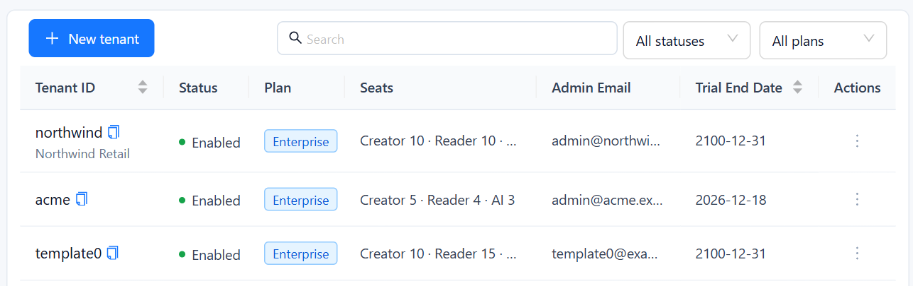
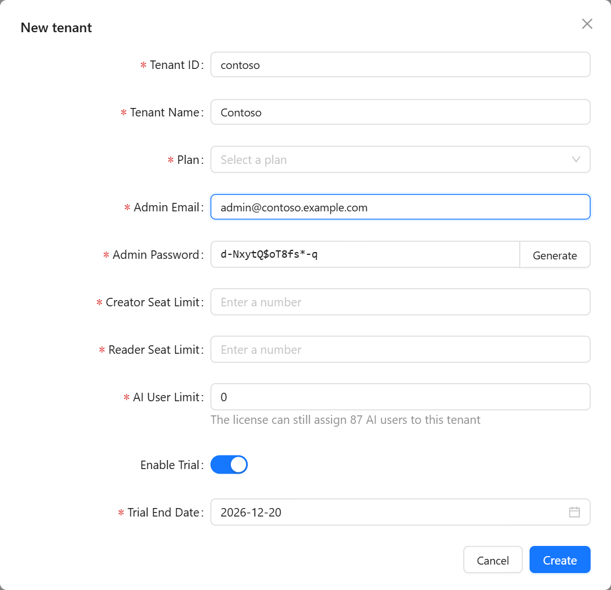
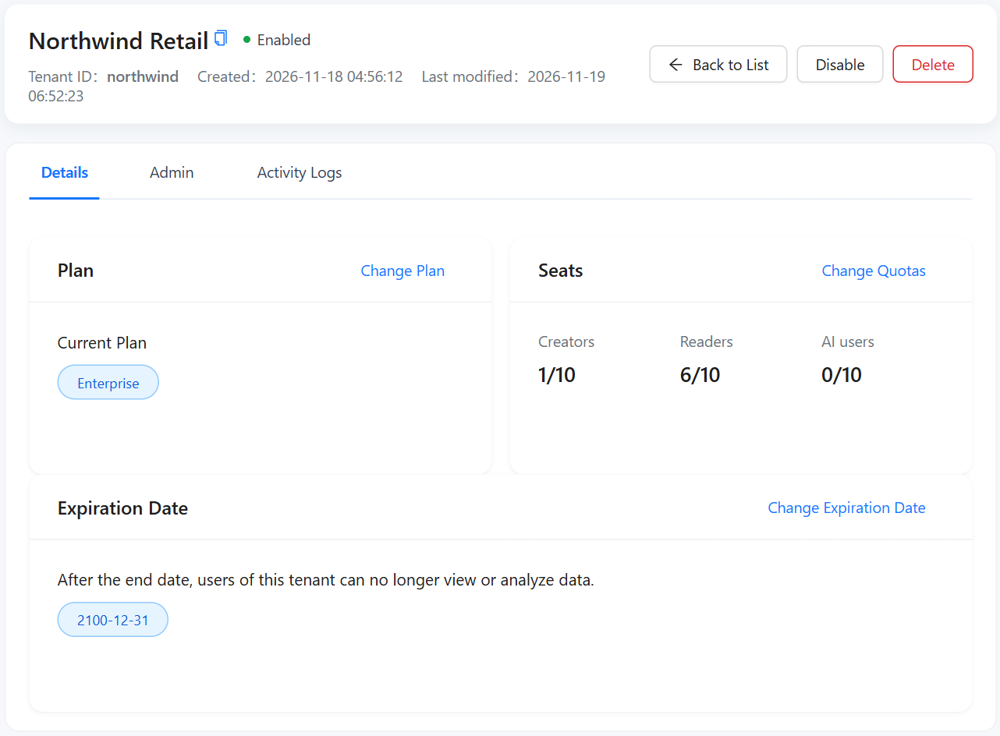

# Multi-tenancy

One Datafor server can host several tenants. Each tenant has its own users, roles, content, models, data sources and settings, and its own sign-in address `…/datafor/t/<tenant-id>`. The **default tenant** is the platform itself; the other tenants are created from a template tenant, **template0**.

This page is for the **platform administrator**: the `superadmin` account, the only one that sees **Settings › Operations › Multi-tenancy**. Upgrade packages do not create `superadmin`; create it by hand after upgrading.

## Who controls what

| Setting | Platform administrator | Tenant administrator |
| --- | --- | --- |
| Tenants, their plan, seat and AI user limits, end date | **Multi-tenancy** | — |
| Admin password of a tenant | **Reset admin password** | Changes it in **My account** |
| [Site address](/documentation/System/Site-Address/) | One value for the whole server | Not shown; the server's value is used |
| [Time zone](/documentation/System/System-Configuration/#time-zone) | **Platform time zone**, the default of every tenant | Its own **System time zone**, or **Same as platform** |
| Query engine, license, backup, JDBC drivers | Yes | Not shown |
| Users, roles, content, data sources, embed tokens, CORS and trusted domains, AI services, subscriptions and alerts settings | For the default tenant | For its own tenant |

Settings that a tenant keeps for itself are not shared: a tenant needs its own [AI service](/documentation/AI-Agent/LLM-Configuration/) and its own embed token configurations. An embed token configuration created in the default tenant signs in to the default tenant only.

## The tenant list

| Column | Shows |
| --- | --- |
| **Tenant ID** | The ID, with the tenant name below it. The copy icon copies the tenant's sign-in address. Click to open the details. |
| **Status** | **Enabled** or **Disabled** |
| **Plan** | The plan |
| **Seats** | *Creator 5 · Reader 20 · AI 2*; *Unlimited* where there is no limit |
| **Admin Email** | Email of the tenant's `admin` account |
| **Trial End Date** | The end date, or **Follows license** when the tenant has none |

**Search** finds a tenant by ID, name or admin email; **All statuses** and **All plans** filter the list. The **⋮** menu of a row has **Details**, **Enable** or **Disable**, **Reset admin password**, **Repair permissions** and **Delete** (not for template0).

## template0

Every new tenant is a copy of **template0**: its branding, data sources, models, sample reports and folders. Changes to template0 apply to tenants created afterwards, not to existing ones. template0 cannot be deleted; keep it as a template and do not give it to a customer.

An upgrade package does not create template0. Until it exists, creating a tenant fails with *Tenant template0 does not exist,create it first*. Create it with **New tenant** and the Tenant ID `template0`; it is the only tenant that can be created without a template.

## Create a tenant

1. Click **New tenant**.
2. Fill in the fields below and click **Create**.
3. The **Tenant created** dialog shows the **Sign-in URL**, the **Account** (`admin`) and the **Password**. Click the copy icon (**Copy all**) and pass them to the tenant administrator. *The password is shown only once.*

| Field | What to enter |
| --- | --- |
| **Tenant ID** | Letters, digits and underscores, starting with a letter or underscore, for example `acme` or `t_acme`. It is part of the sign-in address and cannot be changed. |
| **Tenant Name** | The display name |
| **Plan** | The plan; changeable later |
| **Admin Email** | Email of the tenant's `admin` account. Password resets by email go there. |
| **Admin Password** | Filled in with a generated 16-character password; **Generate** makes another one, or type your own. There is no default password. |
| **Creator Seat Limit**, **Reader Seat Limit** | Whole numbers of at least 1 |
| **AI User Limit** | How many users of the tenant may use the AI Agent. **0** (the default) means none. When the license limits AI users, the field is required and the hint says how many the license can still assign; otherwise leave it empty for no limit. Hidden when the license has no AI. |
| **Enable Trial**, **Trial End Date** | On by default, one month from today. Turn **Enable Trial** off for a tenant that runs as long as the platform license. |

Datafor refuses limits the license cannot cover, with the reason:

- *Sum of tenant seat quotas exceeds the license seats.* The Creator and Reader limits of all tenants together may not exceed the license.
- *Sum of tenant AI user limits exceeds the AI users in the license.*
- *Maximum number of tenants in the license exceeded.* The default tenant and template0 do not count.

## Tenant details

Click a Tenant ID, or **Details** in the row menu. The page has **Details**, **Admin** and **Activity Logs** tabs, and **Back to List**, **Disable** or **Enable**, and **Delete** at the top.

### Plan, seats and AI users

**Seats** shows **Creators**, **Readers** and **AI users** as used/limit; a number above its limit is red. **Change Quotas** changes the three limits. Besides the license totals above, a limit cannot be set below what the tenant already uses, for example *AI user limit cannot be lower than the 3 AI users this tenant already has*.

Inside the tenant, the AI user limit is checked whenever an administrator turns on **Enable AI Agent** for a user or enables a disabled user who has it. At the limit, the tenant administrator sees *This tenant has reached its AI user limit. Ask the platform administrator to raise it.* Lowering a limit never takes AI away from anyone; it only blocks new grants.

### End date

**Change Expiration Date** offers **Set an end date** or **No separate end date (follows the platform license)**; removing a date asks for confirmation first. After the end date, users of the tenant can no longer view or analyze data: the license check of the tenant fails with *License has expired.* from the day after the date (one day of grace for time zones). Set a later date to restore access.

### Admin password

The **Admin** tab shows the admin email (**Change Admin** changes it) and **Reset admin password**, which is also in the row menu. Use it when a tenant administrator is locked out:

1. Click **Reset admin password** and confirm with **Reset**. The current password stops working at once.
2. The **Password reset** dialog shows the sign-in address, account and a new generated password, once. Copy it and pass it on; it is not emailed.

Only the tenant's `admin` account is reset; its roles, email and open sessions are not changed. Other users of a tenant are handled by the tenant administrator on the **Users** page.

### Activity Logs

The tenant's change history: `add` (created), `enabled` and `disabled`, `plan`, `quota`, `expireDay`, `title`, `email`, `password` (admin password reset; the password itself is not logged) and `repairAcl`. **Search** filters it.

## Repair permissions

Tenants created by Datafor versions before 10.02 got the permissions of template0's files pointing at the default tenant's roles. Their Readers and Creators then cannot see the template's models and connections: model lists come back empty, paginated reports on the sample connection are refused, and Lineage shows no models.

Run **Repair permissions** from the row menu on each tenant created before the upgrade, and on template0:

1. Datafor first checks the tenant. *Nothing to repair.* means it is fine.
2. Otherwise it asks *Repair this tenant's permissions?* with the number of files concerned. Click **Repair**.
3. Roles of another tenant are replaced by the roles of the same name in this tenant, other tenants' users are removed from the permissions, and administrators keep full control. The result says how many files were repaired.

Only the tenant's `/etc` folder is touched (models, connections, uploads, map files); reports and home folders are not. The previous permissions are saved to `pentaho-solutions/system/tenant-acl-backup/<tenant>-<date-time>.json`. Tenants created with 10.02 get correct permissions and need no repair.

## Disable or delete a tenant

**Disable** (top of the details page, or the row menu) asks for confirmation: *Users of this tenant who are signed in will be signed out.* They are signed out on their next click, and nobody can sign in to the tenant, also not with tokens, single sign-on, LDAP or from an IM app. **Enable** restores access.

**Delete** removes the tenant with its users and content and cannot be undone. Type the Tenant ID to confirm. Disable a tenant first if you may need it again.

## Signing in to a tenant

- **Address.** `https://<site address>/datafor/t/<tenant-id>`, built from the server's [site address](/documentation/System/Site-Address/). When the session of a tenant user expires, Datafor returns them to this address, not to the platform sign-in page.
- **Forgotten password.** The **Forgot password** page belongs to the platform, so a tenant user must enter their **email address** there (*Tenant users: enter your email address.*); a user name is looked up in the default tenant only. When one email belongs to accounts in several tenants, no code is sent; the tenant administrator resets that person's password on the **Users** page instead.
- **AI clients.** Tenant users can connect claude.ai, ChatGPT or another MCP client with the same MCP address as everyone else; Datafor signs them in to their own tenant. They need **Enable AI Agent** (within the tenant's AI user limit), an AI service configured in the tenant, and personal tokens allowed, either by the tenant's own embed token configuration or by the platform's configuration with **Share with all tenants** ticked. See [Connect AI Clients](/documentation/AI-Agent/Connect-AI-Clients/).

## Upgrading tenants to 10.02

- **AI user limits start at 0.** Users who already have the AI Agent keep it, but no one else can get it, and MCP clients do not work for new users, until you set **AI User Limit** with **Change Quotas**.
- **Run Repair permissions** on every existing tenant and on template0 (see above).
- **Site addresses saved inside tenants are ignored.** Only the default tenant's value counts. Trusted domains keep their per-tenant values and now appear on the [CORS](/documentation/System/CORS/) page.
- **Embedding with a default-tenant token configuration and `?tenantId=` stops working.** Create an embed token configuration in each tenant that embeds content.
- **Time zones.** Every tenant follows the platform time zone until its administrator sets another.
