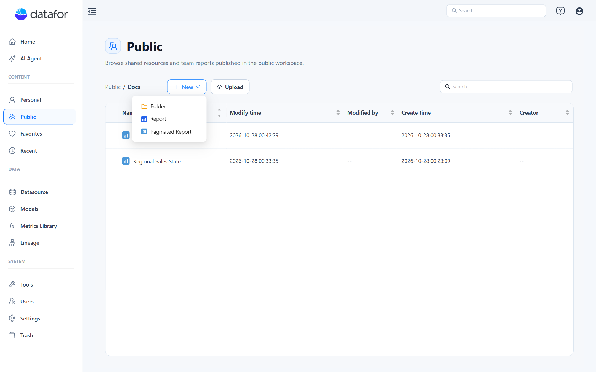
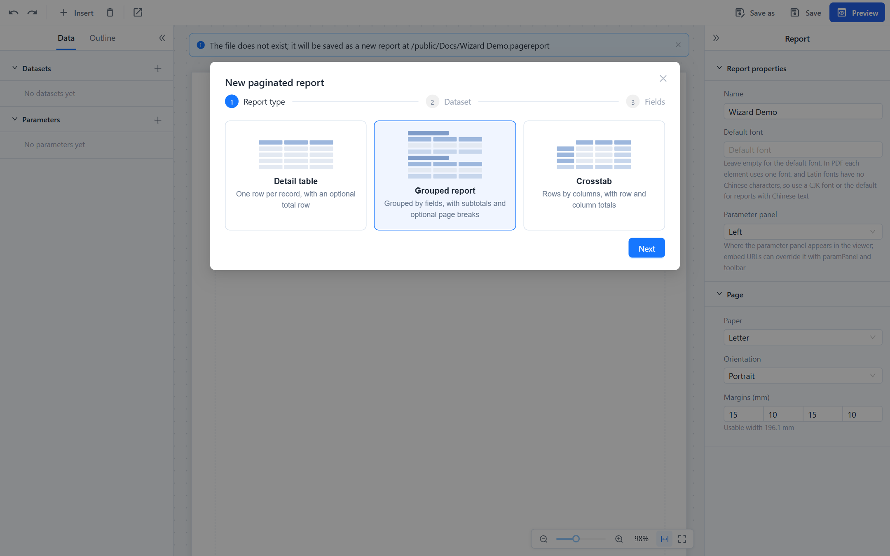
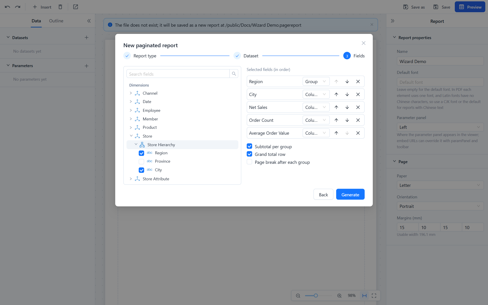
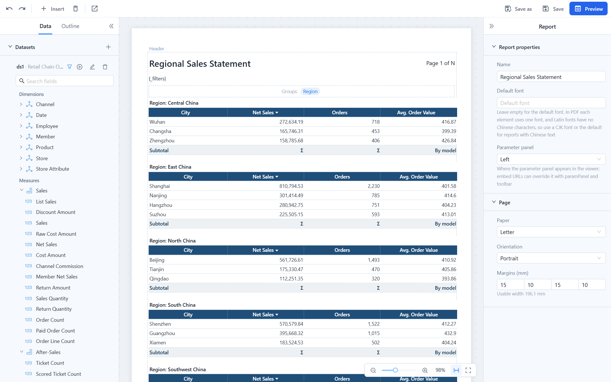
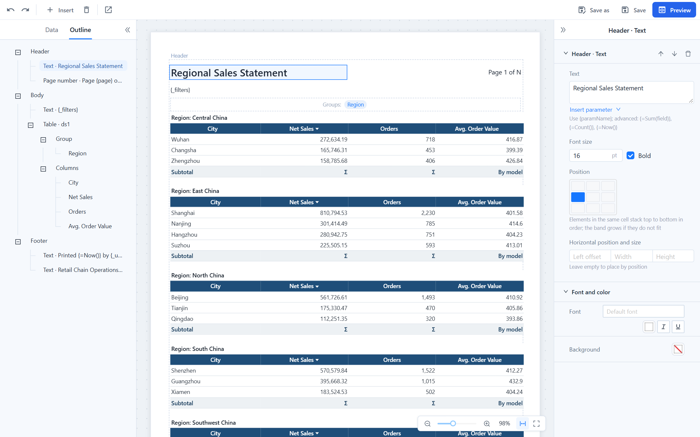
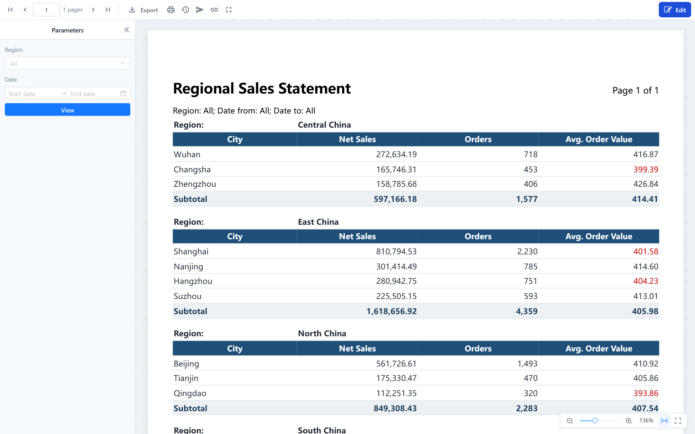

# Creating a Paginated Report

## Create the file

Open the folder where the report should live (**Personal** or **Public**) and choose **New › Paginated Report**. The designer opens in a new tab with the folder preselected; the file is created when you first save.

You need write permission on the folder. To edit an existing report later, use the row menu › **Edit** or the **Edit** button in the viewer.

## Build the first table with the wizard

A new report opens with the wizard. It builds a complete table or crosstab in three steps; everything it produces can be changed afterwards.

1. **Report type.** **Detail table** lists one row per record with an optional total. **Grouped report** groups rows by one or more fields with subtotals and optional page breaks. **Crosstab** puts one field on rows, one on columns and measures in the cells.
2. **Dataset.** Pick a dataset the report already has, or click **New dataset** and choose a **Model dataset** (an analysis model and its cube) or an **SQL dataset** (a connection and a query). See [Datasets and Parameters](/documentation/Paginated-Reports/Datasets-and-Parameters/).
3. **Fields.** Tick the fields in the order you want them. For a model dataset, expand a dimension to reach its hierarchy levels and attributes; measures and calculated measures are listed below. Each selected field gets a role: **Group** or **Column** for a grouped report, **Row**, **Column** or **Value** for a crosstab. The first dimension becomes the group (or the row), the rest become columns; change roles in the drop-down and reorder with the arrows. Options below the list add a **Subtotal per group**, a **Grand total row**, a **Page break after each group** or, for crosstabs, **Row and column totals**.

**Generate** replaces the body with the table and fills it with sample rows. Numeric measures that are sums or counts in the model are totalled; averages, distinct counts and calculated measures are set to **By model**, so their subtotals come from the model rather than from adding rows. If the result is not what you wanted, **Undo** (Ctrl+Z) returns to the empty report; **Use the wizard** on an empty body opens it again.

## The designer

| Area | What it holds |
| --- | --- |
| **Toolbar** | Undo, Redo, **Insert** (Text, Image, Page number, Table, Crosstab), Delete selection, **Open viewer**; on the right **Save as**, **Save**, **Preview**. |
| **Data** tab | **Datasets** with a filter, run, edit and delete button each, the field tree of the selected dataset, and **Parameters**. |
| **Outline** tab | The report structure: header elements, body blocks with their groups and columns, footer elements. Clicking an item selects it on the canvas. |
| **Canvas** | The page at its real proportions. **Header** and **Footer** bands, the body with its blocks. The table shows real sample rows, group titles, subtotals and the grand total. The zoom bar sits at the bottom right. |
| **Property panel** | Properties of the selected element: the report (nothing selected), a band element, the table or crosstab, a column, a parameter. |

The canvas is live:

- **Drag a field** from the tree onto the table to add a column, or onto the **Groups** strip above the table to add a group. The field's context menu offers the same (**Add as column**, **Add as group**) plus **Filter by parameter**.
- **Drag the right edge of a column header** to change its width; a tooltip shows the width and the millimetres left on the page. **Drag a header** left or right to reorder columns. **Double-click a header** to rename it. **Click the sort mark** on a header to cycle no sort, ascending, descending.
- **Click** a header to select the column, the **Groups** strip to select the table, a header or footer element to select it, and empty paper to return to the report properties.

### Report properties

With nothing selected, the property panel shows the report:

| Property | Notes |
| --- | --- |
| **Name** | Shown in the header by default and used as the file name on the first save. |
| **Default font** | Leave empty to use the server's default font (a CJK font, so Chinese text renders in PDF). See [Page Layout, Header and Footer](/documentation/Paginated-Reports/Page-Layout-Header-and-Footer/#fonts). |
| **Parameter panel** | **Left** or **Top** in the viewer. Readers can collapse it but not move it. |
| **Paper**, **Orientation**, **Margins (mm)** | A3, A4, A5, B5, Letter, Legal or **Custom** width and height. The **Usable width** under the margins is the space your columns must fit in. |
| **Table style** | Template, accent colour and density that tables and crosstabs inherit; see [Tables and Crosstabs](/documentation/Paginated-Reports/Tables-and-Crosstabs/#table-style). |

## Save, validate, preview

- **Save** writes the file to its path. The first save of a new report, and **Save as**, open the save dialog: pick **Personal** or **Public**, a folder, and a file name. Saving over an existing name asks for confirmation.
- Every save validates the report. **Errors** (a column wider than the page, a missing field, a bad expression) stop the save and are listed at the bottom with **Locate**, which selects the offending element. **Warnings** (a dataset nothing uses, a header element that does not line up with a column edge) let the save go through. The toolbar shows *No errors*, *No errors, n warnings* or *n errors* at all times.
- **Preview** renders the report with the real engine, including parameters, page breaks and totals, without leaving the designer. **Design** returns to editing.
- **Open viewer** opens the saved report in the viewer in a new tab.

Unsaved changes are protected: closing the tab asks for confirmation.

## What to do next

- Add parameters so readers can narrow the data: [Datasets and Parameters](/documentation/Paginated-Reports/Datasets-and-Parameters/).
- Format columns, groups and totals, or switch to a crosstab: [Tables and Crosstabs](/documentation/Paginated-Reports/Tables-and-Crosstabs/).
- Arrange the header and footer: [Page Layout, Header and Footer](/documentation/Paginated-Reports/Page-Layout-Header-and-Footer/).
- Check how it exports and prints: [Viewing, Pagination and Export](/documentation/Paginated-Reports/Viewing-Pagination-and-Export/).
