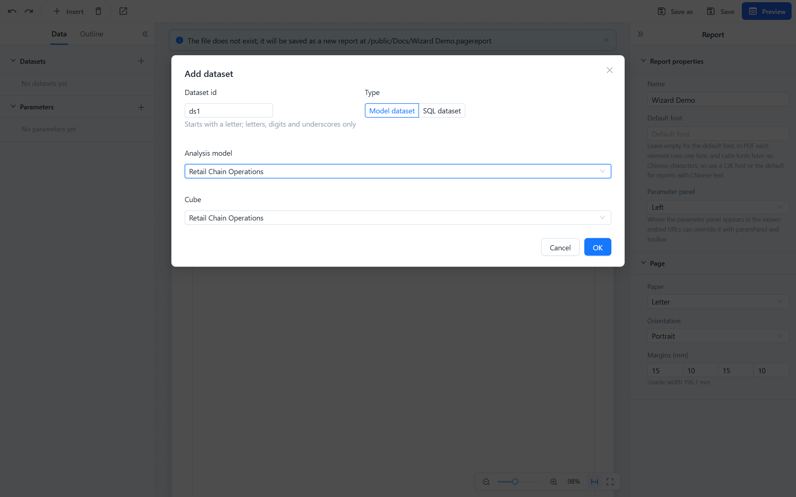
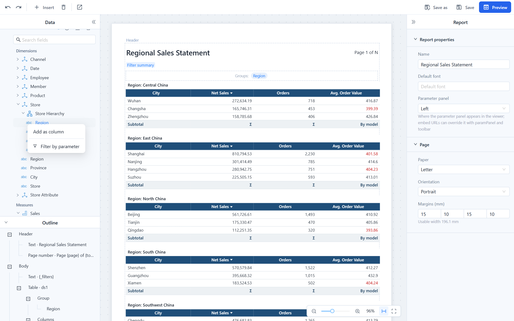
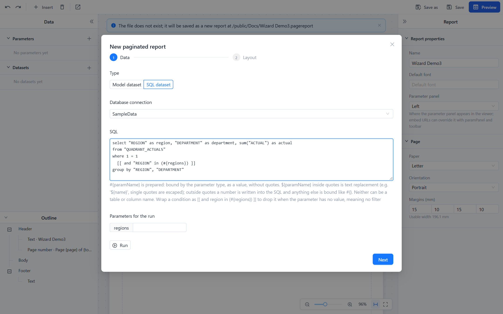
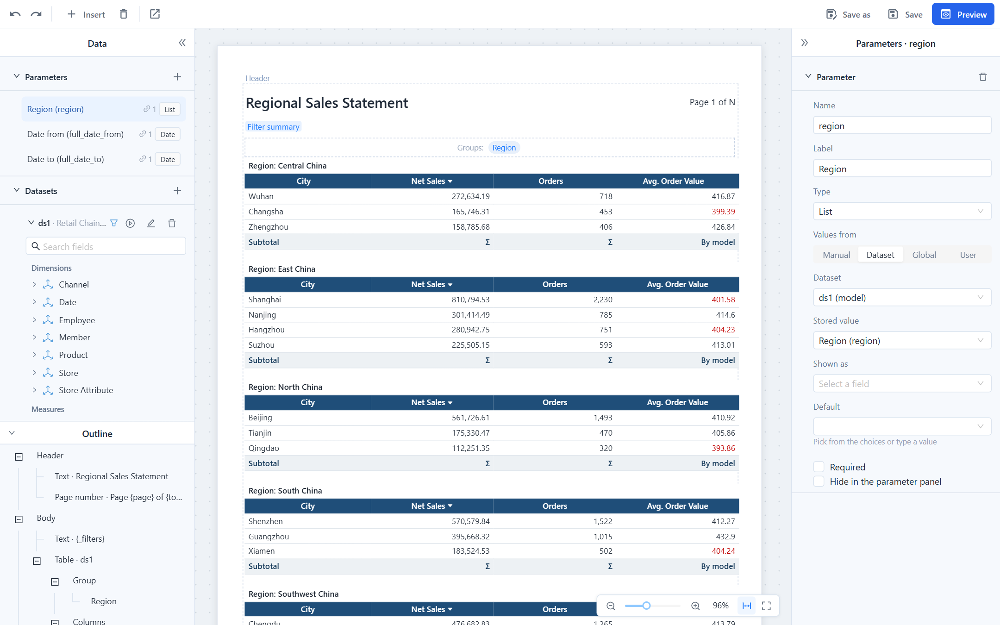
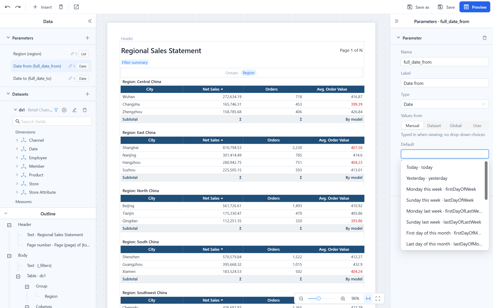

# Datasets and Parameters

A paginated report gets its rows from **datasets** and lets readers narrow them with **parameters**. A parameter does not filter anything by itself: a model dataset carries **filters** that read parameter values, and an SQL dataset contains `#{parameter}` placeholders. One parameter can drive several datasets.

## Datasets

Datasets are listed in the **Data** tab, under the parameters. Click a dataset to fold or unfold its field tree, double-click it to edit it. Each row has buttons to show its filters, **Run** it (fetch the fields and sample rows), **Edit** it and delete it. The table or crosstab of the report, the choice list of a parameter and the fields in the header or footer all name the dataset they read from. A dataset that is still in use cannot be deleted; the message names the elements that use it.



### Model dataset

A model dataset reads an **analysis model** through the same engine as dashboard charts. Choose the model and its cube; the field tree then shows the model's dimensions (with hierarchies, levels and attributes) and its measures and calculated measures. You do not write a query: the designer builds it from the fields you place on the report, and the dataset returns one row per combination of the dimension fields in use.

- Row-level security and the model's permissions apply to the reader who runs the report.
- Date hierarchy levels come back as text such as `2025`, `2025-Q3`, `2025-08` or `2025-08-15`.
- Measures keep the model's aggregation. Sums and counts can be re-totalled by the report; averages, distinct counts and calculated measures should be totalled **By model** (see [Tables and Crosstabs](/documentation/Paginated-Reports/Tables-and-Crosstabs/#totals)).
- Suited to summaries. A model dataset is calculated and held in memory as one result and exports at most 100,000 rows; long detail listings belong in an SQL dataset.
- Needs the dashboard plugin on the server; without it the dialog says *Visualizer is not installed; model datasets are unavailable*.

#### Filters

A model dataset's **Filters** table (dataset dialog, or the filter button next to the dataset) holds conditions on hierarchy levels:

| Filter | Value | Behaviour |
| --- | --- | --- |
| **Is one of** | Fixed member names, or a parameter | Keeps the members listed. Member names must match exactly. Works on text and number levels alike. |
| **Date range** | From and To, each a date or a parameter | Keeps the days between the two, inclusive; one end may be empty. |

A filter whose parameter has no value is skipped, so an optional parameter means "no filter", not "no rows". The quickest way to create a filter and its parameter together is the field's context menu:



- **Filter by parameter** on a level or attribute creates a list parameter named after the field, labelled with the level's caption, with that level's members as choices, and adds an **Is one of** filter that reads it.
- **Filter by date range parameters** on a date level creates two date parameters, `<field>_from` and `<field>_to`, and a **Date range** filter. The viewer shows the pair as one date range picker.

When a parameter takes its choices from a level of a model dataset and no dataset uses the parameter yet, the designer adds the matching **Is one of** filter to that dataset for you; otherwise picking a value would filter nothing.

### SQL dataset

An SQL dataset runs the SQL you write on a **database connection** from **Datasource**. **Run** executes it with the current parameter values and shows the fields and sample rows; the field names are the result's column names.



```sql
select region, city, order_date, amount
from sales
where order_date >= #{startDate}
  [[ and region in (#{regions}) ]]
```

Parameters are written the same way as in a model's SQL views:

| Syntax | What happens | Use it for |
| --- | --- | --- |
| `#{name}` | Prepared: replaced by `?` and bound with the parameter's type. A list parameter expands to `?, ?, ?`, so `in (#{regions})` works. No quotes around it. | Almost everything: dates, numbers, text, lists. |
| `'${name}'` | Text replacement inside quotes you write yourself. Single quotes in the value are doubled, values with a backslash are refused. A list becomes `a','b`, so `in ('${regions}')` works; no value gives an empty string. | Building part of a string, for example `like '${prefix}%'`. |
| `${name}` without quotes | A number is written into the SQL as is (a negative number as `(-5)`); any other value is bound like `#{name}`. | Reports written for an earlier version, and arithmetic such as `time_id = ${t}`. |

Rules that validation enforces when you save:

- A parameter may only stand where a value can stand. Neither syntax can replace a table or column name, and a parameter directly after `order by` or `group by`, or followed by `asc`/`desc`, is refused.
- `#{name}` inside quotes is refused.
- Every parameter used must be defined in the report; a name that differs only in case is reported with the correct spelling.
- The statement must be a single read-only `select`: no `select … into`, no `for update`, and for non-administrators no functions that read or write server files or run on other databases. The query also runs in a read-only transaction that is rolled back.
- Parameters inside comments are ignored, and `[[ ]]` inside quotes or comments is ordinary text.

Wrap a condition in `[[ … ]]` to drop it when any parameter inside has no value. Without the brackets an empty `#{}` parameter binds `NULL`, and `region in (NULL)` returns no rows.

A list parameter is bound with the type of its choice field: when the choices come from an integer column, `in (#{storeIds})` compares integers. The designer runs a choices dataset in the background once to learn its field types if you never ran it yourself.

**Permissions.** Writing SQL is a privileged action:

- To add an SQL dataset, change its SQL or connection, or run it in the designer, you need *raw SQL* permission on the connection, which means manage permission on it. The connection list in the dialog shows only connections you may write SQL on. An existing SQL dataset you may not edit stays in the report unchanged; you can still edit the rest of the report.
- Changing a parameter that an SQL dataset depends on in a way that loosens it (for example un-hiding a parameter whose default is `currentUser`) counts as changing that SQL.
- Readers only need read permission on the report and view permission on the connection. Without it the parameter panel says *no access to the data connection*.
- An SQL error is reported as *Dataset X failed:* followed by the first line of the database message, with a hint when the types do not match (text bound to a number column, a yes/no value bound to a 0/1 column).
- Up to 200,000 rows can be exported from an SQL dataset.

### When fields disappear

If you point a table or crosstab at another dataset, or change a dataset's model, cube or SQL, the designer first lists the fields the report uses that the new dataset does not have. **Keep fields** leaves them in place, marked red on the canvas, in the outline and in the field lists, so you can replace them one by one; **Remove these fields** deletes them from the table, crosstab, header and footer. Missing fields of a model dataset are reported as warnings when saving and are skipped in the query, so the rest of the report still runs.

## Parameters

Parameters are listed at the top of the **Data** tab. Each row shows the parameter's label, its type and how many datasets use it; hover the count for their names. Click a parameter to edit it in the property panel.



| Property | Meaning |
| --- | --- |
| **Name** | Used in `#{name}`, `${name}`, `{name}`, URLs (`p_name`) and lists. Letters, digits and underscores, starting with a letter. A new name takes effect when you leave the field or press Enter, and every reference (dataset filters, SQL, text, header and footer fields) is renamed with it. |
| **Label** | What readers see in the parameter panel and in `{_filters}`. |
| **Type** | **Text**, **Number**, **Date**, **Date time**, **Yes/No** or **List** (several values). Changing the type clears a default that no longer fits. |
| **Default** | The value used when none is passed. It must fit the type, or the save fails. Dates take a relative date (below) or a fixed date such as `2026-01-31`; text accepts `currentUser`; with choices, pick the default from them. |
| **Required** | The report does not run until the parameter has a value. Checked in the viewer and again on the server for previews, exports and distributions. |
| **Hide in the parameter panel** | The parameter is not shown; its value comes from the URL (`p_name`), a distribution or the default, and it is left out of `{_filters}`. A hidden required parameter without a default produces a validation warning. |
| **Values from** | Where readers' choices come from; see below. |

Deleting a parameter that is still referenced first lists the references. Saving warns about parameters that no dataset, text or field uses.

### Values from

| Option | What readers get |
| --- | --- |
| **Manual** | A field to type the value in. Dates and date-times always get a date picker. |
| **Dataset** | A drop-down filled from a dataset: **Dataset**, **Stored value** (the field whose value is passed on) and optionally **Shown as** (the field readers see). |
| **Global** | A parameter from **Parameter Management**. Its default and choices are used when the report sets none; a query-type global parameter runs its read-only SQL (first column the value, second column the label). |
| **User** | A system variable, always the signed-in user's value. The parameter is not shown in the viewer, and values passed in a URL, a request or a distribution are ignored, so readers cannot impersonate someone else. Distributions and background downloads use the value of the person who runs them. |

To restrict data to the person viewing the report, use **User**. A visible parameter with the default `currentUser` only *suggests* the user name and can be changed by readers; the designer warns when such a parameter feeds a dataset. A hidden parameter with the default `currentUser` also accepts only the signed-in user.

### Relative dates

Date and date-time parameters can default to a date that is calculated each time the report is opened or run. Pick it from the **Default** drop-down; the hint below shows what it gives today.



| Keyword | Date |
| --- | --- |
| `today`, `yesterday` | Today, yesterday |
| `firstDayOfWeek`, `lastDayOfWeek` | Monday and Sunday of this week |
| `firstDayOfLastWeek`, `lastDayOfLastWeek` | Monday and Sunday of last week |
| `firstDayOfMonth`, `lastDayOfMonth`, `firstDayOfLastMonth`, `lastDayOfLastMonth` | This month and last month |
| `firstDayOfQuarter`, `lastDayOfQuarter`, `firstDayOfLastQuarter`, `lastDayOfLastQuarter` | This quarter and last quarter |
| `firstDayOfYear`, `lastDayOfYear`, `firstDayOfLastYear`, `lastDayOfLastYear` | This year and last year |

Weeks start on Monday. For a date-time parameter, `today` is the current moment, `lastDayOf…` ends at 23:59:59 and the others start at 00:00. The keywords also work in a URL (`p_startDate=firstDayOfLastMonth`) and in distributions, which recalculate them on every run; this is how a daily, weekly or monthly report always covers the right period.

### How values behave in the viewer

- **Not passed and cleared are different.** A parameter that is not passed gets its default. A parameter the reader cleared stays empty, so a parameter with a default can still be set back to **All**. Empty strings, empty lists and empty items in a list all count as no value.
- **Yes/No** parameters offer **All / Yes / No**; required ones only **Yes / No**.
- **Lists with choices** get **Select all** and **Clear**; left empty they show **All** and do not filter. At most 1,000 choices are loaded; when the list is full it says *Only the first 1000 are listed; you can type other values*, and **Select all** is not offered.
- **Cascading.** A parameter's choices depend only on parameters listed above it. When an upstream value changes, the list is reloaded and selected values that are no longer offered are removed; the others stay.
- **Invalid values.** A URL value that does not fit the type is dropped with a message. A value that is not among the choices is kept and marked *Not among the choices*. A date range whose start is after its end is swapped.
- In a URL, repeat the key for several values of a list: `p_region=East&p_region=North`.

## Placeholders in text

Text blocks and header or footer text can show parameter values and totals. **Insert** under the text adds them for you: a parameter, `{_filters}`, the current time, the current user, a total or a row count of the main dataset.

| Write | Shows |
| --- | --- |
| `{region}` | The parameter's display label (its choice label when it has one), several values separated by commas, **All** when empty; dates as `2026-10-27`, date-times as `2026-10-27 09:30`, yes/no as Yes/No. |
| `{_filters}` | All visible parameters as `Label: value; Label: value`. A from/to date pair is shown as one item: `Date: 2026-06-01 – 2026-06-30`, `from 2026-06-01` or `until 2026-06-30` when only one end is set. The designer adds a `{_filters}` text block above the table when you create the first parameter; move it to the header if you want it on every page. |
| `{_user}` | The signed-in user. In a distribution, the distribution's owner. |
| `{=Sum(amount)}`, `{=Count()}`, `{=Avg(x)}`, `{=Min(x)}`, `{=Max(x)}` | A total over the whole dataset, so it can stand above the table or in the header. |
| `{=Now()}` | Date and time of rendering, `yyyy-MM-dd HH:mm`. |
| `{=Format(Sum(amount), "#,##0.00")}` | A formatted value; `If(cond, a, b)`, `Param("name")`, `Field("name")`, `User()` are also available. |

A lone total is shown as `#,##0.##` and a lone `Now()` as `yyyy-MM-dd HH:mm`; use `Format()` for anything else. An expression that does not parse is reported by validation and printed as written. Field names are written as they appear in the dataset, without brackets.

## Parameters from outside the viewer

- **URL:** `…/viewer?p_region=East%20China&p_startDate=2026-01-01`. See [Viewer URL parameters](/documentation/Paginated-Reports/Viewing-Pagination-and-Export/#viewer-url-parameters).
- **Drill-through from a dashboard:** the dialog maps the clicked fields to report parameters. See [Drill Through to a Paginated Report](/documentation/Paginated-Reports/Drill-Through-and-Embedding/).
- **Distribution:** stored with the distribution or taken from a list row. See [Distribution](/documentation/Paginated-Reports/Distribution/).

Values from outside are converted as strictly as defaults: dates `yyyy-MM-dd` or a relative date keyword, date-times `yyyy-MM-dd HH:mm:ss` (a `T` is also accepted), yes/no only `true`, `false`, `1`, `0`. Anything else, such as `2026-02-30` or `yes`, is refused with an error that names the parameter by its label.

## Related topics

- [Creating a Paginated Report](/documentation/Paginated-Reports/Creating-a-Paginated-Report/)
- [Tables and Crosstabs](/documentation/Paginated-Reports/Tables-and-Crosstabs/)
- [Parameter Controllers](/documentation/Analysis/Parameter-Controllers/)
