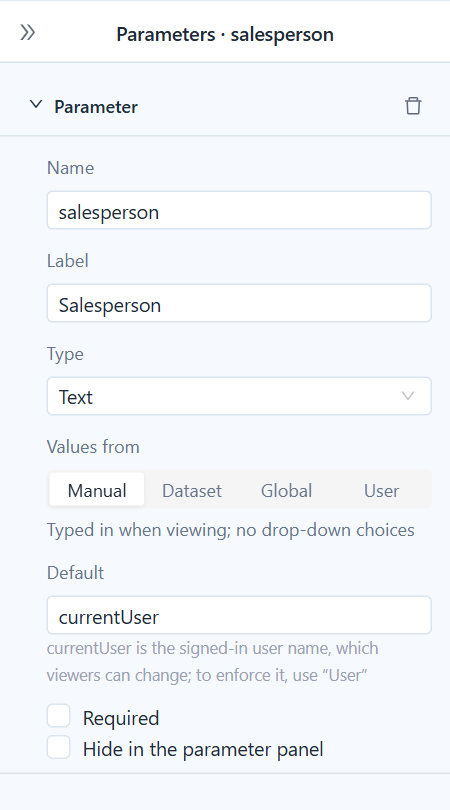
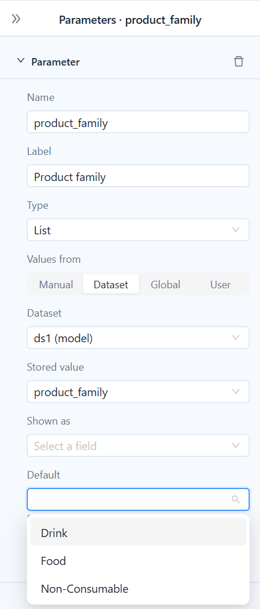
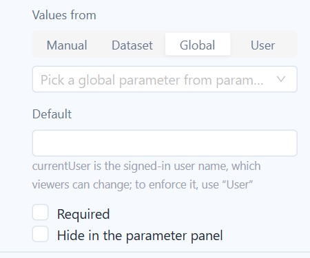
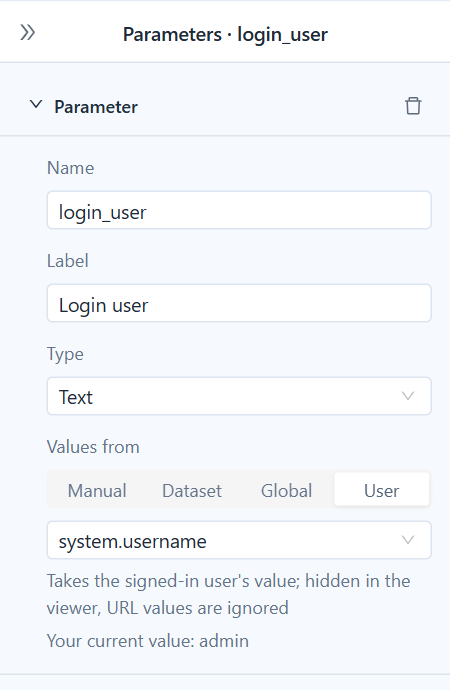
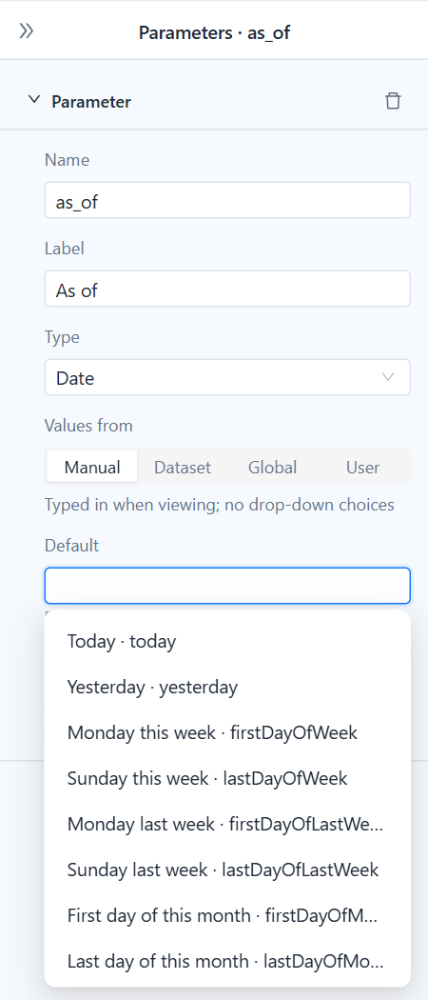
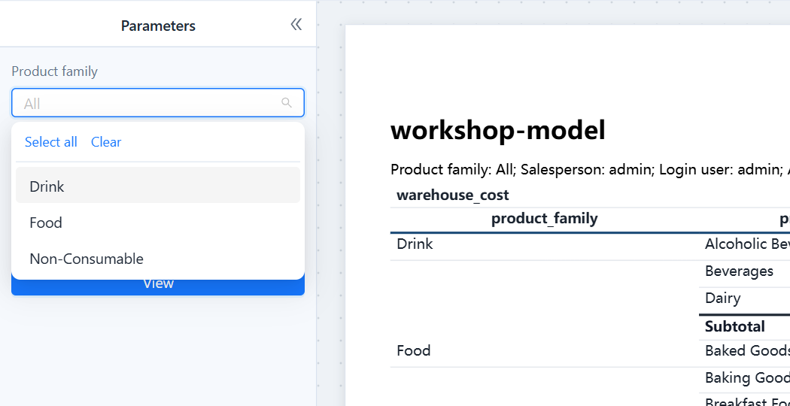

# Working with Parameters

A parameter is a value that readers set before the pages are produced: a period, a list of regions, an order number. This page helps you choose how each parameter should get its value. The full list of properties, the SQL syntax and the viewer rules are in [Datasets and Parameters](/documentation/Paginated-Reports/Datasets-and-Parameters/#parameters).

:::: tip In short
- **Values from** decides how readers fill a parameter: **Manual** (they type it), **Dataset** or **Global** (they pick from a drop-down), or **User** (they don't; it is the signed-in user).
- The **Default** is only the starting value. `currentUser` as a default fills in the reader's own name, and readers can change it.
- To limit rows to the signed-in user so that nobody can see someone else's, use **Values from: User**, not the `currentUser` default.
::::

## How a value is decided


Each time the report runs (in the viewer, an export, a distribution or a link), every parameter's value is decided in this order:

1. **Enforced user value.** A **User** parameter, and a hidden parameter whose default is `currentUser`, take the signed-in user's value. Anything passed in is ignored.
2. **Supplied value.** A value from the parameter panel, the URL (`p_name=…`), a drill-through or a distribution. A value the reader cleared counts as supplied and empty: it means "no filter", and the default is not filled back in.
3. **Default.** The report's default; for a **Global** parameter without one, the global parameter's default.
4. **Required check.** A required parameter that is still empty stops the report. An optional one filters nothing: model dataset filters on it are skipped, and in SQL you wrap its condition in `[[ … ]]`.

## Choose where values come from

Click a parameter in the **Data** tab and pick one of the four **Values from** options in the property panel. Switching clears the settings of the previous option.

| Option | Readers see | Choose it for |
| --- | --- | --- |
| **Manual** | A box to type in; a date picker for dates; **All / Yes / No** for yes/no. | Values with no fixed list, or a list too long to pick from. |
| **Dataset** | A drop-down filled from a field of a dataset in this report. | A list that belongs to this report: regions, product families, stores. |
| **Global** | A drop-down filled from a global parameter in **Parameter Management**. | A list many reports share and an administrator maintains in one place. |
| **User** | Nothing; the parameter is hidden. | Filtering by who the reader is: login name, department, roles. |

### Manual: let readers type

Manual is the right choice when a list of choices would be useless or impossible:

- **Search text**: part of a customer or product name, `where customer_name like '%${keyword}%'`.
- **Codes**: an order, contract or employee number. There are too many to list, and readers already know the one they need.
- **Thresholds**: a **Number** such as "amount over" or "top N", `where amount > #{minAmount}`.
- **Dates**: a **Date** parameter always gets a date picker, and its default can be a relative date.
- **Switches**: a **Yes/No** such as "include cancelled orders".
- **Hidden values**: parameters filled by a URL, a drill-through or a distribution, which readers never type.



If the value comes from a known, limited set (regions, departments, categories, years), do not use Manual: a typo gives an empty report. Use **Dataset** or **Global** so that readers pick it.

### Dataset: pick from this report's data

Choose the **Dataset**, the **Stored value** field (the value that filters, such as a code) and optionally a **Shown as** field (what readers read, such as a name). The **Default** box then offers the same choices.



The fastest way to get here is to right-click a level in a model dataset's field tree and choose **Filter by parameter**: it creates a **List** parameter with the level's members as choices and the filter that reads it. For a country → city cascade, make the city choices read the country parameter and keep the country parameter above the city one in the list.

### Global: share one list across reports

Pick a global parameter from **Parameter Management** (see [Creating Parameters](/documentation/Analysis/Creating-Parameters/#global-parameters)). The parameter takes its type, its choices are listed under the picker, and an empty **Default** uses the global default. Change the list once in Parameter Management and every report that uses it follows.



If the global parameter is later deleted or renamed, the panel says *Not found in parameter management; has no effect when viewing*.

### User: filter by who is reading

Pick a system variable; `system.username` is chosen for you. The parameter always holds the reader's own value, is hidden in the viewer, and ignores values passed in a URL, a drill-through or a distribution. Distributions and background downloads use the value of the person who runs them.



```sql
select order_id, customer, amount
from orders
where salesperson = #{login_user}
```

Other useful variables are `system.dept`, `system.company` and `system.business-roles-array`; with **Type** set to **List**, a variable holding several values becomes a list, so `where role in (#{my_roles})` works. All variables are listed in [Creating Parameters](/documentation/Analysis/Creating-Parameters/#system-variables).

## Defaults

The **Default** is the value a parameter starts with in the viewer and the value used when nothing is supplied. It must fit the type; a default that does not is shown in red.

- **Fixed values**: a number, a text, a date such as `2026-01-31`, or several values for a **List**.
- **Relative dates** for date parameters, such as `firstDayOfMonth` or `yesterday`, calculated on the day the report is opened or run. A pair `firstDayOfLastMonth` / `lastDayOfLastMonth` makes a monthly distribution always cover last month. All keywords are listed in [Relative dates](/documentation/Paginated-Reports/Datasets-and-Parameters/#relative-dates).
- **`currentUser`** for text and list parameters, described next.



### currentUser is a starting value, not a filter

For a **Text** or **List** parameter, the **Default** drop-down offers `currentUser`, the reader's login name. It suits "show my own rows first, but let me look at others": a sales report opens on the reader's orders, and a manager types a team member's name to see theirs.

Because readers can replace it, `currentUser` protects nothing.

:::: warning Restricting rows to the reader
When a visible parameter with the default `currentUser` feeds a dataset, the designer warns that readers can change it to another user. To make sure each reader sees only their own rows, set **Values from** to **User** (`system.username`). Row-level security on the model and permissions on the database remain the place to decide what each person may see at all.
::::

| Setup | Can readers change it? | Use it when |
| --- | --- | --- |
| **Manual**, default `currentUser` | Yes | Own rows by default; looking at others is allowed. |
| **User**, `system.username` | No | Each reader must see only their own rows. |
| **Manual**, default `currentUser`, hidden | No | Older reports. It behaves like **User**; use **User** for new parameters. |

## In the viewer

Readers see every parameter that is not hidden, in the order of the designer's list, filled with the defaults. They change the values and click **View**.



An empty list shows **All** and does not filter. Put a `{_filters}` text block on the page (the designer adds one with your first parameter) so that printed and exported pages say what they were filtered by. [How values behave in the viewer](/documentation/Paginated-Reports/Datasets-and-Parameters/#how-values-behave-in-the-viewer) covers the 1,000-choice limit, cascading and values that are not among the choices.

## Common setups

| Readers should… | Type | Values from | Default |
| --- | --- | --- | --- |
| Search by part of a name | Text | Manual | empty |
| Look up one order or contract | Text | Manual | empty, **Required** |
| Set a threshold or "top N" | Number | Manual | a sensible number |
| Pick a period | Date, as a `_from` / `_to` pair | Manual | `firstDayOfMonth` and `today` |
| Pick one or more regions of this report | List | Dataset | empty (all) |
| Pick from a company-wide list | List or Text | Global | empty (the global default) |
| See their own orders, and only those | Text | User, `system.username` | — |
| Start on their own orders but look at others' | Text | Manual | `currentUser` |
| See their department's data | Text | User, `system.dept` | — |

## Related topics

- [Datasets and Parameters](/documentation/Paginated-Reports/Datasets-and-Parameters/)
- [Viewing, Pagination and Export](/documentation/Paginated-Reports/Viewing-Pagination-and-Export/)
- [Distribution](/documentation/Paginated-Reports/Distribution/)
- [Creating Parameters](/documentation/Analysis/Creating-Parameters/) (global parameters and system variables)
