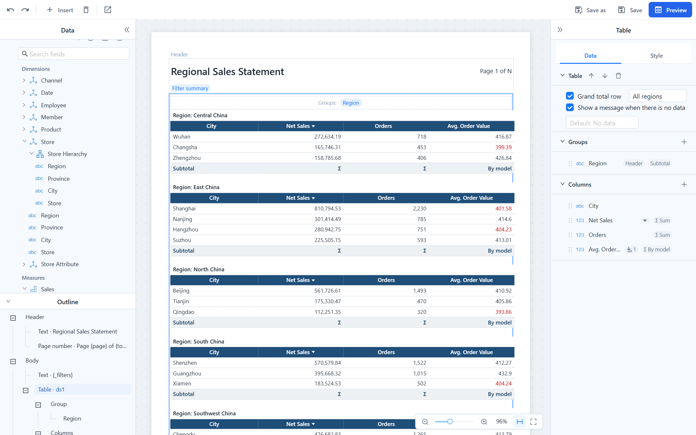
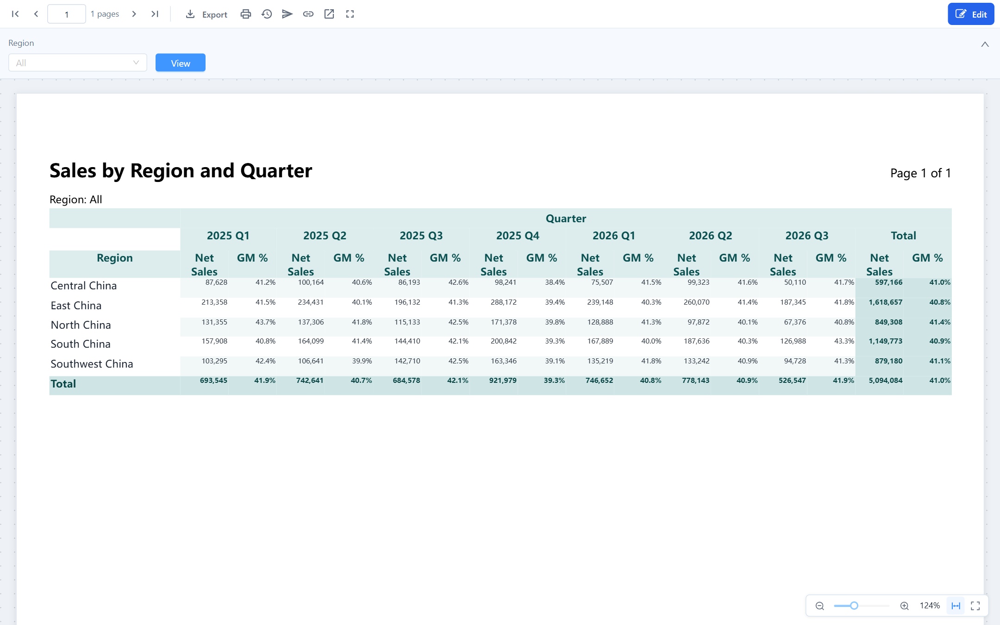
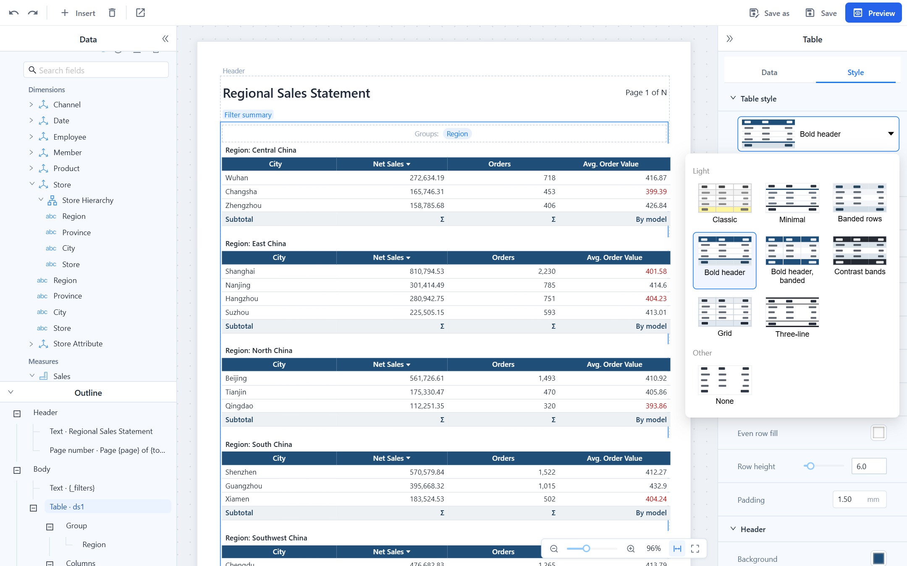

# Tables and Crosstabs

The body of a paginated report holds one data block: a **table** (a list of rows, optionally grouped) or a **crosstab** (rows by columns with measures in the cells). Select it by clicking a data cell on the canvas; its properties have a **Data** tab and a **Style** tab.

## Table

### Columns

Add a column by dragging a field onto the table or into **Columns** in the panel, with **+** next to **Columns**, or with the field's context menu. Each column row shows its total (for example **Σ Sum** or **Σ By model**) and the number of conditional formats it has. Click a column, on the canvas or in the list, to edit it:

| Property | Notes |
| --- | --- |
| **Field**, **Title** | The dataset field and the header text. Double-clicking the header on the canvas renames it too. |
| **Width** (mm) | Leave empty to share the remaining width equally with the other automatic columns. The sum of all widths must stay within the usable page width, or the save fails. |
| **Align** | Left, center or right. Numbers default to right. |
| **Format** | A number pattern such as `#,##0.00` or `0.0%`, or a date pattern such as `yyyy-MM-dd`. |
| **Sort** | None, ascending or descending. Rows are sorted inside their group; several sorted columns apply in column order. |
| **Total** | How the column is summed in subtotals and the grand total; see [Totals](#totals). |
| **Font and color** | Font, size, bold, italic, underline, text colour and background of the detail cells. |
| **Conditional formats** | Rules that colour this column's cells; see [Conditional formats](#conditional-formats). |

Arrows in the panel header move the column; the trash icon removes it; **Group by this column** turns it into a group. On the canvas, drag a header to reorder, drag its right edge to resize, and click the sort mark to change the sort. A column whose field is no longer in the dataset is shown in red; see [When fields disappear](/documentation/Paginated-Reports/Datasets-and-Parameters/#when-fields-disappear).

### Groups

A group breaks the rows by a field, in the order of the **Groups** strip above the table and the **Groups** list in the panel. Add one by dropping a field on either, or with **+**. Tags in the list show which options are on (**Header**, **Subtotal**, **Page break**); **Change to column** turns a group back into a column. Each group has:

| Property | Notes |
| --- | --- |
| **Group title row** | A row `Region: East China` before the group's rows. The colon follows the interface language. |
| **Subtotal row**, **Subtotal label** | A row after the group with the totals of the columns that have a **Total** setting. Default label *Subtotal*. |
| **Page break after group** | Each group starts a new page; in a formatted Excel export each group becomes its own sheet, named after the group value. |
| **Restart page numbers for each group** | With a page break: page numbers (and the total) count from 1 in every group. |
| **Space after group** | Blank space in millimetres after the subtotal row. |

A detail table without groups is simply a table with no entries in the strip.

### Grand total and no-data message

- **Grand total row** adds a final row with the totals of the whole table; **Grand total label** changes its text (default *Total*). When the first column itself has a total, the label and the value share the first cell.
- **Show a message when there is no data** prints a text instead of an empty table when the dataset returns no rows; the default text follows the interface language.
- **Repeat header on each page** is on for every table: column headers are printed at the top of each page the table continues on.

### Totals

The **Total** setting of a column (and the aggregate of a crosstab measure) decides how subtotals and the grand total are calculated:

| Setting | Calculation |
| --- | --- |
| **None** | No value in total rows. |
| **Sum**, **Count**, **Average**, **Min**, **Max** | Calculated by the report engine over the detail rows of the group or the whole table. Text columns can only be counted. |
| **By model** | Model datasets only. The report asks the analysis model for the value at the group level, so the model's own aggregation applies. Blank on an SQL dataset. |

Use **By model** for measures that cannot be added up: averages, distinct counts, ratios and other calculated measures. Summing an *Average Order Value* column would give a meaningless number; **By model** returns the average over all orders in the region, the same figure a dashboard pivot table shows. The designer chooses the default when you add a model field (Sum for sums and counts, Min and Max as in the model, By model for the rest) and warns when you pick Sum, Count or Average for such a measure. The canvas shows **Σ** for engine totals and the setting's name for the others.

### Conditional formats

Conditional formats belong to a column: select the column and click **+** next to **Conditional formats**. A rule colours the column's cells by value: choose a condition (**Less than**, **Less or equal**, **Greater than**, **Greater or equal**, **Equals**, **Not equals**, **Between**, **In**, **Contains**, **Is empty**), the value(s) and the look: text colour, background, bold, italic, with presets such as *Red text* or *Light green fill*. Rules apply to detail cells; the first matching rule wins.

## Crosstab

A crosstab has **Row dimensions**, **Column dimensions** and **Measures**. Drop fields onto the three zones on the canvas or into the lists in the **Data** tab, or use **+** next to each list. The arrow on a dimension (**Move to column dimensions** / **Move to row dimensions**) moves it to the other axis; **Show total row** and **Show total column** switch the totals.

| Setting | Notes |
| --- | --- |
| **Total** on a row or column dimension | Adds a *Total* row or column for that level; inner levels get *Subtotal*. With several row dimensions, the total label spans all inner row header columns. |
| **Aggregate** of a measure | Sum, Count, Average, Min, Max or **By model**, with the same meaning as for table columns. Totals of ratios should be **By model**. |
| **Format** of a measure | Number pattern. |
| **Row header width** (mm), **Cell width** (mm) | On the **Style** tab. The canvas draws the crosstab at these widths. |
| **Fit to page width** | Off for new crosstabs: value columns keep the cell width, so the layout is predictable. On: they shrink down to 8 mm when there are many columns. When the table is narrower than the paper, value columns are widened to fill it either way. |
| **Row height** | Overrides the density of the style template. |

Things to know:

- A crosstab never breaks horizontally across pages. When the sample data makes it wider than the page, the canvas says so (*the crosstab is about N mm wide, more than the usable width*) and offers **Widen paper to N mm**, which switches to a custom paper size that fits. The number of columns depends on the data, so also consider filtering the column dimension or swapping rows and columns. Columns beyond the paper are cut in PDF and print.
- The dimension values on the column axis repeat at the top of every page; the column dimension title is printed once.
- With one measure, its title is not repeated under every column member. With several, each column member gets one sub-column per measure.
- Dimension members sort naturally: `2`, `10`, `11` rather than `10`, `11`, `2`; dates from a date hierarchy sort chronologically.
- In the formatted Excel export every cell is kept; the flat export writes one row per row member × column member × measure.

## Table style

The **Style** tab gives tables and crosstabs the same look system as the dashboard pivot table: a **template**, an **accent** colour and a **density**, followed by the individual style items.

- **Templates:** Classic, Minimal, Banded rows, Bold header, Bold header banded, Contrast bands, Grid, Three-line, None. New reports start with **Minimal**.
- **Accent:** eight presets (navy, blue, teal, green, amber, red, violet, graphite) or a custom colour. Classic, Three-line and None ignore it.
- **Density:** Compact, Standard or Spacious, which set the row height (5, 6 or 7.5 mm).
- The sections below (**Grid**, **Header**, **Body**, **Group header row** or **Row headers**, **Subtotal**, **Total**) show the values the template produces. Change any of them: grid line width and colour, direction (all, horizontal only, vertical only, none), top and bottom rules, odd and even row fills, header background, font size, colour, bold, italic and alignment, the dividers under the header and above the total, row height and padding. A changed item shows ↺ to return to the template value; **Reset to template style** clears all of them.
- Report-level defaults for template, accent and density are set in **Report properties › Table style**; a block inherits them unless it chooses its own.

Templates affect colours, lines and row height only. Column widths, alignment, number formats, fonts and conditional formats are kept when you switch templates. The same look is written to the formatted Excel export.

## Related topics

- [Datasets and Parameters](/documentation/Paginated-Reports/Datasets-and-Parameters/)
- [Page Layout, Header and Footer](/documentation/Paginated-Reports/Page-Layout-Header-and-Footer/)
- [Viewing, Pagination and Export](/documentation/Paginated-Reports/Viewing-Pagination-and-Export/)
- [Table Styles in dashboards](/documentation/Visualization/Table-Styles/)
