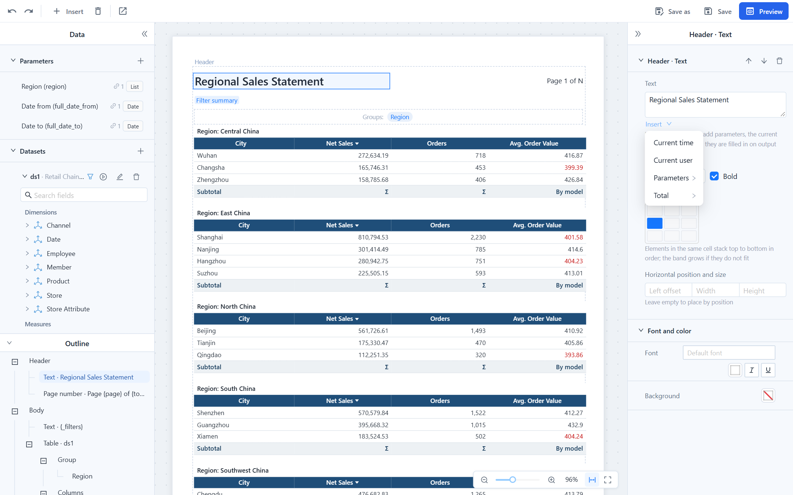

# Page Layout, Header and Footer

## Paper, orientation and margins

**Report properties › Page** sets the paper for the whole report: **A3, A4, A5, B5, Letter, Legal** or **Custom** (width and height in millimetres, 50 to 2000), **Portrait** or **Landscape**, and the four **Margins**. The **Usable width** shown under the margins is the room your table columns have; new reports take Letter in English interfaces and A4 in others.

Choose landscape or a larger paper for wide crosstabs and tables with many columns rather than squeezing the columns. A custom page is printed at its real size; when it is larger than the printer's paper, choose *fit to page* in the print dialog.

## Header and footer bands

The **Header** and **Footer** bands repeat on every page. Each has a **Band height** in millimetres, which is a minimum: the band grows when its elements need more room. Select a band by clicking its label on the canvas, then **Add element**, or select an element to edit it.

| Element | Content |
| --- | --- |
| **Text** | Static text, `{parameter}` values, `{_filters}`, `{_user}`, and `{=…}` expressions such as `{=Now()}` or `{=Sum(amount)}`. **Insert** under the text adds them for you: **Current time**, **Current user**, a parameter or `{_filters}` from **Parameters**, and a sum or row count of the main dataset from **Total**. The canvas shows a parameter placeholder as a blue tag, for example *Filter summary*. |
| **Image** | A picture from the repository (`repo:/public/logo.png`) or an uploaded file; **Fit** contain, cover or stretch. |
| **Page number** | A format with `{page}` and `{total}`, for example `Page {page} of {total}`. |
| **Field** | A value from a dataset. With the dataset of the table or crosstab it shows the current row at the top of the page, so a header can print the group that the page starts with. With any other dataset it shows the first row of that dataset's result, useful for a company name or a period taken from a lookup query. **Format** applies number or date patterns. |

### Position: the nine-cell grid

Elements are placed on a grid of three columns (left, centre, right) and three rows (top, middle, bottom). Click a cell under **Position**. Elements in the same cell stack top to bottom in the order of the band; the band grows if they do not fit.

- When only one column is used it takes the whole width; left and right together split 55 % / 45 %; with the centre in use the split is 25 % / 50 % / 25 %. The column boundaries snap to the nearest column edge of the table below, which keeps Excel exports clean (see below).
- **Width** and **Height** are optional. Without a width the element fills its column; a narrower element aligns inside the column according to its cell. Text height follows the font size.
- **Left offset** places the element at an exact horizontal position and overrides the column; the vertical cell still applies. Use it only when the grid cannot do what you need.

Elements must not overlap. Validation reports overlaps as errors and misaligned elements as warnings:

::: tip Why alignment matters
In table-type exports (Excel, Word), every element edge becomes a column boundary. A header element whose left edge falls in the middle of a table column adds a thin extra column with merged cells on every row of the sheet. The grid snaps to column edges for you; when you type a **Left offset** or **Width**, keep it on a column edge.
:::

## Body blocks

Besides the table or crosstab, the body can hold any number of **Text** and **Image** blocks (**Insert** in the toolbar). They flow from top to bottom with the data block. A text block has a height, font size and bold setting and accepts the same placeholders as header text. Common uses:

- `{_filters}` under the title, so the first page says what the report was filtered by. The designer inserts this block when you add the first parameter; delete it if the header already shows the parameters.
- A total above the table: `Total net sales: {=Format(Sum(Net Sales), "#,##0")}`.
- Notes or a signature line after the table.

Every block has **Space above**, **Page break before** and **Page break after**.

## Fonts

**Report properties › Default font** applies to every element that does not choose its own font under **Font and color**. Leave it empty to use the server's default, a CJK font (Noto Sans CJK SC unless an administrator changed `font-cjk` in the plugin settings), which also covers Latin text.

PDF and HTML behave differently:

- **In the viewer and HTML**, the browser substitutes glyphs the chosen font lacks, so any font looks right.
- **In PDF**, each element is drawn with one embedded font. A Latin font such as Arial has no Chinese glyphs, so Chinese text in an Arial element would be lost; the server therefore falls back to an installed CJK font (PingFang, Microsoft YaHei, Hiragino, Noto Sans CJK, SimHei, WenQuanYi, SimSun, in that order) whenever the chosen font is not installed on the server, and keeps the PDF base fonts Helvetica, Times and Courier as they are. For reports with Chinese or Japanese text, keep the default font or pick a CJK font.

The font list in the designer is the same list the dashboard editor offers, including Chinese and Japanese fonts in those interface languages.

## Parameter panel position

**Report properties › Parameter panel** decides whether the viewer shows parameters on the **Left** (for many parameters) or on **Top** (a single row above the pages, good for a few parameters and for embedding in a wide iframe). Readers can collapse the panel; an embed URL can override the position or hide it, see [Viewer URL parameters](/documentation/Paginated-Reports/Viewing-Pagination-and-Export/#viewer-url-parameters).

## Related topics

- [Tables and Crosstabs](/documentation/Paginated-Reports/Tables-and-Crosstabs/)
- [Datasets and Parameters](/documentation/Paginated-Reports/Datasets-and-Parameters/)
- [Viewing, Pagination and Export](/documentation/Paginated-Reports/Viewing-Pagination-and-Export/)
