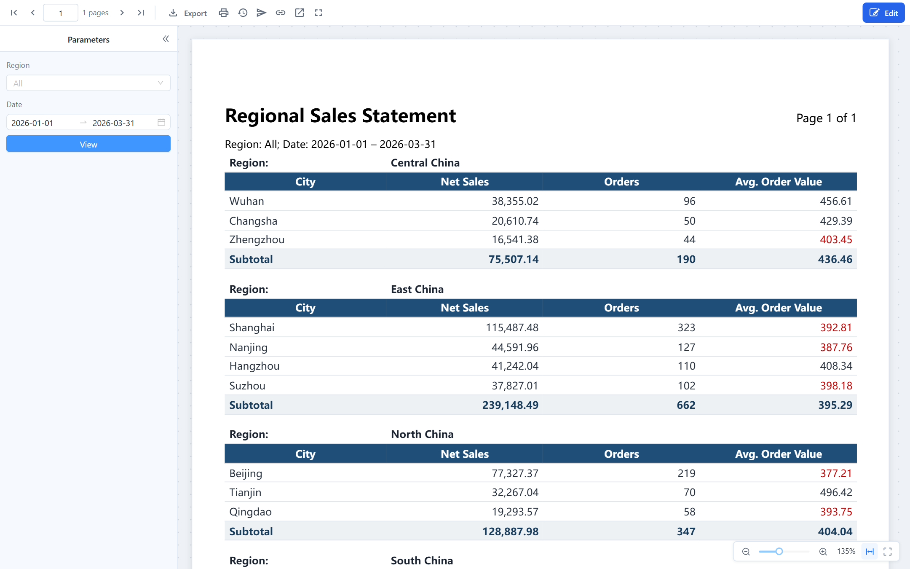
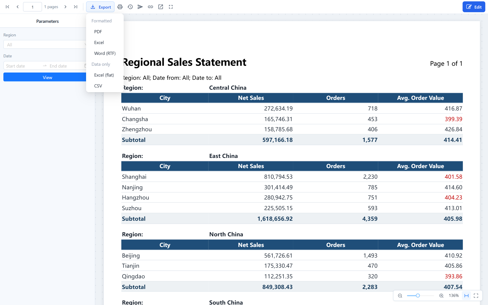

# Viewing, Pagination and Export

## The viewer

Clicking a paginated report in the console opens it in the viewer. Set the parameters on the left, click **View**, and page through the result.

| Control | What it does |
| --- | --- |
| **Parameters › View** | Runs the report with the values entered. Required parameters are marked; the report does not run until they have a value. A list parameter with choices offers **Select all** and **Clear**; left empty it reads **All** and does not filter. A pair of from/to date parameters appears as one date range picker. Clearing a parameter sets it back to **All** rather than to its default. The full rules are in [How values behave in the viewer](/documentation/Paginated-Reports/Datasets-and-Parameters/#how-values-behave-in-the-viewer). |
| **First / Previous / Next / Last page** | Moves between pages. Pages are rendered once and cached, so paging does not query again. |
| **Zoom** | Fit width, fit page, actual size, or a percentage; also on the floating bar at the bottom right. |
| **Full screen** | Fills the browser window, also when the viewer is embedded in the console. |
| **Export** | Downloads the report. See [Export formats](#export-formats). |
| **Print (PDF)** | Generates a PDF and opens it in a new tab for printing. |
| **Report downloads** | Files of this report that were generated in the background. See [Report Downloads](/documentation/Paginated-Reports/Report-Downloads/). |
| **Distribution** | Scheduled delivery, for users with the *manage schedules* permission. See [Distribution](/documentation/Paginated-Reports/Distribution/). |
| **Copy link** | Copies the viewer URL with the parameters that differ from their defaults (cleared ones as empty values), so the recipient opens the same view. Relative date keywords that were in the address are kept as keywords. |
| **Open in new tab**, **Edit** | Leave the console frame, or open the designer (needs write permission). |

The parameter panel sits on the left or above the pages, as the report author chose in **Report properties › Parameter panel**. Readers can collapse it but not move it.

## How pages are cut

The report is laid out on the paper size, orientation and margins set in the report properties. Rows flow from one page to the next; the header and footer bands repeat on every page, and a table's column headers repeat as well when **Repeat header on each page** is on. A group with **Page break after group** starts every group on a new page.

When something does not look right, it is almost always one of these:

| Symptom | Cause | Fix |
| --- | --- | --- |
| Validation error *Column widths exceed the usable width* when saving | The column widths add up to more than the page width minus the margins. The usable width is shown under **Columns**. | Narrow the columns, remove one, reduce the margins, or switch to landscape. |
| Crosstab columns cut off at the right edge | A crosstab never splits horizontally. With **Fit to page width** on, value columns are compressed down to 8 mm; beyond that the rest is cut. | Use landscape or a larger paper, filter the column dimension to fewer members, turn off totals you do not need, or swap the row and column dimensions. |
| Header or footer element pushed to the next page or clipped | The element is wider than the usable width or sits outside the band. | Leave **Width** empty so the element fills its column, or reduce its width. |
| Many short pages | **Page break after group** is on and the groups are small. | Turn it off, or keep it and accept the page count. |
| A blank line after each group | **Space after group** is set. | Set it to 0 if you do not want it. |

## Preview limits and truncation

- The viewer shows at most **5,000 rows**. When the data has more, the report ends with *Data exceeds the preview limit, only the first N rows are shown*, and subtotals and totals are calculated over those rows only. Exports are not limited this way.
- Exports stop at **200,000 rows** for SQL datasets and **100,000 rows** for model datasets. Beyond that the export fails with a message asking you to narrow the range with parameters. Model datasets share the analysis engine with dashboards, so long detail lists belong in an SQL dataset.
- A query that runs longer than **120 seconds** is cancelled.
- A formatted Excel export above **20,000 rows** switches to a faster writer that uses less memory; the result is the same workbook.
- An export made right after a preview with the same parameters reuses the preview's data and does not query again, unless the preview was truncated.

Administrators change these limits in the plugin's `settings.xml`: `preview-max-rows`, `export-max-rows`, `model-export-max-rows`, `query-timeout-seconds`, `xlsx-fast-threshold-rows`.

## Export formats

The **Export** menu has two groups.

| Group | Format | What you get |
| --- | --- | --- |
| **Formatted** | **PDF** | The pages exactly as the viewer shows them. Also used by **Print**. |
| | **Excel** | The report as one continuous table per sheet, with the page styles: fills, fonts, grid lines, column widths, frozen header rows. Not cut into pages. |
| | **Word (RTF)** | The same table layout in a document Word can open and edit. |
| **Data only** | **Excel (flat)** | One row per record, group values repeated in every row, no subtotals, totals or merged cells, column titles as headers. Made for pivot tables. |
| | **CSV** | The same rows as plain text, UTF-8 with BOM so Excel opens it directly; numbers without thousands separators, dates as `2026-10-27`. |

Rules of the formatted Excel export:

- The header band is written at the top of each sheet and frozen. A table without groups also freezes its column header row.
- The footer band goes into Excel's page footer, so it prints on every page; page numbers become Excel page numbers.
- A group with **Page break after group** becomes one sheet per group, named after the group value. The grand total stays on the last sheet. With **Restart page numbers for each group**, PDF and print restart at page 1 for every group.
- Columns in the table-type outputs (Excel, Word) are cut wherever an element starts: every table column edge and the left edge of every header or footer element. An element that starts in the middle of a column adds a narrow extra column with merged cells on every row. The designer places header and footer elements on column edges for you; if you position one by hand, validation warns you.

Which format to choose:

| You want to | Use |
| --- | --- |
| Print, send, archive | PDF |
| Keep working with the numbers, build a pivot | Excel (flat); CSV when the data is large |
| Edit the text in Word | Word (RTF) |
| Hand over a formatted workbook | Excel |

Data exports are the fastest and need the least memory because they skip layout. PDF takes the longest; formatted Excel uses the most memory.

Exports and prints run as background tasks. Anything that finishes within a few seconds downloads at once; larger files continue in the background and you are notified when they are ready. See [Report Downloads](/documentation/Paginated-Reports/Report-Downloads/).

## Large reports

- **Summaries from a model, details from SQL.** A model dataset is calculated by the analysis engine and held in memory as a whole result; it is limited to 100,000 exported rows and runs one at a time in the background. A detail listing of tens of thousands of rows should be an SQL dataset.
- **Narrow with parameters.** A date range or a region parameter keeps each run to the rows that are needed, and lets a distribution produce one file per value instead of one huge file.
- **Choose a data export** for large row counts.

## Viewer URL parameters

The viewer address is `…/datafor/api/repos/<path with ":" instead of "/">/viewer`, for example `/datafor/api/repos/:public:Docs:Regional Sales Statement.pagereport/viewer`. **Copy link** produces it for you. These query parameters can be added:

| Parameter | Values | Effect |
| --- | --- | --- |
| `p_<name>` | A value; repeat the key for a multi-value list, `p_region=East&p_region=North` | Sets a report parameter. Dates are `yyyy-MM-dd` or a relative date keyword such as `firstDayOfLastMonth`, date-times `yyyy-MM-dd HH:mm:ss`, booleans `true`/`false`. A value that does not fit the type is dropped with a message. |
| `paramPanel` | `left`, `top`, `collapsed`, `hidden`, combinable as `top,collapsed` | Overrides the panel position; `hidden` runs the report at once with the URL and default values. If a required parameter is still empty, the panel opens anyway so the reader can fill it in. |
| `toolbar` | `false` | Hides the toolbar; paging moves to the floating bar at the bottom right. |
| `locale` | `en-US`, `zh-CN`, … | Forces the interface language of the viewer. Without it the viewer uses the language of the signed-in user, the same as the console. |

A complete embed URL therefore looks like `…/viewer?toolbar=false&paramPanel=hidden&p_region=East%20China`. Only the viewer page honours `paramPanel` and `toolbar`; the designer's preview always follows the report properties. For sign-in inside an iframe, see [Signing In Users](/documentation/Embedded/Signing-In-Users/).

## Related topics

- [Report Downloads](/documentation/Paginated-Reports/Report-Downloads/)
- [Distribution](/documentation/Paginated-Reports/Distribution/)
- [Page Layout, Header and Footer](/documentation/Paginated-Reports/Page-Layout-Header-and-Footer/)
