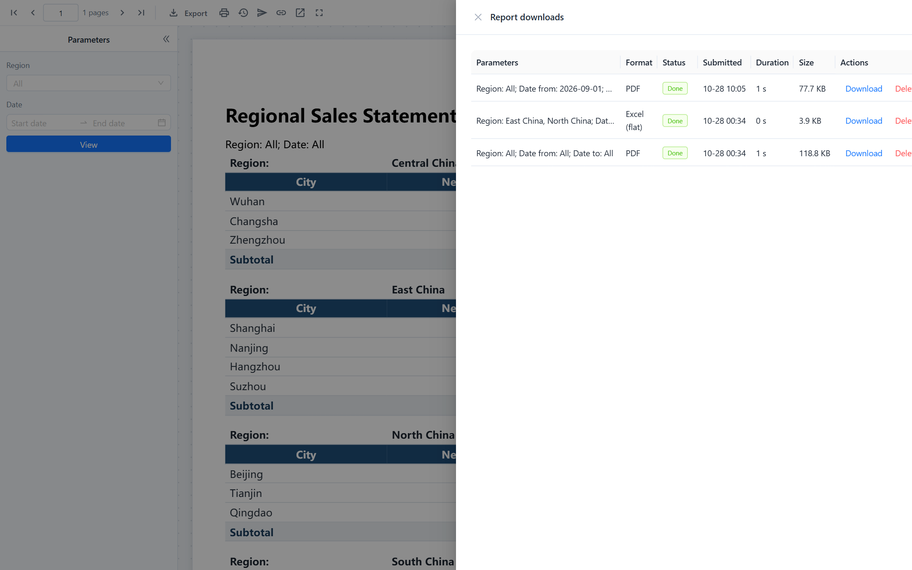
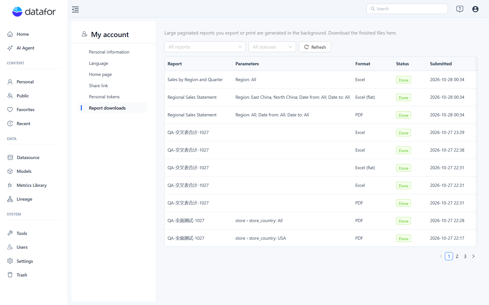

# Report Downloads

Every export or print of a paginated report is a **task** that runs on the server. Small reports finish within a few seconds and download straight away, so you will not notice. Larger ones keep running after the viewer says *This report is large and is being generated in the background*; when the file is ready, a notification with a **Download** button appears, and the file waits for you in **Report downloads**.

Files made by a [distribution](/documentation/Paginated-Reports/Distribution/) are tasks too, owned by the person who created the distribution.

## Where to find your files

- **In the viewer:** **Report downloads** in the toolbar opens a drawer with the tasks of this report only. When the viewer runs inside the console, **View all in My account** at the top of the drawer opens the console page below. In the designer's preview the button is greyed out until the report has been saved once.
- **In the console:** **My account › Report downloads** lists the tasks of all your reports, with filters by report and status. This page appears only when the paginated report plugin is installed.

In My account each row also names the report. Each row shows the parameter summary (the same text as the `{_filters}` placeholder, without hidden parameters), the format, the status, when it was submitted, how long it ran and the file size. Actions:

| Action | Available when |
| --- | --- |
| **Download** / **Open** | The task is done. PDFs open in the browser; other formats download. |
| **Cancel** | The task is queued or running. Cancelling a running task stops the render; a database query that is already running may take a moment to stop. |
| **Delete** | Any finished task. Removes the record and the file. |
| **Reason** | The task failed. Shows the message explained below. |

The lists refresh themselves every few seconds while a task of yours is still running. You only ever see your own tasks.

## Limits

| Limit | Default | Setting in `settings.xml` |
| --- | --- | --- |
| Queued plus running tasks per user | 5 | `task-max-queued-per-user` |
| Running time per task | 30 minutes | `task-timeout-minutes` |
| Files kept | 90 days | `task-retention-days` |
| Tasks running at once (SQL datasets) | 2 | `task-concurrency` |
| Tasks running at once (model datasets) | 1 | `model-task-concurrency` |
| Rows exported, SQL dataset | 200,000 | `export-max-rows` |
| Rows exported, model dataset | 100,000 | `model-export-max-rows` |

Model datasets are calculated by the same analysis engine as dashboards and are held in memory as one result, which is why they run one at a time and have the lower row limit. Files are stored on the server under `pentaho-solutions/system/datafor-pagereport-output/<user>/`, or the folder named in `output-dir`; they survive plugin upgrades.

## Failure messages

| Message | What happened | What to do |
| --- | --- | --- |
| *The data exceeds the export limit. Use parameters to narrow the range.* | An SQL dataset returned more rows than `export-max-rows`. | Add or tighten parameters, or split the report. |
| *The model data exceeds the export limit…* | A model dataset returned more rows than `model-export-max-rows`. | Narrow the range; for detail listings use an SQL dataset instead. |
| *The query result exceeds the analysis engine's limit.* | The analysis engine refused the query (more than 500,000 result rows). | Same as above. |
| *The query timed out.* | The database or the analysis engine did not answer within the query timeout. | Narrow the range, or ask an administrator to raise `query-timeout-seconds`. |
| *The task ran longer than allowed and was stopped.* | The task exceeded `task-timeout-minutes`. | Narrow the range or choose a data export, which is faster than PDF. |
| *You already have several tasks queued or running.* | You reached `task-max-queued-per-user`. | Wait for a task to finish or cancel one. |
| *The server restarted and the task was interrupted.* | Tasks do not survive a server restart. | Submit it again. |
| *The server ran out of memory.* | The render needed more memory than the server had. | Narrow the range or use a data export; tell an administrator if it repeats. |
| *The report definition has errors.* | The saved report no longer validates, for example after a model change. | Open it in the designer, fix the errors it lists, and save. |

## Opening an export URL directly

The viewer uses tasks, but the export address can also be opened directly, for example from a script: `GET /datafor/plugin/datafor-pagereport/api/render/export?path=<report path>&format=pdf&p_<name>=<value>`. That call renders synchronously and returns **413** when the row limit is exceeded, so use it for small reports or when you need the file in the HTTP response; use a distribution for scheduled files.

## Related topics

- [Viewing, Pagination and Export](/documentation/Paginated-Reports/Viewing-Pagination-and-Export/)
- [Distribution](/documentation/Paginated-Reports/Distribution/)
- [My Account](/documentation/Console/My-Account/)
