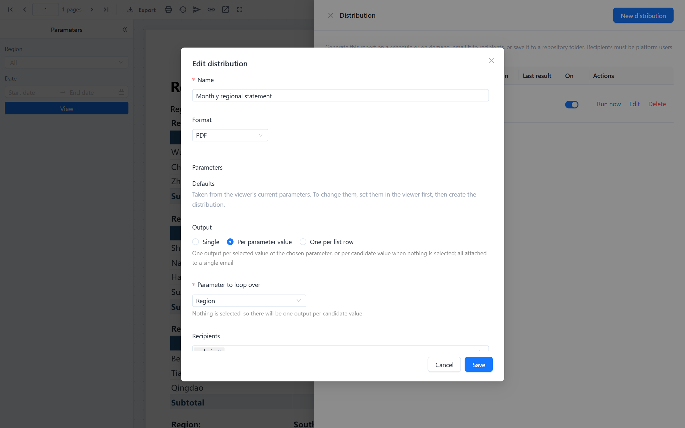
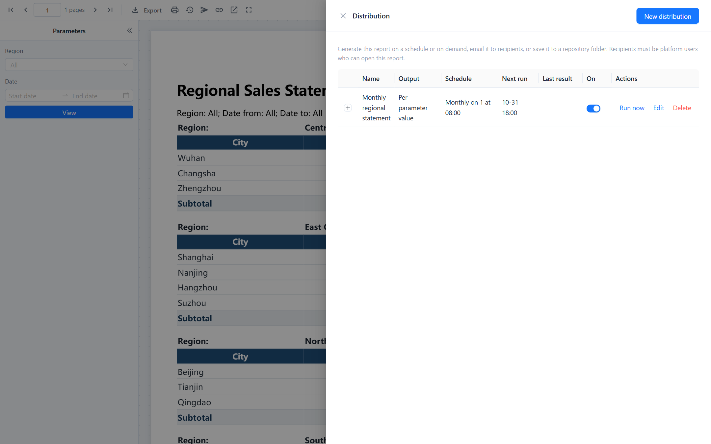

# Distribution

A **distribution** generates a paginated report without anyone opening it, and delivers the files: by email to platform users, to a repository folder, or both. It runs by hand or on a daily, weekly or monthly schedule, and it can produce one copy for everyone, one copy per value of a parameter, or one copy per row of a recipient list.

Distributions live with the report. Open the report in the viewer and click **Distribution** in the toolbar. The button appears only for users with the platform's *manage schedules* permission; everyone else can still receive the emails.

## How a distribution produces its files

| Output | Files produced | Sent to |
| --- | --- | --- |
| **Single** | One file, with the parameter values saved in the distribution | All recipients, in one email |
| **Per parameter value** | One file per value of the parameter you choose. If the parameter has a selection, only the selected values; if nothing is selected, every candidate value. The editor lists the copies it will make. | All recipients, all files attached to one email |
| **One per list row** | One file per row of a distribution list; the row supplies the parameter values | The recipient named in that row |

Parameter values are taken from the viewer at the moment you create the distribution. To change them, set the parameters in the viewer, click **View**, then create or edit the distribution. Rows of a list whose parameter values are identical are generated once and sent to all of those recipients.

**Dates that follow the run date.** When a date parameter still has the value of its relative default (for example *First day of last month*), the distribution stores the keyword, not the date. Each run recalculates it in the distribution's time zone, so a monthly distribution always covers the previous month and a daily one always covers yesterday. The editor shows such a value as *First day of last month (follows the run date; 2026-09-01 if run today)*. A date you changed to a fixed value stays fixed. The subject, message, file names and the report text show the calculated date. See [Relative dates](/documentation/Paginated-Reports/Datasets-and-Parameters/#relative-dates).

::: warning Who sees what
The report is generated **as the person who created the distribution**, with the parameters stored in it. Recipients get the data those parameters produce, not data filtered by their own row-level security. Parameters whose values come from **User** take the creator's value. To give different people different data, use **One per list row** and put each person's parameter values in their row. People who cannot open the report are skipped, not given access.
:::

## Recipients

Recipients must be Datafor users. Pick them by user name in **Recipients**, or name them in a list by user name or email address. A recipient is skipped, and the reason recorded, when:

- the user does not exist or is disabled,
- the user has no email address in their profile,
- the user cannot read the report.

Skipped recipients are listed in the run history and in an email sent to you after the run.

## Distribution lists

A list drives **One per list row**. Upload an **xlsx or csv** file (stored with the distribution) or write an **SQL query** on a connection, which runs again each time. The first row holds column names; case does not matter.

| Column | Meaning |
| --- | --- |
| `email` or `user` | The recipient. One of the two is required. |
| A column named like a report parameter, for example `region` | That row's value for the parameter. Multi-value parameters take a comma-separated list. |
| `format` (optional) | `pdf`, `xlsx`, `xlsxflat`, `csv` or `rtf`. Rows without it use the distribution's format. |
| `subject` (optional) | The email subject for that row. |

A list is processed up to 1,000 rows; rows beyond that are ignored and you are told by email. The upload shows a preview of the parsed rows so you can check the column names before saving.

## Schedule

- **Manual**: runs only when you click **Run now**.
- **Daily**, **Weekly** (choose the weekdays) or **Monthly** (choose a day of the month, or the last day) at a time of day, in the time zone you select. Daylight saving changes follow that zone.
- Optional **Start date** and **End date**. After the end date the distribution switches itself off and sends you a reminder.
- If the server was down at the scheduled time, a run missed by less than an hour is made up once after restart; older misses are skipped and the next regular run is scheduled.

The run history and **Next run** column show when the distribution last ran and will run next.

## Delivery

**Email** uses the server's mail settings (**Settings › Mail server**). The subject defaults to `{report} {date}`; subject and message can use `{report}`, `{date}` and any parameter name such as `{region}`, which prints the parameter's display label. When the attachments of one email would exceed 25 MB, the email is sent without them and says so; fill in a repository folder as well so recipients can fetch the files there.

**Also save to a repository folder** writes each file into the folder you name, for example `/public/sales/monthly`, with the name `<report>-<value or recipient>-<date time>.<ext>`. Files inherit the folder's permissions. The folder is written as you, so you need write permission on it.

Every file a distribution makes is also a background task of yours: it appears under **My account › Report downloads**, where you can download it again. See [Report Downloads](/documentation/Paginated-Reports/Report-Downloads/).

## Run history and problems

Expand a distribution in the drawer to see its runs: time, whether it was scheduled or manual, how many files were produced and how many failed, how many emails went out, and the problems (skipped recipients, oversize attachments, failed renders). Runs are kept for 90 days. Whenever a run has a failure or a skipped recipient, you receive an email listing them.

Each file counts against the same limits as an export: row limits per dataset type, the task time limit, and so on. A failed file shows the same reason as a failed download would.

## Managing distributions

- The switch in the **On** column pauses a distribution without deleting it.
- **Edit** changes any setting; past runs are kept.
- **Delete** removes the distribution and its history. Files already saved to a folder or sent by email are not affected.
- You see the distributions you created. Administrators see everyone's.

Administrators can change the list row limit, the attachment size limit and the retention period in the plugin's `settings.xml` (`dist-list-max-rows`, `dist-attachment-max-mb`, `task-retention-days`).

## Related topics

- [Report Downloads](/documentation/Paginated-Reports/Report-Downloads/)
- [Datasets and Parameters](/documentation/Paginated-Reports/Datasets-and-Parameters/)
- [Mail Server Configuration](/documentation/System/Mail-Server-Configuration/)
