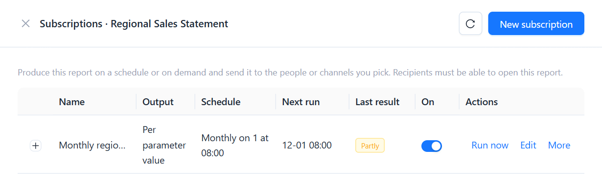
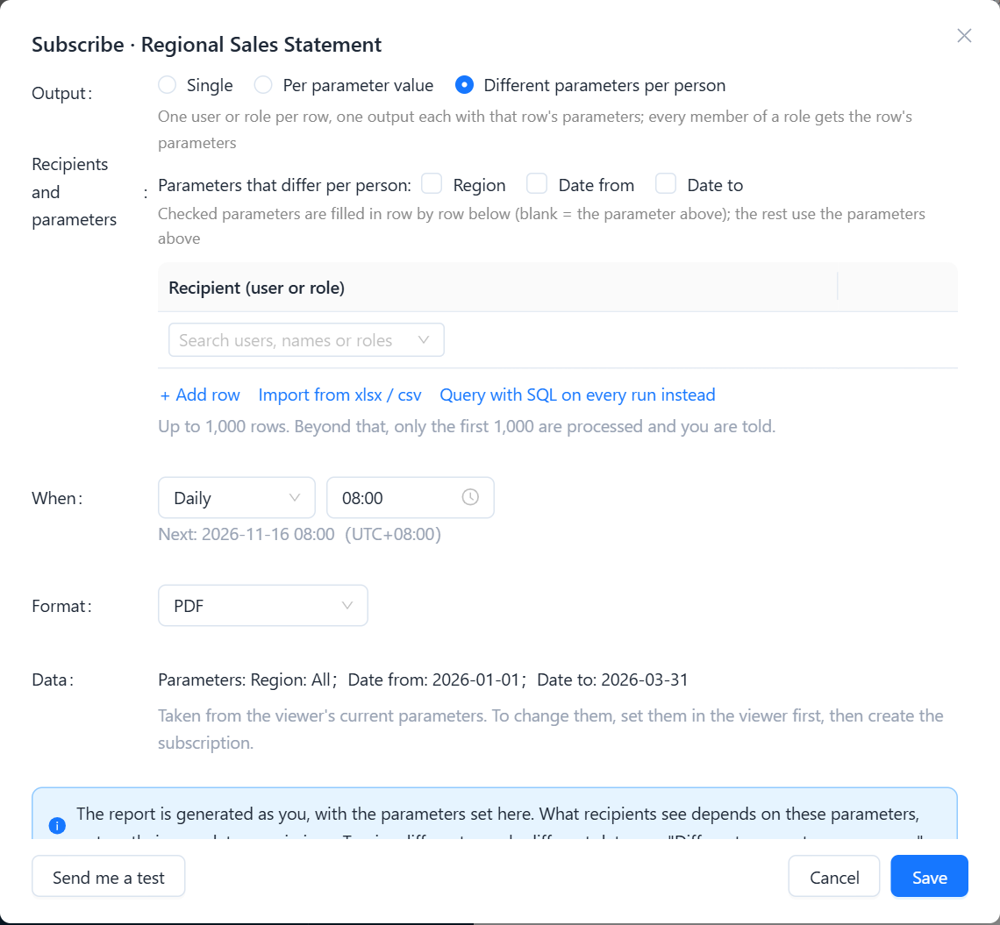

# Subscriptions

A paginated report **subscription** produces the report without anyone opening it and sends the file. It runs on a schedule or when you click **Run now**, and it can make one copy for everyone, one copy per value of a parameter, or a different copy for each person.

Delivery goes through the same system as [dashboard subscriptions and alerts](/documentation/Subscriptions-and-Alerts/Understanding-Subscriptions-and-Alerts/): each person receives the file the way they chose in **My account**, channels get one shared message, and the message follows the administrator's template. The subscriptions and alerts plugin must be installed; without it the viewer shows no **Subscriptions** button.

Open the report in the viewer and click **Subscriptions** in the toolbar. The button appears for users with the platform's *manage schedules* permission and for administrators; anyone can receive the files.

## Create a subscription

1. In the viewer, set the parameters and click **View**. The subscription starts from the parameter values on screen; you can still change them in the editor.
2. Click **Subscriptions › New subscription**.
3. Choose the **Output**, who receives it, **When** and the **Format**, then **Send me a test** and **Save**.

| Field | What it does |
| --- | --- |
| **Output** | How many copies to make, see [below](#how-a-subscription-produces-its-files). |
| **Send to** | People and roles; you are added by default. A role is expanded at every run, so new members of the role receive the next run. People who will be skipped are listed under the field with the reason before you save. |
| **Post to channels** | Slack and Teams channels and the group robots an administrator authorized for you; see [Post to channels](/documentation/Subscriptions-and-Alerts/Dashboard-Subscriptions/#post-to-channels). Not available with **Different parameters per person**, because each copy holds different data. |
| **When** | **Daily**, **Workdays** (Monday to Friday), **Weekly** on chosen weekdays, **Monthly** on a day or the last day, or **Manual only**. Times are in the system time zone; **Next:** shows the next run. |
| **Format** | **PDF**, **Excel**, **Word (RTF)**, **Excel (flat)** or **CSV**. |
| **Data** | The parameter values the subscription uses, in the report's own parameter panel. Change them here, also when editing a saved subscription. A date parameter you leave at its relative default stays relative (see below). |
| **More settings** | **Active dates** (optional start and end; after the end date the subscription switches itself off and you are notified) and **Name** (generated as *Report · schedule* until you type your own). |

## How a subscription produces its files

| Output | Files produced | Sent to |
| --- | --- | --- |
| **Single** | One file with the subscription's parameters | Everyone in **Send to** and every channel |
| **Per parameter value** | One file per value of the parameter you choose: the selected values, or every candidate value when nothing is selected. The editor lists the copies it will make. | Everyone in **Send to** and every channel, all files in one message |
| **Different parameters per person** | One file per row of a recipient table; the row supplies the parameter values | The person or role in that row |

**Dates that follow the run date.** When a date parameter still has its relative default (for example *First day of last month*), the subscription stores the keyword, not the date. Each run recalculates it in the system time zone, so a monthly subscription always covers the previous month. The parameter summary shows it as *First day of last month (follows the run date; 2026-09-01 if run today)*. A date you changed to a fixed value stays fixed. See [Relative dates](/documentation/Paginated-Reports/Datasets-and-Parameters/#relative-dates).

::: warning Whose data recipients see
The report is generated **as you**, with the parameters stored in the subscription. Recipients get the data those parameters produce, not data filtered by their own row-level security, and a channel shows the same file to everyone in it. To give different people different data, use **Different parameters per person**.
:::

**Parameters that take the current user.** When a parameter takes its value from the signed-in user (values from **User**, or a reference to the user name system variable):

- with **Different parameters per person**, each recipient's own user name is used, so everyone gets their own copy even if you fill in no other parameter; the report's text showing the current user shows the recipient too. The data is still read with your permissions, and other system variables such as the department keep your values;
- with **Single** or **Per parameter value**, everyone gets the copy made with your user name, and the editor warns you.

## Different parameters per person

1. Tick the **Parameters that differ per person**. Each ticked parameter becomes a column in the table; unticked ones use the values in **Data**.
2. Add one row per **Recipient (user or role)** and fill in its values. A blank cell uses the value in **Data**. A role in a row gives every member of the role that row's values.
3. Rows whose values are identical are generated once and sent to all of their recipients.

The table holds up to 1,000 rows; beyond that only the first 1,000 are processed and you are told. For long lists:

- **Import from xlsx / csv** reads a file into the table, where you can keep editing. The first row holds column names; case does not matter.

  | Column | Meaning |
  | --- | --- |
  | `user`, `email` or `role` | The recipient: a user name, an email address of a Datafor user, or a role |
  | A column named like a report parameter, for example `region` | That row's value. Multi-value parameters take a comma-separated list. |
  | `format` (optional) | `pdf`, `xlsx`, `xlsxflat`, `csv` or `rtf`; rows without it use the subscription's format |

  A `subject` column is ignored: subjects come from the message template.

- **Query with SQL on every run instead** runs a query on a connection at each run; its columns follow the same rules.

## Delivery

- Each person receives the message the way they chose under **My account › My subscriptions & alerts › How I receive**: email, an IM direct message, or both. People who cannot be reached are skipped and the reason recorded.
- The subject and text follow the administrator's [subscription template](/documentation/Subscriptions-and-Alerts/Setting-Up-Delivery/#message-templates). The default subject is the report name and the date; the parameter values appear as a *Parameters* line. Messages end with an **Open report** link, which opens the report with the recipient's own default parameters.
- **Files.** Email attaches them; when one email's attachments exceed 25 MB, it lists download links instead. Slack uploads files up to the IM file limit (20 MB) and links larger ones; Teams always gets links. Download links require signing in: a recipient can download the copy sent to them, and a copy posted to a channel can be downloaded by anyone who can open the report. Files are kept for 90 days.
- Every file is also a background task of yours, listed under **My account › Report downloads**. See [Report Downloads](/documentation/Paginated-Reports/Report-Downloads/).

A recipient is skipped, and the reason recorded, when the user does not exist or is disabled, cannot open the report, or has neither an email address nor a linked IM account. Members of a role who are disabled or deleted are left out silently.

## Test and run

- **Send me a test** (in the editor, saved or not, and in the row's **More** menu) produces the subscription with its current settings and sends it to you only, the way you chose to receive. The subject starts with *[Test]*. With **Different parameters per person**, you receive the copy of the first row's first person, so you see what they will get. Problems found on the way (someone without permission, someone unreachable) are written into the test message. A test is not recorded in the history and does not count as a failure.
- **Run now** sends to every recipient and channel after a confirmation.

## Schedule rules

- If the server was down at a scheduled time, a run missed by less than an hour is made up once after the restart; older misses are skipped.
- After **5** scheduled runs in a row that produced no file at all, the subscription switches itself off and you are notified with the reason. A successful or partly successful run resets the count; manual runs do not count. Administrators change the number with `dist-max-failures` in the plugin's `settings.xml` (0 turns this off).
- If the subscriptions and alerts plugin is removed or unavailable, scheduled runs produce nothing and record *the subscriptions and alerts plugin is unavailable*; this does not count as a failure, and the subscriptions resume once the plugin is back.

## Run history and management

Expand a subscription in the drawer to see its runs: time, scheduled or manual, how many files were produced, how many failed, how many deliveries went out, and the problems. Runs are kept for 90 days. When a run fails or partly fails, you are notified with the problems. Recipients who [stopped receiving](/documentation/Subscriptions-and-Alerts/Managing-Subscriptions-and-Alerts/#sent-to-me) the subscription are listed in grey; they are not problems.

- The **On** switch pauses a subscription without deleting it.
- **Edit** changes any setting; past runs are kept.
- **More › Delete** removes the subscription and its history. Files already delivered are not affected.
- You see the subscriptions you created; administrators see everyone's.

Your paginated report subscriptions are also listed with your dashboard subscriptions in **My account › My subscriptions & alerts**; when the report is open in the console, **Manage all my subscriptions** at the top right of the drawer opens it. Administrators see all of them under **Settings › Notifications › Subscriptions & alerts**, where they can also [transfer](/documentation/Subscriptions-and-Alerts/Monitoring-and-Limits/#transfer-to-another-owner) them to another owner. Edit them in the viewer.

Administrators can change the list row limit and the retention period in the plugin's `settings.xml` (`dist-list-max-rows`, `task-retention-days`).

## Related topics

- [Understanding Subscriptions and Alerts](/documentation/Subscriptions-and-Alerts/Understanding-Subscriptions-and-Alerts/)
- [Report Downloads](/documentation/Paginated-Reports/Report-Downloads/)
- [Datasets and Parameters](/documentation/Paginated-Reports/Datasets-and-Parameters/)
