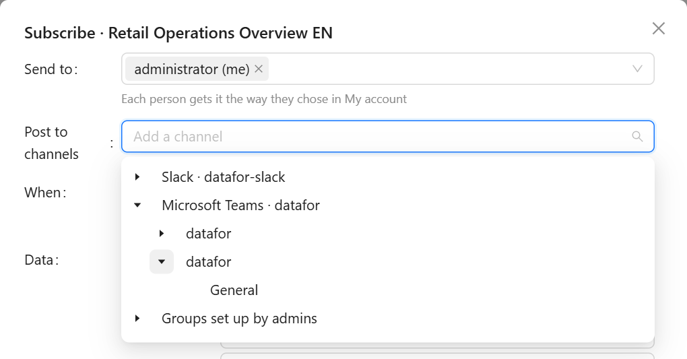
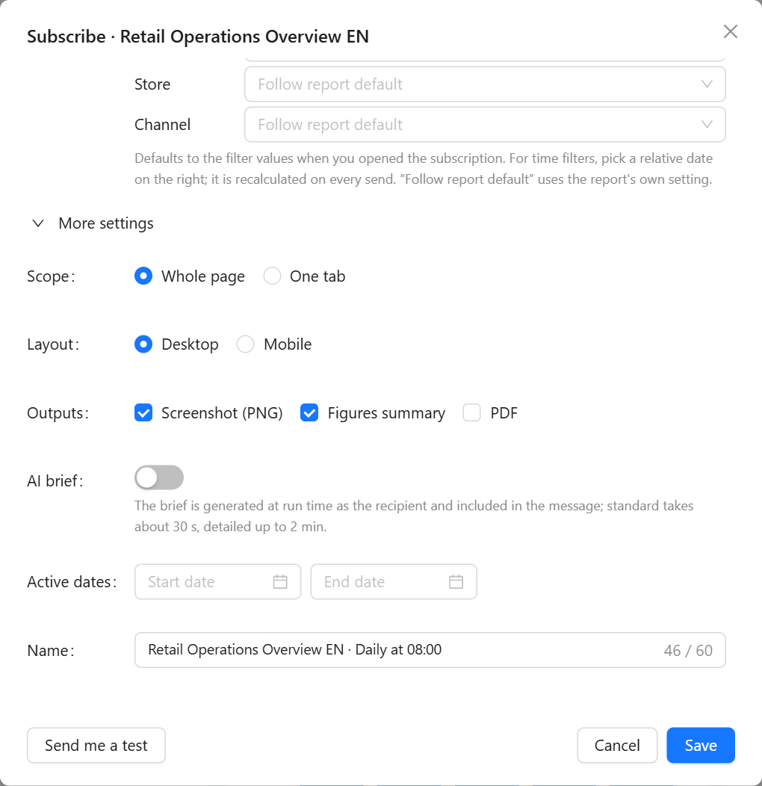
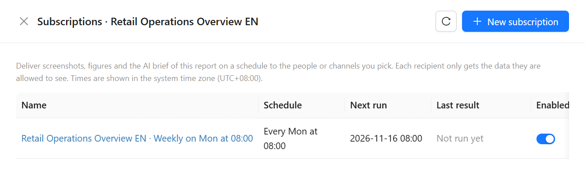

# Subscribing to a Dashboard

A subscription sends one dashboard on a schedule. Each person receives a copy rendered with their own permissions; channels receive one copy rendered with yours. For the overall model, see [Understanding Subscriptions and Alerts](/documentation/Subscriptions-and-Alerts/Understanding-Subscriptions-and-Alerts/).

## Create a subscription

1. Open the dashboard and set its filters to what the recipients should see. The subscription starts from the filter values on screen.
2. Click **Subscribe** in the toolbar (the calendar icon next to the PDF export). If the dashboard has no subscription of yours yet, the editor opens directly; otherwise a drawer lists the existing ones and **New subscription** opens the editor.
3. Check **Send to**, **When** and **Data**, add channels if needed, and open **More settings** for the outputs.
4. Click **Send me a test** to see the result in your own inbox or IM, then **Save**.

### Send to

People and roles. You are added by default. Type to search; results are grouped into **People** and **Roles**, and a role shows how many people it has now. A role is expanded at every run, so someone added to the role next week starts receiving the subscription without any change here.

Under the field, *Each person gets it the way they chose in My account* is a reminder that you do not pick email or IM for other people. If anyone would be skipped, the editor lists them below the field with the reason before you save, for example *Recipient cannot read this report* or *No email address and no linked IM account*. Skipped people never receive the dashboard; to include them, share the report with them first.

A subscription can address up to 50 people by default, roles counted after expansion. Readers can only subscribe for themselves.

### Post to channels

Adds one shared message in a group chat. The list is a tree:

- **Slack · *app name***: the channels of the Slack app. A private channel appears only after you invite the Datafor bot into it.
- **Microsoft Teams · *app name***: teams, and under each team its standard channels. Datafor installs the app into the team when you save.
- **Groups set up by admins**: WeCom, DingTalk and Feishu group robots and webhooks that an administrator has created and authorized for you.

The row is hidden when there is nothing you may post to. Channel messages are rendered **with your permissions** and everyone in the channel can read them, so use channels only for dashboards whose data everyone there may see.

### When

| Choice | Runs |
| --- | --- |
| **Daily** | Every day at the time you set |
| **Workdays** | Monday to Friday. Public holidays are not skipped. |
| **Weekly** | On the weekdays you tick |
| **Monthly** | On a day of the month, or the last day |
| **Manual only** | Never on its own; only when you click **Run now** |

Times are in the system time zone set by the administrator. **Next:** under the field shows the next run, with the zone offset when your browser is elsewhere.

If the server was down at a scheduled time, a run missed by less than an hour is made up once after the restart; older ones are skipped. A run that starts while the previous one is still going is skipped and recorded as such.

### Data

The line reads *Using the report's default filters* or lists the values you changed. Click **Change** to set each filter:

- **Member filters** (region, store, channel…) are a drop-down of the filter's members. **Follow report default** uses whatever the report itself would show.
- **Time filters** have a second drop-down on the right with relative dates, grouped as **Current period** (for example *This Year*), **Latest period** (the most recent period that has data, not counted from today) and **Previous period** (*Last Year*, *The Year Before Last*). A relative date is recalculated at every send, so a subscription set to *Last Month* always covers the month before the send date. Choosing one disables the fixed value on the left.
- Filters the editor cannot list values for (some date components, very long member lists) show a text box: type the value as it is displayed in the report, several separated by semicolons.

## More settings

| Setting | What it does |
| --- | --- |
| **Scope** | **Whole page**, or **One tab** of a tabbed report (only offered when the report has tabs). |
| **Layout** | **Desktop**, or **Mobile** for a tall image that reads well in IM apps. Mobile is available only when the report has a [mobile layout](/documentation/Visualization/Mobile-Layout-View/). |
| **Outputs** | **Screenshot (PNG)**: an image of the page. **Figures summary**: the values of the report's metric and KPI cards written into the message, one *name: value* per line. **PDF**: the page as a PDF. **Excel**: appears when the report has tables; choose up to 5 table components, each exported to its own Excel file. At least one output is required. |
| **AI brief** | A short written summary of the dashboard, generated at send time **as each recipient**, so it only discusses data that person can see. **Standard** takes about 30 seconds, **Detailed** up to 2 minutes. Needs the AI extension; briefs count against a site-wide daily budget, and once it is used up the day's remaining runs go out without a brief. |
| **Active dates** | Optional start and end dates. After the end date the subscription switches itself off and you get an email. |
| **Name** | Generated as *Report · schedule*, for example *Retail Operations Overview EN · Daily at 08:00*, and updated when you change the schedule until you edit it yourself. Up to 60 characters. |

## Send me a test

**Send me a test** (bottom left) sends the subscription as it is in the editor, saved or not, to you only and the way you chose to receive. The subject starts with *[Test]*. Nothing is posted to channels, no run is recorded, and the subscription is not changed.

## What recipients receive

The subject is *Report name* and the date, unless the administrator changed the [message template](/documentation/Subscriptions-and-Alerts/Setting-Up-Delivery/#message-templates). An email contains, in order: the title, a *Filters* line with the values used, the AI brief, the figures summary, an **Open report** button that opens the dashboard with the same filters, the screenshot, and a footer naming whose permissions the data reflects. The PDF and Excel files are attached; when the attachments exceed the mail limit (25 MB by default), the email carries links instead.

IM messages carry the same text as a card. How images and files travel depends on the platform:

| Destination | Screenshot | PDF and Excel |
| --- | --- | --- |
| Email | In the body | Attached |
| Slack direct message or channel | Uploaded | Uploaded |
| Teams direct message or channel | In the card | Download links |
| WeCom, DingTalk, Feishu app direct message | Uploaded | Uploaded |
| WeCom group robot | Uploaded | Uploaded |
| DingTalk or Feishu robot, generic webhook, Slack or Teams webhook | Temporary link | Temporary link |

Temporary links work without signing in and expire after 7 days by default. They need the server to be reachable from the IM platform; when an administrator turns them off, these destinations get the text and the **Open report** link only.

All outputs, the figures and Excel files included, are produced by the render service. If it is unavailable at send time, the message still goes out with the **Open report** link but without any of them, and the run records the problem.

## Manage the subscriptions of this report

With at least one subscription, **Subscribe** opens a drawer listing this report's subscriptions: schedule, next run, last result, and an **Enabled** switch to pause one without deleting it. **Run now** sends it immediately to everyone; the **⋯** menu has **Edit**, **Runs** and **Delete**. Administrators see everyone's subscriptions of the report here.

All your subscriptions, across reports, are in **My account › Subscriptions & alerts**. See [Managing Your Subscriptions and Alerts](/documentation/Subscriptions-and-Alerts/Managing-Subscriptions-and-Alerts/), which also explains run results and problems. When a run fails or some recipients are skipped, you get an email listing what went wrong.

## Limits

| Limit | Default |
| --- | --- |
| Subscriptions per Creator | 20 (administrators: no limit) |
| Subscriptions per Reader (only to themselves) | 5 |
| People per subscription | 50 |
| Excel tables per subscription | 5 |
| Time for one run, all recipients included | 10 minutes |

Administrators change the first three under [Monitoring and Limits](/documentation/Subscriptions-and-Alerts/Monitoring-and-Limits/).

## Related topics

- [Metric Alerts](/documentation/Subscriptions-and-Alerts/Metric-Alerts/)
- [Paginated Report Subscriptions](/documentation/Paginated-Reports/Subscriptions/)
- [Relative Date Filtering](/documentation/Analysis/Relative-Date-Filtering/)
