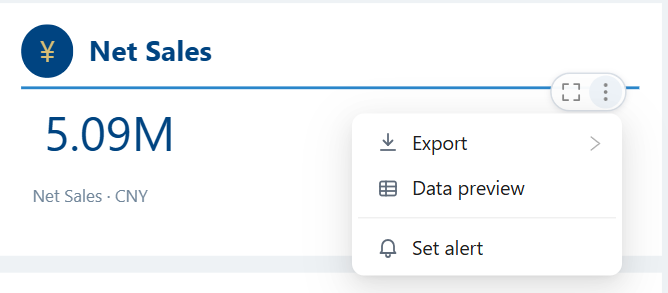

# Metric Alerts

A metric alert checks one measure on a schedule and sends a message only when its condition is met: *Net Sales last month below 500,000*, *Paid Orders down more than 10% on the previous month*, *no new data for 3 days*. It does not open a dashboard and does not need the render service; it runs a query and compares numbers.

## Where to create an alert

- **From a chart.** In a dashboard, hover the chart, click **⋮** and choose **Set alert**. The editor starts with the chart's measure, its time field and the member filters saved in the chart. Selections made in the dashboard's filter controls are not carried over; add them under **More settings › Filters** if the alert should watch that slice.
- **From the Metrics Library.** Open a metric and click **Set alert**. When the metric is bound to several models, pick one first. You choose the time field yourself.
- **From the AI assistant.** In a dashboard, ask for example *tell me when net sales drop more than 10% month on month*. The assistant answers with a suggestion card; **Create** opens this editor with what it understood filled in and highlights anything it could not work out, such as the measure or the threshold.

Administrators and Creators can create alerts (20 per Creator by default). Readers can create [restricted alerts](#restricted-alerts-for-readers) only.

## The editor

### Name

Generated from the measure and the first condition, such as *Net Sales below 2,500,000.00*, and kept in step with the condition until you type your own.

### Period

Two choices: the **time field** to look along, and **which period** to evaluate.

The time field list starts with the fields **Used in this chart**, then the model's other fields. The level you pick sets the grain: day, week, month, quarter or year.

The period is counted on the calendar from the day of the check, in the system time zone:

| Grain | Choices | Default |
| --- | --- | --- |
| Day | **Yesterday**, **Today (so far)** | Yesterday |
| Week | **Last week**, **This week (to date)** | Last week |
| Month | **Last month**, **This month (to date)** | Last month |
| Quarter | **Last quarter**, **This quarter (to date)** | Last quarter |
| Year | **Last year**, **This year (to date)** | This year |

The default for day, week, month and quarter is the last *complete* period. A period still in progress only holds part of its data, so a threshold such as *below 500,000* on *This month* would fire on the 2nd of every month.

Below the field, *Currently: 2026-10* names the period the alert would evaluate today. *No data yet for 2026-10* means the model has nothing for that period yet; threshold and change conditions are then not met, so use **No new data for** if a missing load should alert you.

When the field's values are not recognizable as dates (month names without a year, quarter numbers such as *Q3*, keys like *2026 Q3*), the editor says *This time field isn't recognized as dates* and falls back to **Latest *month* with data** and **The *month* before that**. These follow the data, not the calendar, so a load that stopped in September keeps being evaluated as September. Prefer a date-based field when the model has one.

### Condition

| Choice | Meaning | Fill in |
| --- | --- | --- |
| **Above**, **Below** | The value of the period is above or below a number | The number |
| **Outside range** | The value is outside a range | Lower and upper bound |
| **vs. previous *month*** (the label follows the grain) | Change against the period before | **changes by over**, **drops by over** or **rises by over**, and a percentage |
| **vs same period last year** | Change against the same period one year earlier | As above |
| **No new data for** | The latest date with data is more than N days before today | Days |
| **Unusual movement** | The value is far from the mean of the last 14 periods | **Sensitivity**: low, medium or high (3, 2.5 or 2 standard deviations) |

**Add condition** adds another one (up to 5); with two or more, choose **All conditions are met** or **Any condition is met**.

A change condition needs a comparison value. When the comparison period has no data or is 0, the condition is treated as not met and the run says *No data for the comparison period*. Comparing a period in progress with a complete one, for example *This year (to date)* against last year, compares part of a year with a whole year; set the period to the last complete one for a fair comparison.

As soon as the condition is complete, the editor runs it against current data and shows the result under the conditions: *Now 2,051,342.07 (2026) · With current data: would trigger* or *would not trigger*. Nothing is saved or sent by this check.

### Severity

**Info**, **Warning** or **Critical**. It appears in the subject of the message, as in *[Warning] Net Sales Alert triggered*, and in the alert lists.

### Check

How often the alert is evaluated:

- **Hourly**, on the hour, **All day** or only **Between** two times (for example 08:00 to 20:00).
- **Daily**, **Weekly** (on the weekdays you tick) or **Monthly** (on a day of the month), at a time you set.

**Next:** shows the next check in the system time zone. Checking more often than the data is loaded only repeats the same result; for a model refreshed nightly, **Daily** after the load is enough.

### Send to and Post to channels

The same as for subscriptions: people and roles, each person receiving the message the way they chose in **My account**, and channels for a shared message. See [Send to](/documentation/Subscriptions-and-Alerts/Dashboard-Subscriptions/#send-to) and [Post to channels](/documentation/Subscriptions-and-Alerts/Dashboard-Subscriptions/#post-to-channels).

An alert is evaluated **with your permissions** and every recipient gets the same result; the message says so. People who cannot use the model, or open the report the alert was created from, are skipped and listed under the field before you save. You can only save an alert on a model you can use yourself.

## More settings

| Setting | What it does |
| --- | --- |
| **Model**, **Measure** | The model is fixed when the alert came from a chart or a metric; the measure can be changed. |
| **Filters** | Restrict the measure to some members, for example *Channel = Online*. Up to 10 filters. |
| **Check separately** | Choose a field, such as *Region* or *Store*, to evaluate the condition for each of its members. The alert fires when **any** member meets the condition, and the message lists the members that did. Only the first 200 members are checked. Each member has its own state, so a second region going below the line is reported even while the first is still in alarm. |
| **Notifications** | **Notify once when it becomes abnormal** (default): one message when the condition starts being met, nothing more while it stays met. **Keep reminding while abnormal**, every N hours (up to 168): a *still abnormal* message at that interval. **Notify on recovery** (on by default) sends a message when the condition stops being met. |
| **Attach AI analysis** | When the alert fires, the AI assistant breaks the change down by the dimensions you choose (up to 3; leave them empty to let the assistant choose) and the breakdown is added to the message. It waits up to 3 minutes; if the analysis is not finished, the alert is sent anyway with a note, and the result appears in the alert history. The breakdown shows which parts contributed to the change, not why it happened. Needs the AI extension and counts against a site-wide daily budget. |
| **Check result** | The detailed result of the live check: the period and comparison period with their values, the change, which conditions matched, and with **Check separately** a table per member. |

Changing the measure, the filters or the conditions of a saved alert resets its state to normal when you save, so the next check that meets the condition notifies again.

## How an alert decides to send

| Before the check | Condition met | Result | Sent |
| --- | --- | --- | --- |
| Normal | Yes | **Entered alarm** | Yes |
| In alarm | Yes | **Still in alarm** | Only with **Keep reminding**, once the interval has passed (otherwise recorded as **Cooldown**) |
| In alarm | No | **Recovered** | If **Notify on recovery** is on |
| Normal | No | **Normal** | No |

A silenced alert is still evaluated and its state still changes; messages are held back until the silence ends, and runs show **Silenced**.

## What recipients receive

The default subject is *[Severity] Metric status*, for example *[Critical] Net Sales Alert triggered* or *[Critical] Net Sales Recovered*. The message gives the current value and period, the comparison value and change, the condition that matched, the filters, and with **Check separately** the members that matched. Then come the AI breakdown if attached, and these links:

- **Open report**, when the alert was created from a dashboard.
- **Ask the AI assistant** opens the assistant with a question about the change, to keep investigating.
- **Silence for 24 hours** opens a confirmation page; confirming it silences the alert for everyone for 24 hours. The link works without signing in for the owner and for people added to **Send to** by name, and expires after 7 days.

The footer says the result was calculated with the owner's permissions. Administrators can change the wording through the [alert message template](/documentation/Subscriptions-and-Alerts/Setting-Up-Delivery/#message-templates).

## Restricted alerts for Readers

Readers can set an alert on a chart they can see, for themselves only:

- Start from the chart's **⋮ › Set alert** in the dashboard. The measure, filters and time field come from the chart and cannot be changed; the condition, check, notifications and severity can.
- The alert is sent only to the Reader; other people, roles and channels cannot be added, and **Check separately** is not available.
- Filters set with the dashboard's filter controls are not included, so the value can differ from what the dashboard shows at that moment.
- If the report or the chart changes so that it no longer matches the alert, the alert is turned off and its history says *The report or component changed*; set it up again from the chart.
- A Reader can have up to 5 restricted alerts by default; administrators can lower the limit or set it to 0 to turn the feature off.

Restricted alerts are marked **Restricted** in the alert lists.

## Related topics

- [Managing Your Subscriptions and Alerts](/documentation/Subscriptions-and-Alerts/Managing-Subscriptions-and-Alerts/)
- [Metrics Library](/documentation/Metrics-Library/Metrics-Library/)
- [Time Semantics and Default Time Settings](/documentation/Model/Time-Dimensions-and-Time-Intelligence/)
