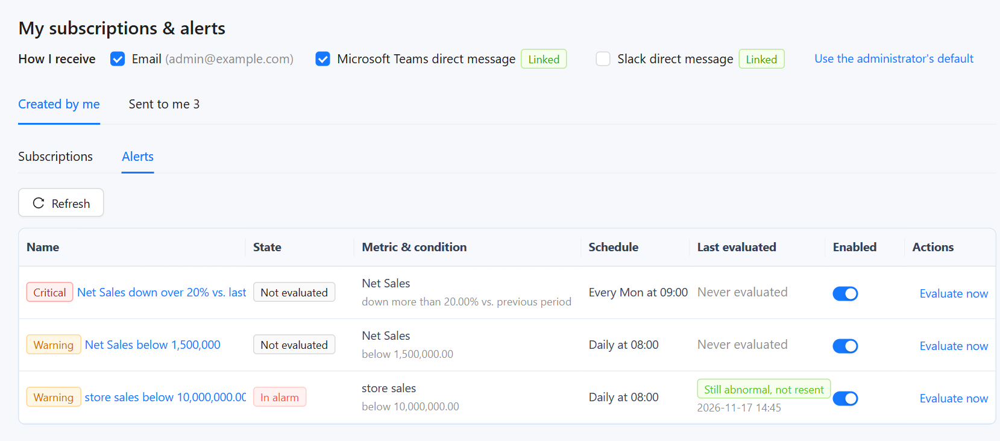
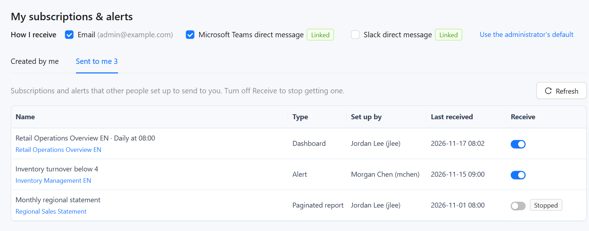
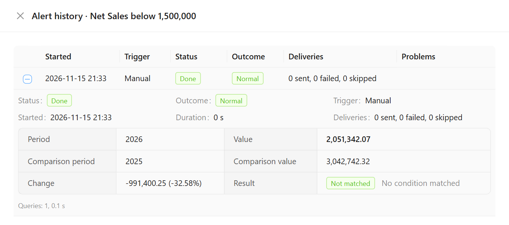

# Managing Your Subscriptions and Alerts

Open the profile menu (top right), choose **My account**, then **My subscriptions & alerts**. The page has **How I receive** at the top and two lists below it: **Created by me** and **Sent to me**. You also get here from **Manage all my subscriptions** in a report's **Subscribe** drawer, and from the link at the bottom of every message you receive.

On a phone the page shows cards instead of tables, so you can check a subscription or stop receiving it from the link in a message.

## How I receive

This decides how **you** receive every subscription, alert and paginated report subscription that names you, whoever created it.

- **Email** shows the address in your profile.
- Each IM app the administrator connected appears as a choice, such as **Microsoft Teams direct message** or **Slack direct message**, marked **Linked** or **Not linked**. You can only tick a linked one; click **Not linked** to open **Linked IM accounts**. Slack and Teams find you by the email address in your profile. For WeCom, DingTalk and Feishu, open Datafor once from the Datafor app in that IM and sign in when asked; the administrator's directory sync can also link you.
- Until you tick something yourself, you get the administrator's default, which is **Email only** unless it was changed. Once you have chosen, **Use the administrator's default** at the end of the line goes back.
- At least one way must stay ticked.
- If none of your chosen ways can reach you at send time, for example you ticked Slack only and the link was removed, the message is sent by email instead; without an email address, by any IM you are linked to.

Messages posted to channels are not affected by this setting.

## Created by me

### Subscriptions

The **Subscriptions** tab lists your dashboard subscriptions and your [paginated report subscriptions](/documentation/Paginated-Reports/Subscriptions/) in one table; paginated ones are tagged **Paginated**. Filter by type, report or last result. The report name under each subscription opens the report.

| Column or control | What it shows or does |
| --- | --- |
| **Recipients** | For example *2 people · 1 channels*; hover for the names. People who stopped receiving it are counted separately, as in *3 people (1 stopped receiving)*. |
| **Schedule** | The schedule and the next run |
| **Last result** | The result and time of the last run |
| **Enabled** | Pauses or resumes it. A paused one keeps its settings and history. |
| **Run now** | Sends it now to all its recipients and channels |
| **⋯ › Edit** | Opens the editor (dashboard subscriptions; paginated report subscriptions are edited in the paginated report viewer). Without the report open, the scope keeps its saved value. |
| **⋯ › Runs** | Opens the run history |
| **⋯ › Open report** | Opens the report |
| **⋯ › Delete** | Deletes it and its run history. Files already sent are not affected. |

### Alerts

The **State** column shows where each alert stands:

| State | Meaning |
| --- | --- |
| **Not evaluated** | Saved but not checked yet |
| **Normal** | The last check did not meet the condition |
| **In alarm** / **In alarm: 3 members** | The condition is met, overall or for that many members when the alert checks members separately |
| **Silenced until …** | Messages are held back until that time |
| **Evaluation failed** | The last check could not compute a result; see its run |
| **Disabled** | Switched off |

| Control | What it does |
| --- | --- |
| **Enabled** | Switches the alert on or off. |
| **Evaluate now** | Runs a check now and sends a message if the result calls for one. On a disabled alert, a message is sent to you only, so you can see what it would send. |
| **⋯ › Edit** | Opens the editor. |
| **⋯ › Runs** | Opens the alert history. |
| **⋯ › Silence 24 h** / **Unsilence** | Holds back messages for 24 hours for all recipients, or lifts the silence. Checks continue. |
| **⋯ › Delete** | Deletes the alert and its history. This cannot be undone. |

## Sent to me

**Sent to me** lists what other people set up and Datafor actually sent to you: dashboard subscriptions, alerts and paginated report subscriptions, with who set each one up, when you last received it, and a **Receive** switch. The number on the switch counts them. If you have created nothing yourself but receive something, the page opens on this list.

- An item appears after its first delivery to you, not when you are added as a recipient. It stays for the run retention period (90 days by default) after the last delivery, so after you are removed from the recipients it lingers for a while with an old **Last received** date.
- It counts no matter how you were included: by name, through a role, or from a paginated report's recipient list.
- Deleted subscriptions and alerts disappear from the list.

**Turn off Receive** to stop getting one. After you confirm, it is no longer rendered or sent to you, and the owner sees *1 stopped receiving* next to the recipients. Only you can turn it back on: the owner cannot, and removing you and adding you again does not either. Messages posted to group channels are not affected. This is different from **Silence 24 h** on an alert, which pauses it for everyone for a day.

Each email and IM direct message has a link at the bottom: **Manage what I receive** opens this list at that item, or **Manage this subscription or alert** when you are its owner. Both require signing in. There is no one-click unsubscribe without signing in.

## Run history

**Runs** lists each run, newest first, with when it started, whether it was **Schedule** or **Manual**, its status and how many deliveries were sent, failed or skipped. Expand a run for the details. Runs are kept for 90 days by default.

### Run results

A subscription run ends with one of three results, which answer one question: did the people who should get it get all of it?

| Result | Meaning | Owner gets an email |
| --- | --- | --- |
| **Done** | Everyone received it, complete. It may carry notices. | No |
| **Partial** | Someone did not receive it, or what was sent is incomplete (a component failed, an export was too large) | Yes |
| **Failed** | Nobody received it | Yes |

While a run is in progress its status is **Queued** or **Running**.

**Notices** are shown in grey and do not change the result: *Daily AI brief budget used up* (sent without a brief), *Daily attribution budget used up*, *Proactive tasks are off in the AI assistant; no attribution*, *No mobile layout; desktop layout used*, and *Recipient stopped receiving this*. A run where every recipient has stopped receiving ends **Done** with nothing delivered.

The details list each recipient and channel with:

- **Render**: **OK**, **Failed**, **Skipped**, or **Shared render with *name*** when the person has the same permissions as someone already rendered.
- **Delivery results**: each way the message was sent, such as **Email** or **Teams direct message**, **Delivered** or **Failed** with the reason, or **Skipped (no linked account)**.
- **Problems** and notices for that recipient. **Technical details**, collapsed, holds the raw message from the render service when there is one.

Below the list, **Generated files** links the screenshot, PDF and Excel files of the run until they expire.

**Alert runs** add an **Outcome**: **Normal**, **Entered alarm**, **Still in alarm**, **Recovered**, **Silenced** or **Cooldown** (see [How an alert decides to send](/documentation/Subscriptions-and-Alerts/Metric-Alerts/#how-an-alert-decides-to-send)). A reminder that was not due is shown as *Still abnormal, not resent*. Expanded, they show the evaluated period and value, the comparison, which conditions matched, the members when checked separately, and the status of the AI analysis.

The owner of an alert gets an email when a check fails, when a restricted alert is turned off because its chart changed, or when a message could not be delivered.

## Problems and what to do

| Problem shown | What it means | What to do |
| --- | --- | --- |
| *Recipient cannot read this report* | The person has no read permission on the report | Share the report with them, or remove them |
| *Recipient has no access to this analysis model* | Alerts: the person cannot use the model | Grant access to the model, or remove them |
| *No email address and no linked IM account* / *Recipient has no email address* / *Recipient has no linked IM account* | Nothing can reach the person | Add an email address to their user, or have them link an IM app |
| *Recipient not found* / *Recipient is disabled* | The user was deleted or disabled | Remove them |
| *Render service unreachable; no screenshot this time* | The render service was down; the message went out with the link only | Ask an administrator to start the render service |
| *Page did not finish loading in time; the screenshot may be incomplete* | The dashboard was still loading when the screenshot was taken | Run it again; if it keeps happening, check for slow components |
| *Page render timed out* / *Page render failed* / *A component query failed* | The dashboard did not finish loading for that recipient | Open the report as that person would and check the slow or failing component |
| *AI brief failed* | The message went out without the brief | See whether the AI service works; the next run tries again |
| *Attachment exceeds the size limit* | PDF and Excel exceeded the mail limit, so the email carries links instead | Nothing, or send fewer Excel tables or one tab instead of the whole page |
| *Temporary links are blocked* | DingTalk, Feishu or webhook messages went out without images and files | Ask an administrator to allow temporary links |
| *Channel delivery failed after retries* / *Channel rate limit* | The IM platform rejected the message or was too busy | Check the channel with **Test** under Delivery channels |
| *Previous run still in progress; this one was skipped* | The schedule is shorter than a run takes | Reduce recipients or outputs, or run less often |
| *Run was interrupted* | The server restarted during the run | Run it again |
| *The owner cannot read this report* | The report was deleted, or your access was removed. A renamed or moved report is followed automatically. | Restore your access, or recreate the subscription |
| *Owner is disabled* / *Owner no longer exists* | The owner's account was disabled or deleted | An administrator can [transfer](/documentation/Subscriptions-and-Alerts/Monitoring-and-Limits/#transfer-to-another-owner) it to someone else |
| *Alert query failed* / *Alert query timed out* | The measure or a filter no longer exists, or the model is slow | Edit the alert; the run shows the database or model message |
| *No data for the evaluated period* | The model has nothing for that period yet; conditions count as not met | Check the data load, choose **Latest *month* with data**, or add a **No new data for** condition |
| *No data for the comparison period (or it is 0)* | A change condition had nothing to compare with | Choose another period or comparison |
| *Too many members for per-member evaluation* | **Check separately** found more than 200 members; the rest were not checked | Add a filter, or check a coarser field |
| *Attribution timed out* / *Attribution failed* | The alert was sent without the AI breakdown | See whether the result arrived later in the run; otherwise ask an administrator |
| *The report or component changed, so the alert was turned off* | A restricted alert no longer matches its chart | Set it up again from the chart |

Administrators see failures that need them, such as the render service or a broken channel, on the [Overview tab](/documentation/Subscriptions-and-Alerts/Monitoring-and-Limits/#needs-attention).

## Related topics

- [Subscribing to a Dashboard](/documentation/Subscriptions-and-Alerts/Dashboard-Subscriptions/)
- [Metric Alerts](/documentation/Subscriptions-and-Alerts/Metric-Alerts/)
- [My Account](/documentation/Console/My-Account/)
