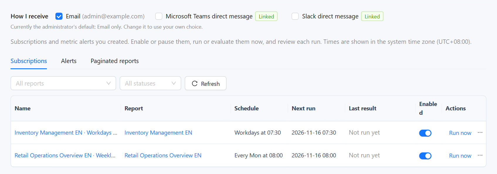

# Managing Your Subscriptions and Alerts

Open the profile menu (top right), choose **My account**, then **Subscriptions & alerts**. The page has two parts: **How I receive** at the top, and the lists of what you created below.

## How I receive

This decides how **you** receive every subscription, alert and paginated report subscription that names you, whoever created it.

- **Email** shows the address in your profile.
- Each IM app the administrator connected appears as a choice, such as **Microsoft Teams direct message** or **Slack direct message**, with **Linked** or **Not linked**. You can only tick a linked one. Slack and Teams find you by the email address in your profile. For WeCom, DingTalk and Feishu, open Datafor once from the Datafor app in that IM and sign in when asked; the administrator's directory sync can also link you. Your links are listed under **My account › Linked IM accounts**.
- Until you tick something yourself, the line under the choices reads *Currently the administrator's default: Email only* (or the default your administrator set). Ticking a box makes it your own choice; **Use the administrator's default** goes back.
- At least one way must stay ticked.
- If none of your chosen ways can reach you at send time, for example you ticked Slack only and the link was removed, the message is sent by email instead; without an email address, by any IM you are linked to.

Messages posted to channels are not affected by this setting.

## Your subscriptions

The **Subscriptions** tab lists the dashboard subscriptions you own. Filter by report or by last result. The name opens the editor; the report name opens the report.

| Control | What it does |
| --- | --- |
| **Enabled** | Pauses or resumes the subscription. A paused one keeps its settings and history. |
| **Run now** | Sends it now to all its recipients and channels. The result appears under **Last result** when the run ends. |
| **⋯ › Edit** | Opens the editor. Without the report open, the scope and the components to capture keep their saved values. |
| **⋯ › Runs** | Opens the run history. |
| **⋯ › Delete** | Deletes the subscription and its run history. Files already sent are not affected. |

The **Paginated reports** tab lists your [paginated report subscriptions](/documentation/Paginated-Reports/Subscriptions/) with their schedule and last result. You can run them now, switch them off, see their runs or open the report; editing happens in the paginated report viewer.

## Your alerts

The **State** column shows where each alert stands:

| State | Meaning |
| --- | --- |
| **Not evaluated** | Saved but not checked yet |
| **Normal** | The last check did not meet the condition |
| **In alarm** / **In alarm: 3 members** | The condition is met, overall or for that many members when the alert checks members separately |
| **Silenced until …** | Messages are held back until that time |
| **Evaluation failed** | The last check could not compute a result; see its run |
| **Disabled** | Switched off |

| Control | What it does |
| --- | --- |
| **Enabled** | Switches the alert on or off. |
| **Evaluate now** | Runs a check now and sends a message if the result calls for one. On a disabled alert, a message is sent to you only, so you can see what it would send. |
| **⋯ › Edit** | Opens the editor. |
| **⋯ › Runs** | Opens the alert history. |
| **⋯ › Silence 24 h** / **Unsilence** | Holds back messages for 24 hours, or lifts the silence. Checks continue. |
| **⋯ › Delete** | Deletes the alert and its history. This cannot be undone. |

## Run history

**Runs** lists each run, newest first, with when it started, whether it was **Schedule** or **Manual**, its status and how many deliveries were sent, failed or skipped. Expand a run for the details. Runs are kept for 90 days by default.

**Subscription runs** have the status **Queued**, **Running**, **Done**, **Partial** (some deliveries failed or some recipients were skipped) or **Failed**. The details list each recipient and channel with:

- **Render**: **OK**, **Failed**, **Skipped**, or **Shared render with *name*** when the person has the same permissions as someone already rendered.
- **Delivery results**: each way the message was sent, **Delivered** or **Failed** with the reason, or **Skipped (no linked account)**.
- **Problems** for that recipient.

Below the list, **Generated files** links the screenshot, PDF and Excel files of the run until they expire.

**Alert runs** add an **Outcome**: **Normal**, **Entered alarm**, **Still in alarm**, **Recovered**, **Silenced** or **Cooldown** (see [How an alert decides to send](/documentation/Subscriptions-and-Alerts/Metric-Alerts/#how-an-alert-decides-to-send)). Expanded, they show the evaluated period and value, the comparison, which conditions matched, the members when checked separately, and the status of the AI analysis.

When a run ends **Partial** or **Failed**, or an alert check fails, the owner receives an email listing the problems.

## Problems and what to do

| Problem shown | What it means | What to do |
| --- | --- | --- |
| *Recipient cannot read this report* | The person has no read permission on the report | Share the report with them, or remove them |
| *Recipient has no access to this analysis model* | Alerts: the person cannot use the model | Grant access to the model, or remove them |
| *No email address and no linked IM account* / *Recipient has no email address* | Nothing can reach the person | Add an email address to their user, or have them link an IM app |
| *Recipient not found* / *Recipient is disabled* | The user was deleted or disabled | Remove them |
| *Render service unreachable; no screenshot this time* | The render service was down; the message went out with the link only | Ask an administrator to start the render service |
| *Page render timed out* / *Page render failed* / *A component query failed* | The dashboard did not finish loading for that recipient | Open the report as that person would and check the slow or failing component |
| *Daily AI brief budget used up* / *AI brief failed* | The message went out without the brief | Wait for the next day, or ask an administrator to raise the budget |
| *Attachment exceeds the size limit* | PDF and Excel exceeded the mail limit, so the email carries links instead | Nothing, or send fewer Excel tables or one tab instead of the whole page |
| *Temporary links are blocked* | DingTalk, Feishu or webhook messages went out without images and files | Ask an administrator to allow temporary links |
| *Channel delivery failed after retries* / *Channel rate limit* | The IM platform rejected the message or was too busy | Check the channel with **Test** under Delivery channels |
| *Previous run still in progress; this one was skipped* | The schedule is shorter than a run takes | Reduce recipients or outputs, or run less often |
| *Run was interrupted* | The server restarted during the run | Run it again |
| *The owner cannot read this report* | The report was deleted or moved, or your access was removed | Recreate the subscription on the report's new location |
| *Alert query failed* / *Alert query timed out* | The measure or a filter no longer exists, or the model is slow | Edit the alert; the run shows the database or model message |
| *No data for the evaluated period* | The model has nothing for that period yet; conditions count as not met | Check the data load, or add a **No new data for** condition |
| *No data for the comparison period (or it is 0)* | A change condition had nothing to compare with | Choose another period or comparison |
| *Too many members for per-member evaluation* | **Check separately** found more than 200 members; the rest were not checked | Add a filter, or check a coarser field |
| *Attribution timed out* / *Attribution failed* / *Daily attribution budget used up* / *Proactive tasks are off* | The alert was sent without the AI breakdown | See whether the result arrived later in the run; otherwise ask an administrator |
| *The report or component changed, so the alert was turned off* | A restricted alert no longer matches its chart | Set it up again from the chart |

## Related topics

- [Subscribing to a Dashboard](/documentation/Subscriptions-and-Alerts/Dashboard-Subscriptions/)
- [Metric Alerts](/documentation/Subscriptions-and-Alerts/Metric-Alerts/)
- [My Account](/documentation/Console/My-Account/)
