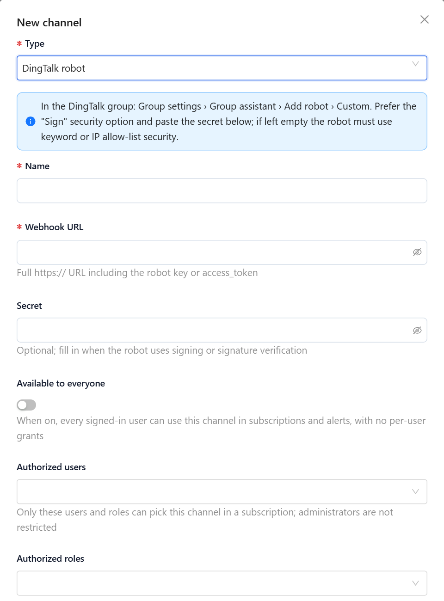
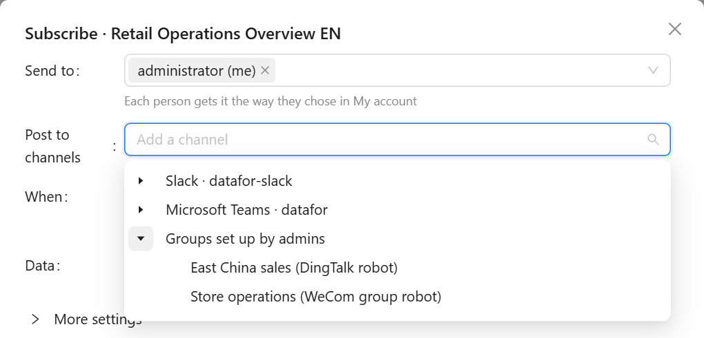
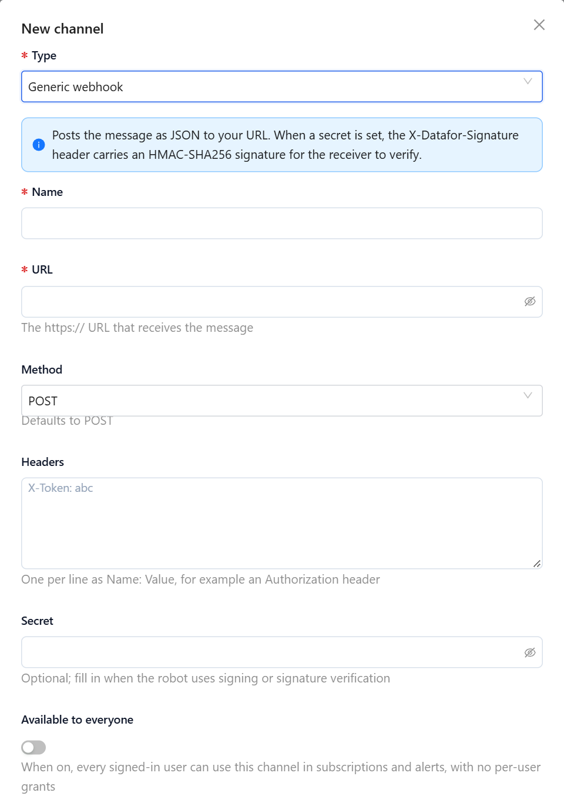

# Delivery Channels

This page is for administrators. A **delivery channel** is a destination you set up once under **Settings › Notifications › Delivery channels**; subscriptions, metric alerts and paginated report subscriptions then send to it. There are two kinds:

- **Group channels** post one shared message into a group or another system: **WeCom group robot**, **DingTalk robot**, **Feishu robot**, **Teams Webhook**, **Slack Webhook** and **Generic webhook**. Users pick them under **Post to channels › Groups set up by admins**.
- **Direct-message channels** send each person their own message through an IM app: **Slack direct message**, **Teams direct message**, **WeCom app message**, **DingTalk app message** and **Feishu app message**. People choose them under **How I receive**.

Slack and Teams channels reached through an IM app are not delivery channels: users pick them directly in **Post to channels**, see [IM Platforms](/documentation/System/IM-Platforms/).

## Which one to use

| You want to | Use |
| --- | --- |
| Post to a WeCom, DingTalk or Feishu group | That group's robot. No app is needed; add one robot per group. |
| Post to a Slack or Teams channel | If a Slack or Teams app is set up under **IM platforms**, nothing here: pick the channel in the editor. Screenshots and files then arrive without Datafor needing a public address. Otherwise a **Slack Webhook** or **Teams Webhook** per channel. |
| Send each person a direct message | An IM app under **IM platforms**, plus its direct-message channel (see [Direct-message channels](#direct-message-channels)) |
| Feed another system, such as a ticketing tool or a message bus | A **Generic webhook** |

## What a group receives

| Channel | Message | Screenshot | PDF and Excel | Open report |
| --- | --- | --- | --- | --- |
| **WeCom group robot** | Markdown text, cut at 4,096 bytes | A separate image message, compressed to fit 2 MB | Separate file messages, up to 20 MB each; larger files are left out | Link in the text |
| **DingTalk robot** | Action card with the text | In the card, from a temporary link | Links in the card | Button |
| **Feishu robot** | Card with the subject as title and the text | **View screenshot** button, a temporary link | One button per file | Button |
| **Teams Webhook** | Adaptive card with the text and figures | In the card, from a temporary link | Links | Button |
| **Slack Webhook** | Message with the text and figures | In the message, from a temporary link | Links | Button |
| **Generic webhook** | JSON, see [Generic webhook](#generic-webhook) | Link in `assets` | Links in `assets` | `report.link` |

Temporary links are signed, work without signing in and expire after 7 days by default. The platform's servers fetch the images, so the links must be reachable from the internet, through **Site address**. When temporary links are turned off or blocked, these channels receive the text and the **Open report** link only. See [Temporary links](/documentation/Subscriptions-and-Alerts/Setting-Up-Delivery/#temporary-links). A WeCom group robot uploads the image and files itself and needs no public address.

## Add a channel

1. Create the robot or webhook on the platform, as described for each type below, and copy its URL (and secret).
2. Go to **Settings › Notifications › Delivery channels** and click **New channel**.
3. Choose the **Type**. The dialog shows where the URL comes from.
4. Enter a **Name**. Users see it under **Post to channels** and in run results, so name it after the group, for example *East China sales*. The editor adds the type, as in *East China sales (DingTalk robot)*.
5. Paste the **Webhook URL**, and the **Secret** when the platform gives you one.
6. Decide [who may use the channel](#who-can-post-to-a-group-channel).
7. Leave **Enabled** on and click **Save**, then click **Test** on the row. The group should receive *This is a test message from the Datafor delivery channel "Name".*



Users who may post to the channel then find it in the subscription and alert editors, under **Post to channels › Groups set up by admins**:



Datafor checks only the form of the URL when you save:

| Type | The URL must start with |
| --- | --- |
| WeCom group robot | `https://qyapi.weixin.qq.com/cgi-bin/webhook/send?key=` |
| DingTalk robot | `https://oapi.dingtalk.com/robot/send?access_token=` |
| Feishu robot | `https://open.feishu.cn/open-apis/bot/v2/hook/`, or `https://open.larksuite.com/open-apis/bot/v2/hook/` for Lark |
| Teams Webhook | `https://` on `*.logic.azure.com`, `*.powerautomate.com`, `*.webhook.office.com` or `flow.microsoft.com` |
| Slack Webhook | `https://hooks.slack.com/` |
| Generic webhook | `http://` or `https://` |

The URL is the credential: anyone who has it can post to the group. It is stored encrypted and shown masked; when you edit a channel, leave a masked field unchanged to keep its value.

## WeCom group robot

1. In the WeCom group (desktop app), open the group settings, choose **Group robots**, then **Add robot** and create a new robot.
2. Copy its **Webhook** address.
3. In Datafor, choose **WeCom group robot** and paste it into **Webhook URL**. There is no secret.

A WeCom robot accepts about 20 messages a minute. One subscription run sends up to three kinds of message to the group: the text, the screenshot, and one message per file.

## DingTalk robot

1. In the DingTalk group, open **Group settings › Group assistant › Add robot**, and choose **Custom** (the robot added by webhook).
2. Choose a security setting:
   - **Sign** (recommended). Copy the secret, which starts with `SEC`, into **Secret**. Datafor signs every message with it.
   - **Custom keywords.** DingTalk rejects any message that does not contain one of the keywords. The test message always contains *Datafor*, but subscription and alert messages contain only what the message templates produce. Add the keyword to the message body of both templates under **Settings › Notifications › Subscriptions & alerts › Settings › Message templates**, or **Test** succeeds while real deliveries fail.
   - **IP address range.** Enter the public address from which the Datafor server reaches the internet.
3. Copy the **Webhook** address and finish.
4. In Datafor, choose **DingTalk robot**, paste the webhook into **Webhook URL** and, for **Sign**, the secret into **Secret**.

A DingTalk robot accepts 20 messages a minute; when exceeded, DingTalk refuses its messages for a while. Datafor sends at most 18 a minute per channel.

## Feishu robot

1. In the Feishu group, open **Settings › Group bots › Add bot** and choose **Custom bot**.
2. Copy the webhook address.
3. Choose a security setting: **Signature verification** (recommended; copy the secret into **Secret**), **Custom keywords** (same caution as for DingTalk), or an **IP whitelist** with the Datafor server's public outgoing address.
4. In Datafor, choose **Feishu robot**, paste the webhook and, with signature verification, the secret.

Feishu checks the signature against the time it was made, so the Datafor server's clock must be correct.

## Teams Webhook

Use this only when no Teams app is set up under **IM platforms**; with an app, users pick Teams channels directly and the screenshot needs no public address.

1. In Teams, open the channel, choose **⋯ › Workflows**, and pick the template **Post to a channel when a webhook request is received**.
2. Name the workflow, confirm the team and channel, and click **Add workflow**.
3. Copy the URL it shows.
4. In Datafor, choose **Teams Webhook** and paste the URL.

URLs of the old Office 365 *Incoming Webhook* connector, which Microsoft has retired, do not work; create a workflow instead. Treat the workflow URL as a password.

## Slack Webhook

Use this only when no Slack app is set up under **IM platforms**; with an app, users pick Slack channels directly, and screenshots and files are uploaded.

1. At `api.slack.com/apps`, create an app for your workspace (or open an existing one) and open **Incoming Webhooks**.
2. Turn on **Activate Incoming Webhooks**, click **Add New Webhook to Workspace**, pick the channel and allow it.
3. Copy the `https://hooks.slack.com/…` URL. Each URL posts to one channel.
4. In Datafor, choose **Slack Webhook** and paste the URL.

## Generic webhook



| Field | Use |
| --- | --- |
| **URL** | Your endpoint, `http://` or `https://` |
| **Method** | Leave it at **POST**; messages are sent as `POST`. |
| **Headers** | Extra request headers, one `Name: Value` per line, for example `Authorization: Bearer …` |
| **Secret** | Optional. With a secret, the `X-Datafor-Signature` header carries `sha256=` followed by the hex HMAC-SHA256 of the raw request body, keyed with the secret. Verify it before trusting the message. |

The body is JSON with `Content-Type: application/json`. A subscription delivery looks like this:

```json
{
  "event": "subscription.delivered",
  "sentAt": "2026-11-16T00:00:05Z",
  "subscription": { "id": "sub_01…", "name": "Retail Operations Overview EN · Weekly on Mon at 08:00", "owner": "admin" },
  "report": { "path": "/public/demo/Retail Operations Overview EN.datafor", "title": "Retail Operations Overview EN", "link": "https://bi.example.com/datafor/…" },
  "recipient": { "kind": "channel" },
  "filters": { "Region": "East China", "Year": "2026" },
  "summary": [ { "title": "Net Sales", "formatted": "5.09M" } ],
  "insight": { "level": "standard", "markdown": "…" },
  "assets": [ { "kind": "png", "label": "View screenshot", "url": "https://…", "bytes": 482113, "expiresAt": "2026-11-23T00:00:05Z" } ],
  "runId": "run_01…"
}
```

An alert sends `"event": "alert.fired"` or `"alert.recovered"` with `alert` (`id`, `name`, `owner`, `severity`, `metric`), `outcome`, `evaluation` (period, value, comparison, matched conditions, members), `filters`, `condition`, and the AI analysis when there is one. **Test** sends `"event": "channel.test"` with a `message`. Read the event from the body's `event` field.

Answer with any 2xx status. Other answers count as failures; 5xx and 429 are retried as described [below](#test-health-and-failures). Datafor waits 10 seconds for an answer.

## Direct-message channels

- **Slack and Teams.** Saving a Slack or Teams app under **IM platforms** creates its **Slack direct message** or **Teams direct message** channel; there is nothing to add here.
- **WeCom, DingTalk and Feishu.** Click **New channel**, choose **WeCom app message**, **DingTalk app message** or **Feishu app message**, and pick the **IM app**. The list is empty until an app for that platform exists under **IM platforms**.

Every user then sees the channel under **My account › Subscriptions & alerts › How I receive**, marked **Linked** or **Not linked**. A person receives direct messages only once their account is linked to the app; see [How people get linked](/documentation/System/IM-Platforms/#how-people-get-linked). The default for people who never chose is set by **Default delivery**, see [Setting Up Delivery](/documentation/Subscriptions-and-Alerts/Setting-Up-Delivery/#defaults-for-everyone). The availability settings below apply only to group channels.

## Who can post to a group channel

- **Available to everyone**: every signed-in user who can create subscriptions or alerts sees the channel under **Post to channels**.
- Otherwise, only the **Authorized users** and the members of the **Authorized roles**. With nobody authorized, the **Authorized to** column shows *Nobody authorized* and only administrators can use the channel.
- Administrators can always use every channel. Readers never see group channels: they can only subscribe for themselves.

Authorize with care: a message posted to a group is rendered with the permissions of the person who created the subscription or alert, and everyone in the group reads it.

## Test, health and failures


- **Test** sends the test message and shows the result, with the platform's own error text when it fails. It does not change **Last delivery**.
- **Last delivery** shows whether the most recent real message went through, and when; a failure shows the error, in full when you hover it.
- **Retries.** A delivery that fails for a reason that may pass (timeout, platform busy, rate limit) is retried twice, after 10 seconds and after 1 minute. Errors such as a wrong signature are not retried.
- **Repeated failures.** After 3 failed deliveries in a row, the row shows a **×3** tag (*Failed 3 times in a row; no longer retried*): each delivery is then tried once, without retries, until one succeeds. Fix the channel and run **Test**, then run an affected subscription.
- **Rate limit.** Datafor sends at most 18 messages a minute to each channel and queues the rest. A message that waits more than 2 minutes fails with *Channel rate limit; queued too long*. Spread subscriptions that post to the same group over different times.
- **Turning a channel off** with **Enabled** stops all messages to it; runs record *Channel missing or disabled* for that destination.
- **Deleting** is refused while subscriptions or alerts still post to the channel; the message says how many. Remove the channel from them first.

The built-in **Email** channel uses the mail server and cannot be deleted.

## Troubleshooting

| Test or run shows | Cause | What to do |
| --- | --- | --- |
| The URL is refused when you save | It does not start with the platform's address (see the table under [Add a channel](#add-a-channel)) | Copy the complete webhook address again |
| *The endpoint did not respond in time*, *Connecting to the endpoint timed out*, *The endpoint refused the connection* | The Datafor server cannot reach the platform | Allow outgoing HTTPS from the server to the platform, or configure the proxy |
| DingTalk or Feishu error mentioning the **sign** or **signature** | The secret is wrong or missing, or the server clock is off | Paste the secret again; check the server time |
| DingTalk or Feishu error mentioning **keywords** | Keyword security is on and the message lacks the keyword | Add the keyword to the message templates, or switch the robot to signing |
| DingTalk or Feishu error mentioning the **IP** or **whitelist** | The robot accepts only listed addresses | Add the server's public outgoing address to the robot |
| WeCom error about an invalid webhook | The robot was removed from the group, or the key changed | Create the robot again and update the URL |
| The message arrives without the screenshot (DingTalk, Feishu, Teams Webhook, Slack Webhook) | Temporary links are off or blocked, or the site address is not reachable from the internet | Check **Temporary links** on the **Overview** tab and the site address |
| The screenshot or file link answers *link expired or invalid* | The link is older than **Link validity** | Open the report instead, or raise **Link validity** (at most 30 days) |
| *Channel rate limit; queued too long* | Too many messages to one group at the same time | Spread the schedules |
| *Channel missing or disabled* | The channel was turned off or deleted | Turn it on, or remove it from the subscription |

## Example: a dashboard in a DingTalk group every morning

1. In the DingTalk group *East China sales*, add a custom robot named *Datafor* with **Sign**, and copy the webhook and the secret.
2. Under **Delivery channels**, click **New channel**, choose **DingTalk robot**, name it *East China sales*, paste the webhook and the secret, and add the role *East China managers* to **Authorized roles**. Save, then **Test**: the group shows the test message.
3. On the **Overview** tab of **Subscriptions & alerts**, check that **Temporary links** is **Available**, so the screenshot shows in the card.
4. A member of *East China managers* opens the dashboard, sets **Region** to *East China*, clicks **Subscribe**, adds *East China sales (DingTalk robot)* under **Post to channels › Groups set up by admins**, sets **When** to **Workdays** at 08:00 and saves.
5. To see the result without waiting, they click **Run now** in the subscription list. **Send me a test** does not post to channels.

The group's card shows the dashboard as that member sees it, because channel messages use the creator's permissions.

## Related topics

- [Setting Up Delivery](/documentation/Subscriptions-and-Alerts/Setting-Up-Delivery/)
- [IM Platforms](/documentation/System/IM-Platforms/)
- [Subscribing to a Dashboard](/documentation/Subscriptions-and-Alerts/Dashboard-Subscriptions/)
