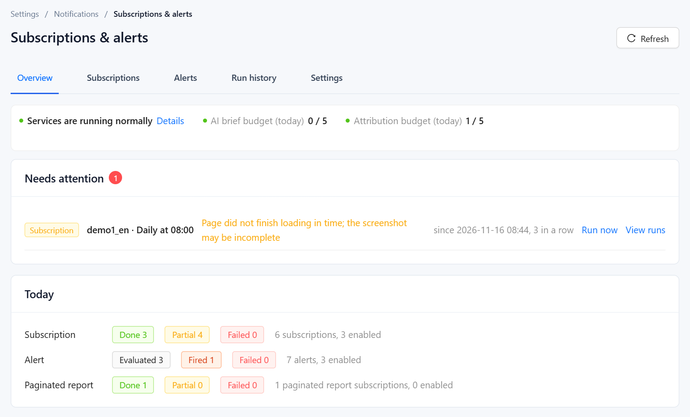
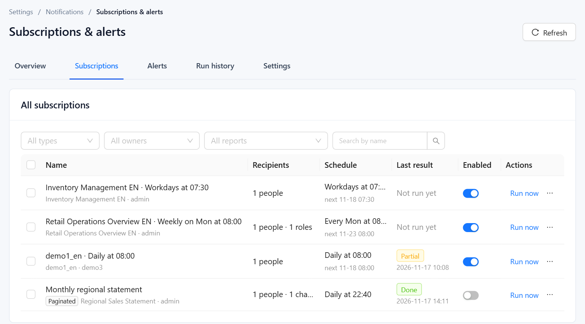
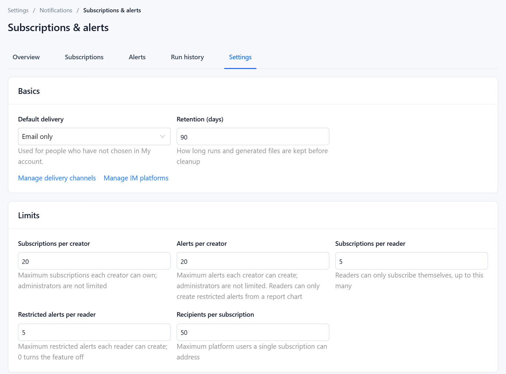

# Monitoring and Limits

This page is for administrators. **Settings › Notifications › Subscriptions & alerts** covers everyone's dashboard subscriptions, metric alerts and paginated report subscriptions. It has five tabs, **Overview**, **Subscriptions**, **Alerts**, **Run history** and **Settings**; the tab is part of the address (`#/settings/notify-ops?tab=alerts`), so a reload or the browser's Back button keeps it.

## Overview tab

### Status line

When everything works, it reads **Services are running normally**; **Details** shows the **Render service** (queue and 95th-percentile render time), **Temporary links** and **Scheduler**. A failing item is listed on its own in red with what to do, for example *The scheduler is not running: scheduled subscriptions and alerts will not run. Check pentaho.log and restart the server.*

**AI brief budget (today)** and **Attribution budget (today)** show today's use, such as *3 / 200*; they turn orange at 80% and red when used up, and read **Off** when the budget is 0.

### Needs attention

The number next to the title counts only what an administrator has to fix. A subscription or alert is listed when its latest run failed or ended **Partial** for a reason the owner cannot fix:

| Reason | What the item offers |
| --- | --- |
| Render service unreachable, page render timed out or failed, page did not finish loading, run timed out or was interrupted | **Run now** once the cause is fixed |
| Channel delivery failed, channel missing, channel rate limit | **Go to Delivery channels** |
| Temporary links are blocked | **Go to Site address**, see [Temporary links](/documentation/Subscriptions-and-Alerts/Setting-Up-Delivery/#temporary-links) |
| AI brief or attribution failed | **Go to AI service** |
| Recipient has no email address | **Go to Users** |
| The owner is disabled or no longer exists, while the subscription or alert is still enabled | **Transfer** to someone else, or **Turn off** |

Items with the same reason are grouped under one heading with the number affected, so a stopped render service shows up once, not once per subscription. Each item shows since when and how many runs in a row, and **View runs** opens its history. **Run now** asks for confirmation first and says how many people and channels will receive it. **Evaluate now** on an alert does not ask, since it only sends when the condition is met.

Failures the owner can fix, such as a recipient without access to the report, a component or alert query that fails after a model change, or an export that is too large, are not counted. The owner already got an email about them. They are summed up in one line below, *2 more did not succeed for business reasons; their owners have been notified*, and **View** lists them with **Open report** and **View runs**. One of them moves up into **Needs attention** when:

- it failed 5 times in a row or for 7 days: *The owner has not dealt with it*, with **Transfer** and **Turn off**;
- its owner has no email address: *The owner has no email address and cannot be notified*;
- 3 or more owners' items failed for the same reason within 24 hours: *Several failed at once; likely a shared cause*, usually a data source or model problem.

An item leaves the list when a later run succeeds. Disabled subscriptions and alerts are never listed, and ones that only run manually drop off 7 days after their last run. Runs that ended **Done** with only notices, such as an AI budget used up, are not problems; see [Run results](/documentation/Subscriptions-and-Alerts/Managing-Subscriptions-and-Alerts/#run-results).

### Today

Today's runs by result, for subscriptions, alerts and paginated reports. Click a number to open **Run history** filtered to it.

## Subscriptions and Alerts tabs

**Subscriptions** lists dashboard subscriptions and paginated report subscriptions together; paginated ones are tagged **Paginated** under their name. Filter by type, owner and report, or search by name. **Alerts** has the same layout, with a model filter, the metric and condition, and the **State** of each alert; when the last evaluation failed, the state is greyed out and marked as possibly out of date.

**Recipients** summarizes who receives it, such as *2 people · 1 channels*, *List of 12* or *SQL list* for paginated reports, or *Saved to folder only*. Hover to see the names. People who [stopped receiving](/documentation/Subscriptions-and-Alerts/Managing-Subscriptions-and-Alerts/#sent-to-me) are counted separately: *3 people (1 stopped receiving)*.

Row actions:

| Action | What it does |
| --- | --- |
| **Enabled** | Pauses or resumes it |
| **Run now** / **Evaluate now** | Runs it now, after a confirmation for subscriptions |
| **⋯ › Runs** | Its run history |
| **⋯ › Open report** | Opens the report (paginated report subscriptions are edited there, in the viewer) |
| **⋯ › Edit** | Opens the editor. Saving checks the report or model against the owner's permissions, not yours, and recipients who could not see the data are listed as usual. When the owner is a Reader, **Send to** stays fixed to the owner and no channels can be added. |
| **⋯ › Transfer** | Gives it to another user, see below |
| **⋯ › Delete** | Deletes it and its run history after a confirmation that names the owner |

Tick several rows to **Turn off** or **Transfer** them at once.

### Transfer to another owner

Use it when someone leaves or changes role: filter by owner, tick all, **Transfer**, pick the new owner. The new owner manages it from now on, and it runs with their permissions: channel messages and alerts show their data.

- The new owner must be able to read the report (for alerts, use the model) and must not already have one with the same name. Reader users cannot take over. Items that cannot be transferred stay in the dialog with the reason, so you can pick someone else for them.
- Quotas are not checked.
- Both the previous and the new owner are notified, and the transfer is recorded in the [Audit Log](/documentation/System/Audit-Log/).

## Run history tab

All runs of all three kinds in one list, newest first: type, **Schedule** or **Manual**, name, report and owner, the result (for example *Done · 3 delivered* or *Not sent · Still in alarm*) and the time. Filter by type, status, date, object or owner. Click a name to see only that object's runs with their details, described in [Run history](/documentation/Subscriptions-and-Alerts/Managing-Subscriptions-and-Alerts/#run-history). Runs are kept for the retention period below.

## Settings tab

Settings take effect without a restart. One **Save** at the bottom saves the whole tab.

**Basics**: **Default delivery** (see [Defaults for everyone](/documentation/Subscriptions-and-Alerts/Setting-Up-Delivery/#defaults-for-everyone)) and **Retention (days)**: how long runs and generated files are kept, 90 by default. Cleanup runs every day at 03:00.

**Limits** and **Daily AI limits**:

| Setting | Default | Notes |
| --- | --- | --- |
| **Subscriptions per creator** | 20 | Administrators are not limited |
| **Alerts per creator** | 20 | Administrators are not limited |
| **Subscriptions per reader** | 5 | Readers can only subscribe themselves |
| **Restricted alerts per reader** | 5 | 0 turns restricted alerts off |
| **Recipients per subscription** | 50 | People, after roles are expanded |
| **Daily AI brief budget** | 200 | AI briefs per day for the whole site. 0 turns briefs off and removes the option from the editor. Once the budget is used up, the day's remaining runs go out without a brief. |
| **Daily attributions** | 50 | AI analyses of alerts per day for the whole site; 0 turns them off |

The AI brief and the alert analysis do not count against anyone's personal AI quota; these two budgets limit them instead. See also [AI Operations and Quotas](/documentation/AI-Agent/AI-Operations-and-Quotas/).

**Message templates**: see [Message templates](/documentation/Subscriptions-and-Alerts/Setting-Up-Delivery/#message-templates).

**Advanced** (collapsed):

| Setting or action | Effect |
| --- | --- |
| **Allow images and files in IM messages**, **Link validity (days)** | Temporary links for DingTalk and Feishu robots and webhooks, see [Temporary links](/documentation/Subscriptions-and-Alerts/Setting-Up-Delivery/#temporary-links) |
| **Clean up now** | Deletes runs and files older than the retention period immediately |
| **Rotate system token secret** | Regenerates the key the plugin uses to open reports as each recipient. Runs in progress may fail, so do it when nothing is running. |

The system time zone that schedules use is set in [System Configuration](/documentation/System/System-Configuration/#time-zone).

## Other limits

The plugin's `settings.xml`, in `pentaho-solutions/system/datafor-notify/`, holds the remaining limits. Changes need a restart.

| Key | Default | Meaning |
| --- | --- | --- |
| `run-concurrency` | 2 | Subscriptions running at the same time |
| `run-timeout-minutes` | 10 | Time for one run, all recipients included |
| `render-concurrency` | 2 | Pages sent to the render service at the same time |
| `render-timeout-seconds` | 120 | Time for one page to render |
| `insight-timeout-seconds` | 150 | Extra time allowed for the AI brief |
| `merge-renders` | true | Recipients with the same permissions share one render; reports whose data depends on who is signed in are still rendered per person. `false` renders once per recipient. |
| `mail-attachment-max-mb` | 25 | Above this, emails carry links instead of attachments |
| `im-file-max-mb` | 20 | Largest file uploaded to an IM |
| `asset-link-max-days` | 30 | Longest **Link validity** an administrator can set |
| `alert-eval-concurrency` | 2 | Alerts evaluated at the same time |
| `alert-query-timeout-seconds` | 60 | Time for one alert query |
| `alert-max-members` | 200 | Members checked by **Check separately** |
| `attribution-timeout-seconds` | 180 | How long an alert waits for its AI analysis |
| `webhook-timeout-seconds` | 10 | Timeout for robot and webhook calls |
| `channel-rate-per-minute` | 18 | Messages per minute per robot |
| `render-url` | `http://127.0.0.1:38082` | Address of the render service |
| `public-base-url` | empty | Prefix for links in messages; empty means **Site address** |
| `output-dir` | empty | Where definitions, runs and files are stored; empty means `pentaho-solutions/system/datafor-notify-output` |

Subscription and alert definitions, runs and generated files are plain files under the output directory, one folder per tenant. Make sure your server backups include that folder.

## Audit log

Changes to subscriptions, alerts, delivery channels and these settings, transfers, people stopping or resuming receiving, silencing and token rotation are recorded in the [Audit Log](/documentation/System/Audit-Log/) under **Subscriptions & alerts**. **Run subscription** and **Run alert** are recorded once per run, when it ends, as scheduled tasks: every subscription run, and alert checks that sent something or failed. The audit record carries the run number, the result and how many recipients were reached; who received what by which route stays in the run history.

## Related topics

- [Setting Up Delivery](/documentation/Subscriptions-and-Alerts/Setting-Up-Delivery/)
- [Managing Your Subscriptions and Alerts](/documentation/Subscriptions-and-Alerts/Managing-Subscriptions-and-Alerts/)
