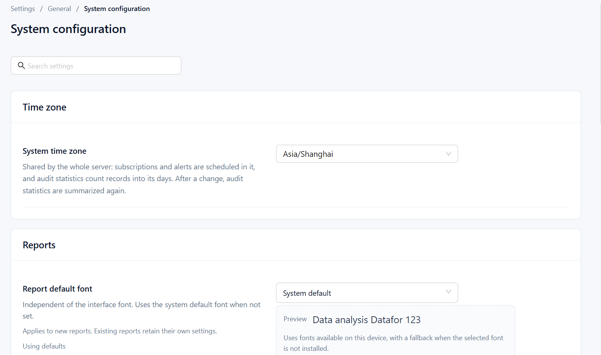

# System Configuration

**Settings › General › System configuration** holds the time zone and tenant-wide defaults. Only administrators see it.

## Time zone

The time zone decides, for a tenant:

- when subscriptions, alerts and paginated report subscriptions run, and what *today*, *last month* or *this year* mean in their filters and alert periods, message dates and file names;
- for IM apps, the dates of questions asked without a user time zone, silence times and the directory sync schedule;
- which day each record is counted in on the [Audit Log](/documentation/System/Audit-Log/#overview-tab) dashboards.

There are two levels. In the default tenant the row is called **Platform time zone**: it is the zone of every tenant that has not set its own. In any other tenant the row is **System time zone**, and its first option, **Same as platform (*zone*)**, keeps the tenant on the platform zone and follows it when it changes.

| | Default tenant | Other tenants |
| --- | --- | --- |
| Row title | **Platform time zone** | **System time zone** |
| Default | **Same as server (*zone*)**: the zone of the Datafor server's operating system | **Same as platform (*zone*)** |
| Who can change it | Platform administrators (*Only platform administrators can change it.*) | Administrators of that tenant (*Only administrators of this tenant can change it.*) |
| A change affects | The platform zone and every tenant that follows it | Only this tenant |

Pick the zone your business days are counted in. Only region names such as *Asia/Shanghai*, *Europe/Berlin* or *America/New_York*, and *UTC*, are offered: they carry daylight saving rules, which a fixed offset such as UTC+08:00 does not. Type in the list to search; the search matches the text shown, so typing *Same* finds the follow option again after you picked a zone.

The row has its own **Save** button, which appears once you change the value. After a change, the next run times of the affected tenants' subscriptions and alerts are rearranged within about 30 seconds, and their audit statistics are summarized again, which can take a while on a large log. Other tenants are not touched. A change is recorded in the audit log as **Edit system settings**.

## Settings

Some settings only seed **new** reports or models; others apply to **all** reports after they are reopened.

| Group | Setting | Default | Applies to |
| --- | --- | --- | --- |
| **Reports** | **Report default font** | System default | New reports. Independent of the interface font. |
| | **Default color scheme**: Default, Classic, Color-blind friendly, Pastel, Paired, Dark | Default | New reports |
| | **Default tooltip style**: Dark, Light | Dark | New reports |
| | **Empty data message**: **Show** and **Text** (up to 100 characters) | Show on, text empty | All reports and components without their own empty-data setting, after they are reopened. Empty text shows *No data* in each viewer's language. |
| **Modeling** | **Default measure format**: **Number** (`#,##0`, `#,##0.0`, `#,##0.00`) and **Percentage** (`0%`, `0.0%`, `#,##0.00%`) | `#,##0.00` and `#,##0.00%` | New measures, after reopening the modeler. **Number** is used for new measures and calculated measures; **Percentage** only for a calculated measure created from a Metrics Library metric whose unit is %. |
| | **Default model cache expiration** (seconds, 0 = never) | 0 | New models, after reopening the modeler |
| | **First day of the week**: Monday, Sunday | Monday | All reports after reopening: "this week", "last week", date pickers, calendar chart. Match the model's week definition. |
| **Queries and refresh** | **Default chart query row limit** (100–200,000 rows) | 5,000 | All reports after reopening, unless the page sets its own **Max query records** |
| | **Minimum auto-refresh interval** (1–86,400 s) | 2 | All reports, including shared and embedded ones: shorter refresh intervals run at this value |

New reports store the font, color scheme and tooltip style on their first **Save** or **Save as**; changing them here later does not change those reports. The empty data message is not stored in reports: it is read when a report opens. New reports also start with the table style **Minimal**, which is not configurable here.

Query timeout and concurrency are on the [Query engine](/documentation/System/Query-Engine/) page, linked from **Queries and refresh** for administrators of the default tenant; tenant administrators cannot change them. Reports wait for a query for the engine's query timeout plus 10 seconds.

The **Auto-build knowledge index** switch, here until 10.02, is now at the top of **Settings › AI Agent › Knowledge indexes**; see [Preparing Data for AI](/documentation/AI-Agent/Preparing-Data-for-AI/).

## Working on the page

- **Search settings** filters the rows by name and description.
- Each row shows **Using defaults** or **Custom**; a changed row shows its default and **Restore default**.
- **Save** sends only the changed settings; **Discard changes** drops them. Leaving the page with unsaved changes asks **Keep editing**, **Discard changes** or **Save and leave**.
- If another administrator saved in the meantime, nothing is overwritten: the latest values are loaded with your edits kept, and you review them before saving again.
- Every saved change is recorded in the [Audit Log](/documentation/System/Audit-Log/) as **Edit system settings**, with its old and new value.

Settings are stored per tenant.

Related: [Settings Overview](/documentation/System/Settings-Overview/) · [Page Settings](/documentation/Visualization/Size-Display/) · [Fonts](/documentation/Console/Fonts/)
