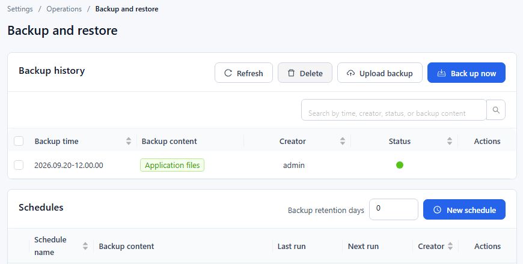

# Backup and Restore

Go to **Settings › Operations › Backup and restore**. The page has a status bar at the top and two panels: **Backup history** (all backups, manual, scheduled and uploaded, plus the retention period) and **Schedules** (automatic backups).

All times on the page are shown as `YYYY-MM-DD HH:mm` in your browser's time zone. Hover over a time to see it to the second with its UTC offset.

## 1. Backup content

Each backup contains one or more of these parts:

| Backup content | What it holds |
| --- | --- |
| **Content and settings** | Reports, models, users and system settings: the data directory of the bundled PostgreSQL database. The AI Agent stores its data in the same database, so this also includes AI conversation history, LLM profiles and their encrypted API keys. |
| **Uploaded data files** | Data files uploaded to Datafor, such as Excel and CSV datasets. |
| **Application files** | Only the Datafor program, its plugins and JDBC drivers. It does not include the AI Agent program. |

When **Content and settings** is not selected, the backup dialog warns "This backup leaves out reports, models and users."

Backups are stored as `.zip` files in the `backup/` folder of the Datafor installation directory (the folder that contains `tomcat` and `pentaho-solutions`).

### What backups do not include

No backup includes the `ai-agent/` folder, and in particular not `ai-agent/instance-secrets.env`. That file holds `MODEL_PROFILE_ENCRYPTION_KEY`, the key that encrypts the LLM API keys stored in the database.

- Restoring on the **same** server: nothing extra to do; the key file is still there.
- Restoring on a **new** server: copy `ai-agent/instance-secrets.env` from the old server to the new one as well. Without the original key, the stored LLM API keys cannot be decrypted and must all be entered again.
- Keep a copy of `instance-secrets.env` in a safe place together with your downloaded backups.

### Status bar

Only a backup with **Content and settings** can bring back reports, models and users, so the bar at the top of the page tracks the most recent successful one:

| Bar | Meaning |
| --- | --- |
| Green | The last successful backup with content and settings is less than 7 days old. The bar shows how long ago it was and when. |
| Yellow | The last one is more than 7 days old. Check that the backup schedule is running. |
| Red | "No backup can restore reports, models and users yet". Either there are no successful backups, or none of them include content and settings. Click **Create a daily backup schedule** to open the schedule dialog with **Content and settings** selected, every day at 02:00. |

The bar is based on the backup records. It does not check that the backup files are still on disk.

## 2. Back up now

1. In **Backup history**, click **Back up now**.
2. In the **New backup** dialog, select the **Backup content**. **Content and settings** is selected by default.
3. Click **OK**. "Backup task has been successfully created." appears and the backup is added to the list.

**Backup history** has these columns:

| Column | What it shows |
| --- | --- |
| **Backup time** | When the backup was taken. |
| **Backup content** | The parts in the backup. **Content and settings** is highlighted in blue. |
| **Source** | The schedule name for scheduled backups, or **Manual or uploaded** for the others (the two cannot be told apart yet). The user who created the backup is shown below. |
| **Duration** | How long the backup took. Shows "—" while it runs. |
| **Status** | **Succeeded**, **Failed** or **In progress**. For a failed backup the error is shown below the status; hover over it to read all of it. |
| **Actions** | See below. |

The list refreshes every 5 seconds while a backup is in progress, and stops when all backups have finished. Use **Refresh** to reload the list, and the search box to find backups by time, source, creator, status or backup content.

## 3. Upload a backup package

Click **Upload backup** and select a backup package (`.zip`), for example one downloaded from another Datafor server. The upload starts as soon as you select the file; the package then appears in **Backup history** and can be restored. If the server refuses the upload, for example because the package is already there, "The file already exists" appears.

## 4. Row actions: restore, download, delete

Each successful backup shows **Restore** in the **Actions** column. The **⋯** menu next to it has the other actions:

| Action | What it does |
| --- | --- |
| **Restore** | Restores the system from this backup. Available only for successful backups. See below. |
| **Download** (in **⋯**) | Downloads the backup package. Available only for successful backups. |
| **Delete** (in **⋯**) | Deletes the backup and its file permanently. |

A backup that is still in progress has no actions. To delete several backups at once, select their check boxes and click **Delete** in the panel header.

### Restore a backup

1. Click **Restore** on the backup row. The dialog is titled "Restore the backup from" followed by the backup time.
2. Check what the restore does:
   - **Replaces** lists the parts in this backup. They are replaced with the versions in the backup.
   - **Keeps as is** lists the parts that are not in this backup. They stay as they are now.
   - If the backup has only **Application files** or **Uploaded data files** and no **Content and settings**, a yellow warning appears. Restoring such a backup puts the program back to the version in the backup while the data stays at the current version, so some features may not work, or the server may fail to start. You can still restore it.
3. Type `RESTORE` in the box. **Restore and restart** stays disabled until you do.
4. Click **Restore and restart**.

Datafor then stops, restores the backup and starts again. The page shows "Restoring and restarting" with the elapsed time and reloads itself when the server is back. You will usually need to sign in again. If the server has not stopped after about 90 seconds, the page says the restore may not have started; check the output of the restore script on the server. If the server is still not back after 20 minutes, the page says so but keeps waiting.

Before it replaces anything, Datafor backs up the parts it is about to replace. That backup is saved as a `.zip` in the `backup/` folder, but it does not appear in **Backup history** and the retention period does not delete it.

::: warning
Restoring overwrites everything in the replaced parts that was changed after the backup was taken.
:::

## 5. Schedules

The **Schedules** panel lists automatic backups with **Schedule name**, **Backup content**, **Frequency** (for example "Every weekday · 02:00" or "Run once" with its date and time), **Last run**, **Next run** and **Status**:

- **Active**: the schedule will run again.
- **Ended**: the schedule has no next run, for example a **Run once** schedule that has already run, or a repeating schedule past its end date.
- **Paused**: the schedule is paused in the scheduler.

Each row has three actions:

| Action | What it does |
| --- | --- |
| **Run now** | Runs the schedule once right away. The backup appears in **Backup history** when it starts. Not available for an ended schedule. |
| **Edit** | Opens the schedule dialog. |
| **Delete** | Deletes the schedule. Backups it already made stay in **Backup history**. |

To add a schedule:

1. Click **New schedule**.
2. Enter a **Schedule name** and select the **Backup content**.
3. Choose **Repeat**: **Run once**, **Daily**, **Weekly**, **Monthly**, **Yearly** or **Cron** (then enter a **Cron string**).
4. Set the **Start time** (not for **Cron**) and the **Start date**. For repeating schedules, choose **No end date** or **Ending** with an end date.
5. Click **Save**.

Backups created by a schedule appear in **Backup history**.

### Retention period

The retention period is set in the toolbar of **Backup history**: "Delete backups and their files after N days (0 keeps them forever)". Type a number, then press Enter or click elsewhere to save it. "Saved" appears when it is saved; if saving fails, the reason is shown.

- `0` keeps all backups.
- A value above 0 deletes backups older than that number of days, together with their files. It applies to all backups in **Backup history**, not only those created by schedules, including failed ones.
- The first clean-up runs about a minute after you save, then once a day. If the new value would delete backups that are already in the list, a confirmation shows how many before anything is saved.

## 6. Keep a copy off the server

Backups are stored on the same server as Datafor. Download important backups and keep them outside the Datafor server, so that they survive a disk or server failure.
