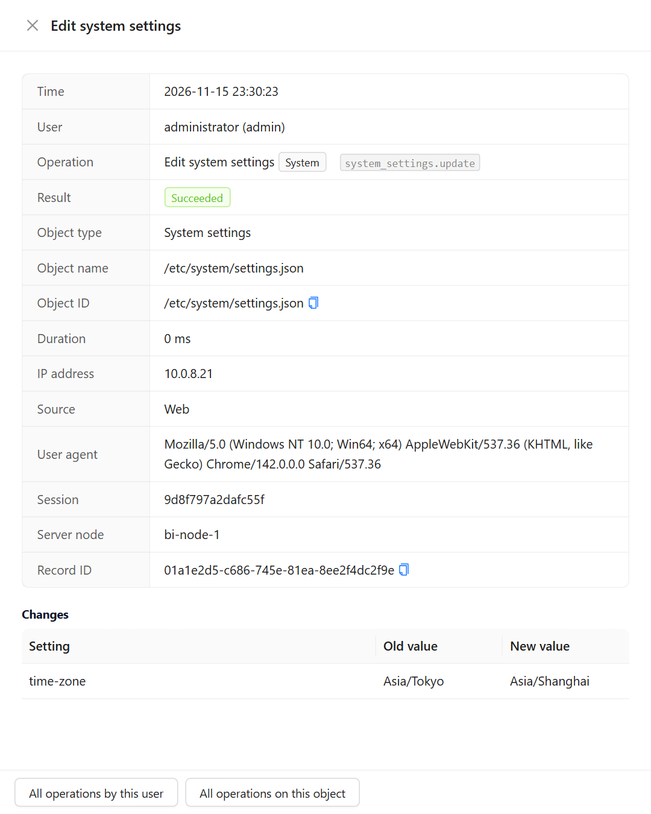
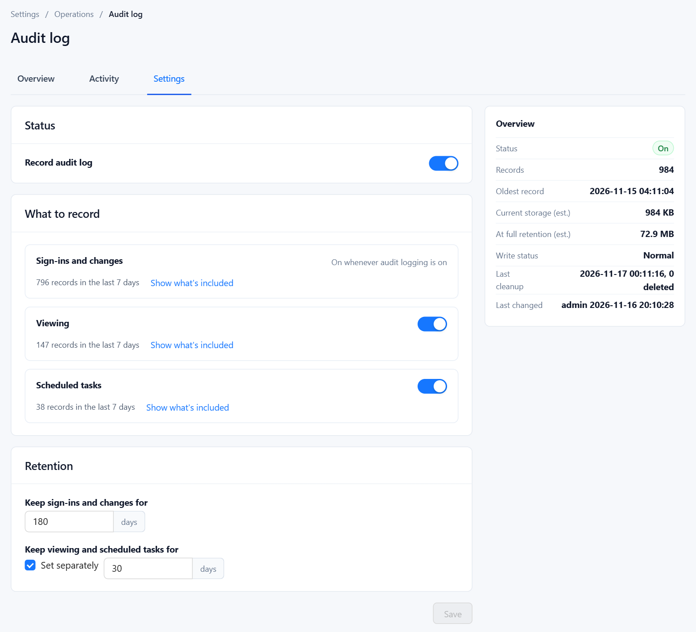

# Audit Log

The audit log records who signed in, who opened, changed, exported or deleted what, and what the server ran on its own schedule. Records are stored in a database table, so they can be searched, filtered and exported, and they are deleted automatically when they pass the retention period.

Open **Settings › Operations › Audit log**. The page appears when the `datafor-audit` plugin is installed, and only administrators can open it. Each tenant has its own records and settings; an administrator sees only the tenant they are signed in to.

The page has three tabs:

| Tab | Use it to |
| --- | --- |
| **Overview** | See usage and security trends on three built-in dashboards |
| **Activity** | Search individual records, open their details, export them |
| **Settings** | Turn recording on or off, choose what is recorded, set the retention |

## What is recorded

Operations fall into three categories. On the **Settings** tab, each category has its own card.

| Category | Contains | Switch |
| --- | --- | --- |
| **Sign-ins and changes** | Sign-ins, sign-outs and failed sign-ins; creating, editing, moving, deleting and restoring content; changes to users, roles, access permissions, data security, data sources, tokens, AI services and system settings; data exports; changes to subscriptions, alerts, IM platforms and backups | None: recorded whenever audit logging is on. You can untick single operations. |
| **Viewing** | **Open report**, **Open share**, **Ask AI**, **View audit statistics** | On by default. On a busy system this is most of the records. |
| **Scheduled tasks** | **Run subscription**, **Run alert**, **Sync contacts** | On by default |

**Edit audit settings**, **Clear audit records** and **Export audit records** are always recorded, even while audit logging is off, so turning the log off or emptying it leaves a trace.

The full list, by group:

| Group | Operations |
| --- | --- |
| **Authentication** | Log in, Log out, Failed login |
| **Users & roles** | Create user, Edit user, Delete user, Import users, Reset password, Change own password, Create role, Delete role |
| **Reports** | Open report, Create report, Edit report, Delete report, Copy report, Move report, Restore report, Permanently delete report |
| **Sharing** | Open share, Create share, Edit share, Delete share |
| **Folders** | Create folder, Edit folder, Delete folder, Copy folder, Move folder, Restore folder, Permanently delete folder |
| **Data** | Export data |
| **Models** | Create model, Edit model, Delete model |
| **Data sources** | Create data source, Edit data source, Delete data source |
| **Data security** | Create, Edit and Delete row security; Create, Edit and Delete object security; Change access permissions |
| **Dictionaries** | Create dictionary, Edit dictionary, Delete dictionary |
| **Parameters** | Create parameter, Edit parameter, Delete parameter |
| **Tokens** | Create token, Edit token, Delete token, Issue personal token, Revoke personal token |
| **AI** | Create AI service, Edit AI service, Delete AI service, Ask AI |
| **System** | Edit system settings, Edit audit settings, Clear audit records, Export audit records, View audit statistics |
| **Subscriptions & alerts** | Create, Edit, Delete, Enable or disable, Transfer and Run subscription; the same for alerts, plus Silence alert; Stop receiving, Resume receiving; Create, Edit, Delete and Test delivery channel; Edit subscription & alert settings; Rotate notification system token |
| **IM platforms** | Create IM app, Edit IM app, Delete IM app, Bind IM user, Unbind IM user, Sync contacts, Edit IM settings, Rotate IM system token |
| **Backup & restore** | Run backup, Restore backup, Upload backup, Download backup, Delete backup, Edit backup settings |

The last three groups appear only when their plugins are installed.

### What a record holds

Every record has the time, the user (login name and display name), the operation, the object (type, name, path and ID), the result with the failure reason, the duration, the IP address and the source: **Web** for the browser, **Token** for calls signed in with a token, **System** for work the server did on its own. The details add the browser's user agent, the session, the server node, and operation-specific values.

Operations that change settings keep the old and new value of each field: **Edit user** (including roles, user type and whether the account is enabled), **Change access permissions** (one row per user or role whose permission changed, plus owner and inheritance), **Edit system settings**, **Edit audit settings**. Passwords, tokens and verification codes are never stored; a changed password shows only that it changed.

### Behavior worth knowing

- **Failed login** records the reason: wrong username or password (an unknown username counts as this too), wrong verification code, account locked, disabled or expired, or an invalid token. To keep a password-guessing attack from flooding the log, at most 20 failures per minute are recorded for one IP and username, and 100 per minute for one IP; the number left out is noted in the next record.
- **Log out** records whether the user signed out, the session timed out, or the server was shut down, and how long the session lasted.
- **Shares**: the object is the shared report, not the share ID; people who open a link without signing in are shown as **Anonymous visitor**.
- **Export data** is recorded when someone exports a component's data to Excel or CSV, or exports a paginated report; the object is the report, with its path. The details give the format and the component title; the Excel files a subscription attaches are recorded too, marked as made by the render service.
- **Change access permissions** is recorded only when something changed. Saving the permission dialog without changes leaves no record. Batch changes give one record per file.
- **Run subscription** is recorded once per run, when it ends. Scheduled runs are recorded under the owner with the source **System**; **Run now** is recorded under the person who clicked it. A run that reached only some recipients is **Succeeded**, and its details give how many were delivered and not delivered.
- **Run alert**: scheduled checks are recorded only when they sent a notification or failed, because most checks find nothing. **Evaluate now** is always recorded. **Send me a test** and **Check now** in the editors are not recorded.
- **Restore backup** is recorded when Datafor starts again after the restore. The restore puts back the database that holds the audit records, so records written after the backup was taken are no longer in the log. See [Backup and Restore](/documentation/System/backup/#audit-records-and-restores).
- **View audit statistics** is recorded instead of **Open report** when someone views the audit dashboards, so they do not count in the usage statistics.

**Not recorded**: copying, moving, restoring or permanently deleting files by calling the platform's own REST API (`/api/repo/files/...`) directly instead of through Datafor's pages and APIs; individual deliveries of subscriptions and alerts (see their [run history](/documentation/Subscriptions-and-Alerts/Managing-Subscriptions-and-Alerts/#run-history)); the queries behind reports; and changes made directly in the database or in configuration files.

## Overview tab

The tab shows one of three dashboards; pick it at the top. **Open in new window** opens the selected one in the report viewer.

| Dashboard | Shows |
| --- | --- |
| **Platform usage overview** | Active users, report opens, exports and AI questions against the previous period; daily trends; active users by department; the most active users |
| **Content usage** | The most opened and the slowest reports; opens by folder; reports nobody has opened for a long time |
| **Security and exceptions** | Failed sign-ins by day and by username; failed operations; the users who export the most; recent changes to data security, data sources, tokens, users, backups and system settings |

Things to know when reading them:

- The figures come from a daily summary of the records, counted into days in the tenant's [time zone](/documentation/System/System-Configuration/#time-zone). **Updated** shows when the summary last ran; **Updating (N days left to summarize)** appears while it catches up, for example after the time zone was changed, which recounts every day of that tenant only.
- Work the server does on its own (source **System**) is left out of the figures: scheduled runs and syncs, and the sign-ins and report opens of the render service when it opens a dashboard as each recipient of a subscription or alert. So a subscription sent to 200 people does not add 200 report opens or 200 sign-ins, and does not keep an otherwise unused report off the *not opened for a long time* list.
- **Anonymous visitor** (share links opened without signing in, silence links in alert messages) is not counted as an active user. Statistics summarized before this rule are recounted once after the upgrade.
- If an operation a dashboard needs is not recorded, a banner says so, for example *Open report not recorded; related charts are empty*, with **Turn on**.
- When viewing records are kept for less time than the rest, a note says how far back the viewing charts go.
- Clicking a user or a report in a dashboard opens **Activity** filtered to it, in a new window.
- The dashboards are maintained by Datafor and replaced on upgrade. To change one, save a copy to your own folder. The model behind them can only be used by administrators, cannot be opened in the model editor, and its dashboards cannot be shared by link.

## Activity tab

Filters, combined:

- **All**, **Sign-ins and changes**, **Viewing**, **Scheduled tasks**: switch to *Sign-ins and changes* to see what changed without the much larger volume of report opens.
- Time range: **Today**, **Last 7 days** (default), **Last 30 days**, **Last 90 days** or **Custom**, up to 366 days.
- **Users**, **Operations** (a group or single operations), **Result**, and **Object name or path**.

Times are shown in your browser's time zone. Click a user's name to keep only that user. Click a report or folder to open it; this still works after it was renamed or moved, while deleted objects show *Deleted or not accessible*. Hover a failed result to read the reason.

The list can be browsed up to the first 10,000 matching records; above that, narrow the time range or add filters.

Click a row for its details:

**All operations by this user** and **All operations on this object** at the bottom switch the list to that user or object.

### Export

**Export** downloads the records that match the filters as a CSV file (UTF-8, opens in Excel), named `audit-<from>-<to>.csv`. The time column is in your browser's time zone and names it in the header; the other columns are user, display name, operation, group, object type, object, path, object ID, result, duration in milliseconds, IP, source, error and the details as JSON. One export holds up to 100,000 records. Each export is itself recorded as **Export audit records**, with its filters and row count.

### Opening the log from other pages

Administrators can jump straight to the relevant records:

| Where | Menu item | Shows |
| --- | --- | --- |
| **Users**, a user's row menu | **View this user's activity** | What that user did, last 30 days |
| | **View changes to this account** | What was done to that account, last 90 days |
| Content lists, a report's or folder's row menu | **View activity** | Operations on it, last 90 days |
| **Models** and data source lists, row menu | **View activity** | Operations on it, last 90 days |

## Settings tab

**Status › Record audit log** turns recording on or off. While it is off nothing is recorded except changes to these settings and exports and clearing of the log, and the Overview dashboards stop updating.

**What to record** has a card per category with the number of its records in the last 7 days. **Show what's included** lists the operations; untick one to stop recording only that operation. Turning **Viewing** or **Scheduled tasks** off stops all operations of that kind, including ones added by plugins later. When some sign-in or change operations are unticked, a warning names how many, with **Record them** to tick them again.

**Retention**:

- **Keep sign-ins and changes for** *N* days: 180 by default, from 30 to 3650.
- **Keep viewing and scheduled tasks for**: **Same as above**, or tick **Set separately** for a shorter period. Viewing records are most of the volume, so this saves the most space; for example keep changes for two years and report opens for 180 days.

Records past their retention are deleted every day at about 03:30 server time. There is no separate clear button: to delete records now, shorten the retention.

**Save** first lists what the change will do and asks to confirm: turning logging off, turning **Viewing** off (the dashboards based on it will be empty), and shortening a retention period with the number of records that will be deleted. The deletion then runs in the background, and a **Clear audit records** entry appears in **Activity** when it is done. Deleted records cannot be recovered.

The **Overview** panel on the right shows the status, the number of records, the oldest record, **Current storage (est.)**, **At full retention (est.)**, **Write status**, the last cleanup and who last changed the settings.

When an administrator opens the console, a notice **Audit log needs attention** appears at the top right if audit logging is off, if records cannot be written to the database, or if the estimated storage at full retention exceeds the warning threshold. **View** opens this tab.

## Storage and capacity

Records are stored in Datafor's configuration database, the same one that holds users and settings: the `datafor_modeler_auth` connection if it exists, otherwise the Hibernate repository database. With the bundled PostgreSQL this is included in [backups](/documentation/System/backup/) with **Content and settings**.

Each record takes about 1 KB including indexes, and the panel estimates storage from the last 7 days. Almost all of it comes from report opens and shared-link opens:

| Usage | Records per day | Kept 180 days |
| --- | --- | --- |
| 1,000 active users, 20 report opens and 5 other operations each per day | 25,000 | About 4.5 GB |
| 5,000 active users, 50 report opens and 5 other operations each per day | 275,000 | About 50 GB |
| 1,000 active users, viewing not recorded | 5,000 | About 1 GB |

Reports embedded in a portal or opened through shared links can produce far more opens than your own users do.

If writing to the database fails, records are kept in `pentaho-solutions/system/logs/audit/pending-<node>-<date>.jsonl` and written later; **Write status** shows how many are waiting. Files that still cannot be written after 30 days are renamed to `.failed`.

### Server settings

`pentaho-solutions/system/applicationContext-datafor-audit.xml` holds the limits that apply to the whole server. Changes need a restart.

| Property | Default | Meaning |
| --- | --- | --- |
| `defaultRetentionDays` | 180 | Retention for tenants that never saved audit settings |
| `minRetentionDays`, `maxRetentionDays` | 30, 3650 | Allowed retention range. Raise the minimum if a regulation requires a longer one, for example 180 |
| `cleanupTime` | 03:30 | Time of the daily cleanup |
| `queryMaxDays` | 366 | Longest time range for one search |
| `exportMaxRows` | 100000 | Most records in one export |
| `capacityWarnGb` | 20 | Estimated storage above which administrators are warned |
| `trustedProxies` | `127.0.0.1,::1` | Proxies whose `X-Forwarded-For` header is trusted for the client IP. Add your reverse proxy, or every record shows its address |
| `loginFailedPerMinute`, `loginFailedPerIpPerMinute` | 20, 100 | Failed sign-ins recorded per minute, see above |
| `auditDatasource` | empty | Name of a data source connection to keep the audit tables in a separate database instead of the configuration database |
| `mirrorToFile` | false | Also write each record as a JSON line to `pentaho-solutions/system/logs/audit/audit-<node>-<date>.jsonl`, for log collectors such as Filebeat |

## Upgrading from earlier versions

- Where audit settings were never saved, audit logging is **on** after the upgrade, with 180 days of retention. Settings saved in an earlier version are carried over.
- Earlier versions wrote to the text file `PentahoAuditLog.log` and their clean-up did not work. That file no longer receives Datafor operations and is not imported.
- A `pro_audit` table created by hand in the Hibernate database is no longer used and can be dropped.

## Related topics

- [Permission Evaluation Overview](/documentation/System/Permission-Evaluation-Overview/)
- [System Configuration](/documentation/System/System-Configuration/)
- [Backup and Restore](/documentation/System/backup/)
- [Monitoring and Limits](/documentation/Subscriptions-and-Alerts/Monitoring-and-Limits/) for subscription and alert runs
