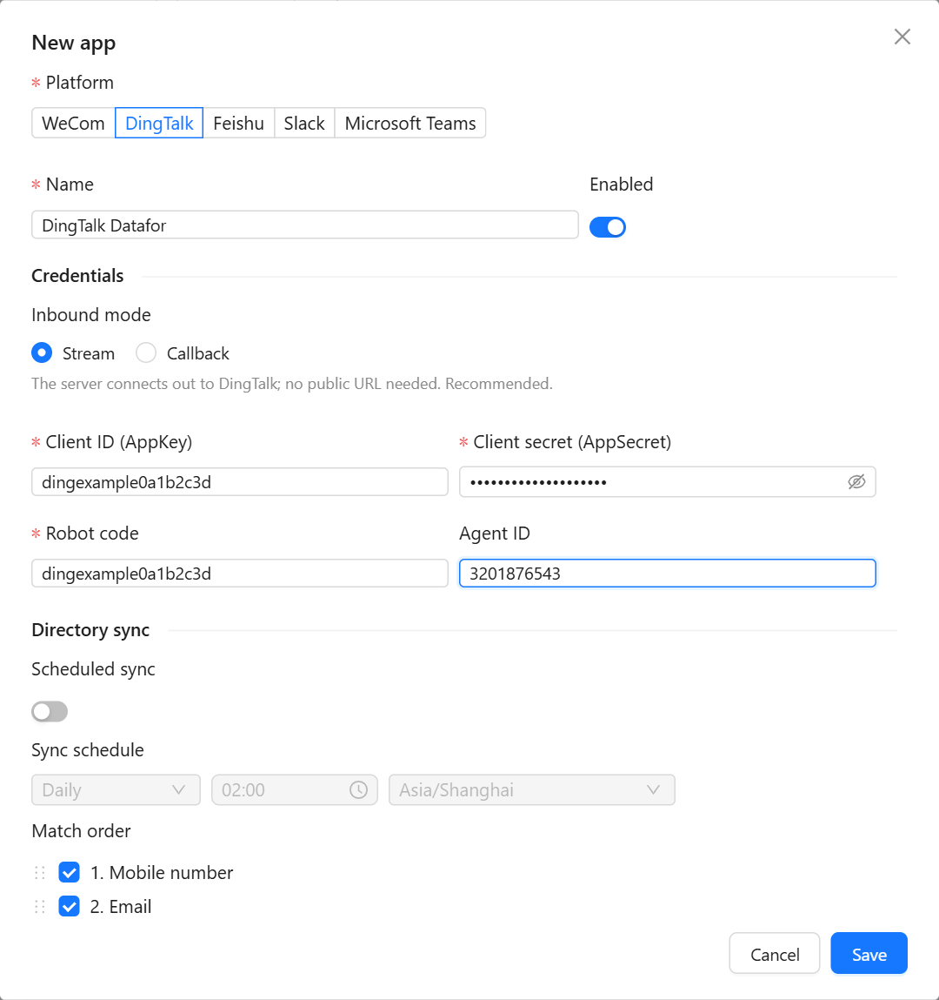
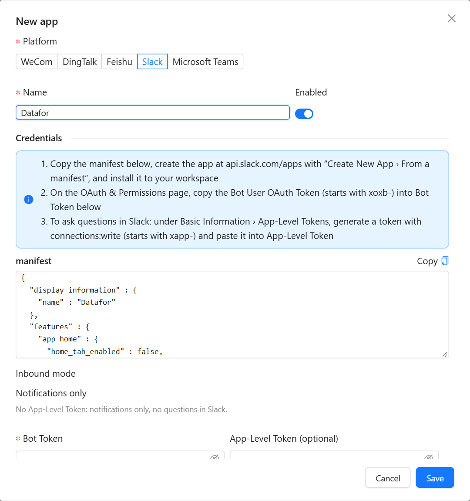
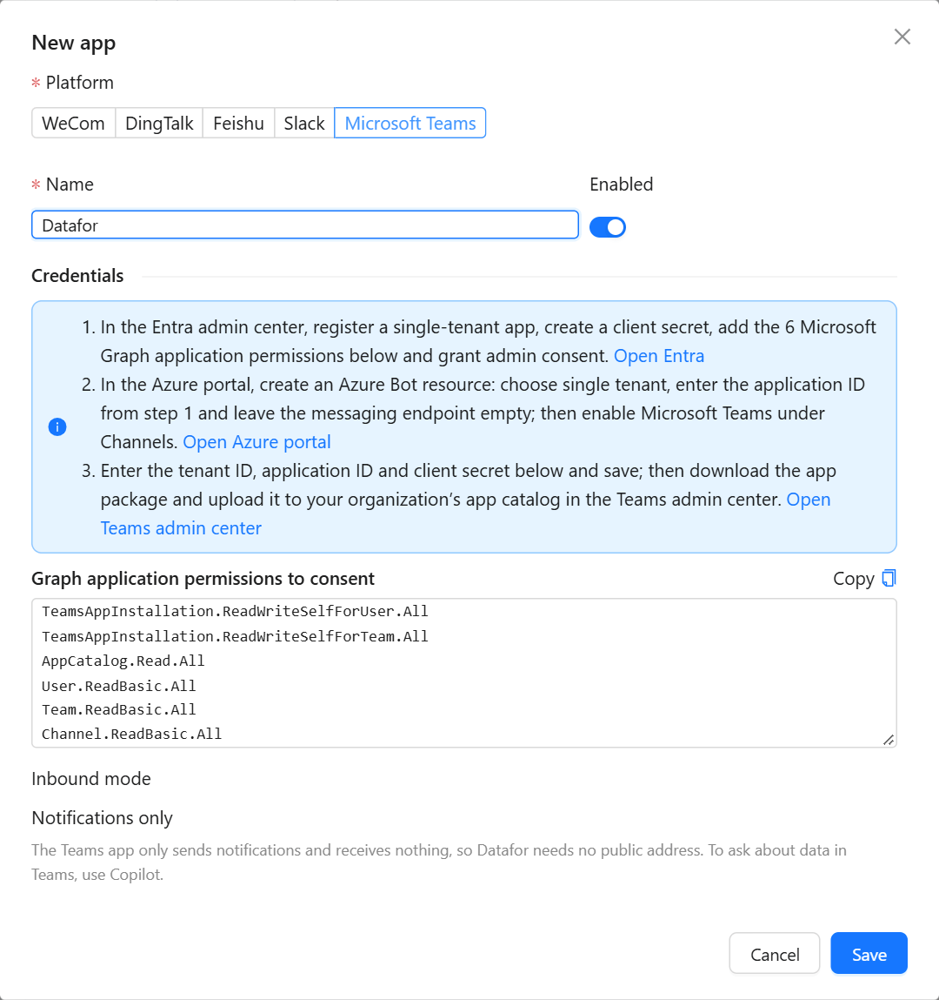
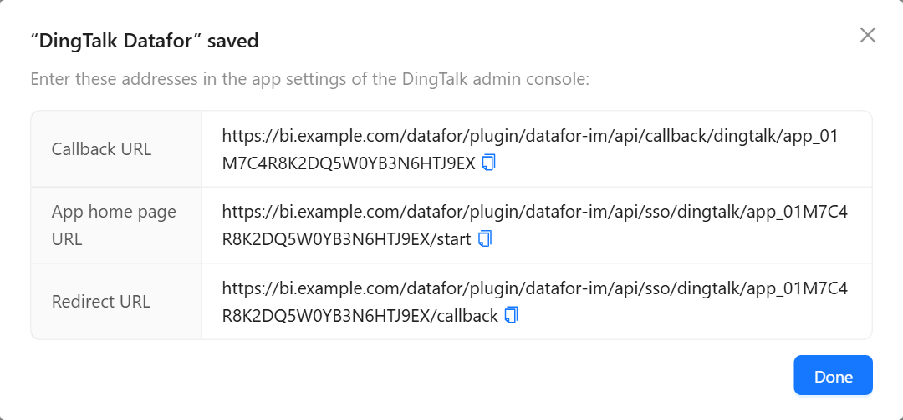
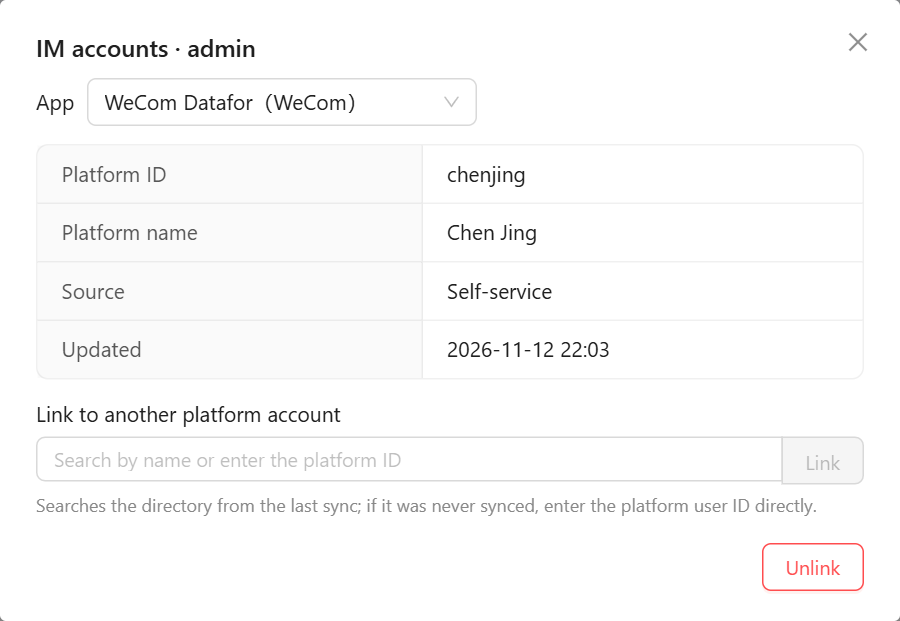

# IM Platforms

**Settings › Notifications › IM platforms** connects an app that you create in WeCom, DingTalk, Feishu, Slack or Microsoft Teams to Datafor. This page is for administrators. What people do in the IM app is described in [Using Datafor in IM Apps](/documentation/System/Using-Datafor-in-IM-Apps/).

What an app can do depends on the platform:

| | WeCom | DingTalk | Feishu | Slack | Microsoft Teams |
| --- | --- | --- | --- | --- | --- |
| Direct messages for subscriptions and alerts | Yes | Yes | Yes | Yes | Yes |
| Channels picked directly in subscriptions and alerts | — | — | — | Yes | Yes |
| Open Datafor from the IM without signing in | Yes | Yes | Yes | — | — |
| Directory sync | Yes | Yes | Yes | Members only, no departments | Members only, no departments |
| Accounts linked by email automatically | — | — | — | Yes | Yes |
| Asking questions and chat commands | Direct messages to the app | Direct messages and @ in groups | Direct messages and @ in groups | Direct messages and @ in channels, needs the App-Level Token | — |
| Datafor must be reachable from the internet | Yes | Only in Callback mode | Only in Callback mode | No | No |

Group robots and webhooks that only post to one group do not need an app; they are delivery channels, see [Delivery Channels](/documentation/Subscriptions-and-Alerts/Delivery-Channels/).

## Before you start

- **License.** IM platforms need an Enterprise license or above. Otherwise saving an app fails with *Your license does not include IM platforms*.
- **Site address.** Every address the page gives you is built from **Site URL** under **Settings › Access & Integration › Site address** (see [Site Address](/documentation/System/Site-Address/)). The sign-in pages open on people's phones and computers, so they must be able to reach that address, and in Callback mode the platform's servers must reach it from the internet. While the site address is `localhost` or a private address, the page shows a warning with **Change site address**.
- **Outbound access.** The Datafor server calls the platform: `qyapi.weixin.qq.com` (WeCom), `api.dingtalk.com` and `oapi.dingtalk.com` (DingTalk), `open.feishu.cn` (Feishu), `slack.com` (Slack), `login.microsoftonline.com`, `graph.microsoft.com`, `api.botframework.com` and `smba.trafficmanager.net` (Teams). Stream, long-connection and Socket Mode connections are outgoing WebSockets to the same platforms.
- **Security rule.** Sign-in from the IM, the account link page and platform callbacks are reached without a Datafor session. The upgrade adds this rule to `pentaho-solutions/system/applicationContext-spring-security.xml`, before the `\A/plugin/.*\Z` rule; if sign-in from the IM ends on the Datafor login page, check that it is there and restart:

  ```xml
  <sec:intercept-url pattern="\A/plugin/datafor-im/api/(sso|callback|bind)/.*\Z" access="Anonymous,Authenticated" />
  ```

- **AI service.** Asking questions in chat uses the AI Agent, see [How to Enable the AI Feature](/documentation/AI-Agent/AI-Feature/).

## The page


The cards count the apps per platform and how many have working credentials. The **Apps** table shows:

| Column | Meaning |
| --- | --- |
| **Enabled** | Off pauses the app: nothing is sent through it and its inbound connection closes. Links and settings are kept. |
| **Credentials** | Result of the last credential check: **OK**, **Failed**, **Not checked**, or **Missing scopes** for a Slack app that works but lacks some scopes. Hover for the error and the time of the check. |
| **Inbound** | How messages from the IM reach Datafor, and the connection state, see [Inbound mode](#inbound-mode). Hover for the time of the last message received. |
| **Last sync** | Result and time of the last directory sync. Click to open **Sync history**. |
| **Linked** | Number of Datafor users linked to an account in this app. |

The ⋮ menu of a row has **Edit**, **Check credentials**, **Sync now**, **Send test**, **Sync history** and **Delete**.

## Create an app

1. Create the app in the platform's developer or admin console, as described for each platform below.
2. In Datafor, click **New app** and choose the **Platform**. It cannot be changed after saving.
3. Enter a **Name**. People see it in delivery channel names, in **How I receive** and under **My account › Linked IM accounts**. For Slack it is also the app's name in Slack.
4. Fill in **Credentials**, then the [Directory sync](#directory-sync) and [Ask](#asking-questions-in-chat) sections.
5. Click **Save**. For WeCom, DingTalk and Feishu the dialog that follows lists the [addresses to enter in the platform](#addresses-to-enter-in-the-platform). Slack and Teams credentials are checked when you save, and the dialog shows the result.
6. Use **Check credentials** and **Send test** on the row to confirm that everything works, see [Check and test](#check-and-test).

Secrets are stored encrypted and shown as asterisks. When you edit an app, leave a secret unchanged to keep its value.



### WeCom

Create a self-built app in the WeCom admin console under **App Management**. Then enter:

| Field | Where to find it |
| --- | --- |
| **Corp ID** | **My Company › Company Information** |
| **Agent ID**, **Secret** | The app's detail page |
| **Callback token**, **Callback EncodingAESKey** | The app's **Receive Messages › Set API Receiving**, where you generate both. Optional: without them the app only sends, and people cannot ask questions in WeCom. |

WeCom delivers messages only by callback, so the **Callback URL** must be reachable from the internet. In the WeCom app also set the **Trusted domain** (web authorization), the **App homepage** and, under **Receive Messages**, the **Callback URL** from [Addresses to enter in the platform](#addresses-to-enter-in-the-platform). WeCom checks the trusted domain with a verification file (`WW_verify_….txt`) that must be reachable at the root of that domain, so serve it from your web server or reverse proxy.

Newer WeCom apps accept API calls only from the IP addresses listed under **Enterprise trusted IP** at the bottom of the app's page, which you can fill in once the trusted domain or the Receive Messages URL is set. If **Check credentials** reports `60020` (*not allow to access from your ip*), add the IP address shown in the error, which is the Datafor server's outgoing public address.

New WeCom apps do not receive members' mobile numbers and email addresses. Match users by **Platform ID equals login name** when the WeCom user IDs equal Datafor login names, or let people link themselves by opening the app once.

### DingTalk

Create an internal app in the DingTalk developer console (`open-dev.dingtalk.com`) and add the **Robot** feature. Then enter:

| Field | Where to find it |
| --- | --- |
| **Client ID (AppKey)**, **Client secret (AppSecret)** | The app's credentials page |
| **Robot code** | The robot's configuration page |
| **Agent ID** | The app's basic information; optional |
| **Callback token**, **Callback EncodingAESKey** | Only in **Callback** mode: the token and AES key of the app's event subscription |

**Inbound mode** is **Stream** (recommended: the server connects out to DingTalk and needs no public address) or **Callback**. Set the robot's message receiving mode in DingTalk to the same mode; for Callback, enter the **Callback URL**. Also set the app's home page to the **App home page URL** and register the **Redirect URL** for sign-in. Grant the app permission to read the directory (members and departments) and to send messages as the robot, then publish a version of the app so the changes take effect.

### Feishu

Create a custom app in the Feishu developer console (`open.feishu.cn/app`) and add the **Bot** feature. Then enter:

| Field | Where to find it |
| --- | --- |
| **App ID**, **App secret** | **Credentials & Basic Info** |
| **Verification token**, **Encrypt key** | Only in **Callback** mode: the app's event encryption settings. **Encrypt key** is optional. |

**Inbound mode** is **Long connection** (recommended, no public address needed) or **Callback**. In the app's event settings, choose the persistent connection or enter the **Callback URL**, and subscribe to the event for received messages. Set the app's home page to the **App home page URL** and add the **Redirect URL** under the security settings. Grant permissions to read the directory, send messages and upload images and files, then publish a version of the app.

### Slack

Slack apps need no public address: messages come in through Socket Mode, an outgoing connection.



1. Enter the **Name** first; the manifest uses it as the app's name in Slack (35 characters at most).
2. **Copy** the manifest. At `api.slack.com/apps`, choose **Create New App › From a manifest**, pick the workspace, paste it and create the app. Then install it to the workspace.
3. On the app's **OAuth & Permissions** page, copy the **Bot User OAuth Token** (starts with `xoxb-`) into **Bot Token**.
4. To let people ask questions and use chat commands in Slack, go to **Basic Information › App-Level Tokens**, generate a token with the `connections:write` scope (starts with `xapp-`) and paste it into **App-Level Token**. Without it, **Inbound mode** shows **Notifications only**.
5. **Save.** The dialog shows **Connected to** *workspace*, or the scopes the app is missing. Add missing scopes in Slack and reinstall the app.

The manifest requests `chat:write`, `im:write`, `im:history`, `app_mentions:read`, `files:write`, `users:read`, `users:read.email`, `channels:read`, `groups:read` and `channels:join`. The bot reads only direct messages and messages that mention it.

One Slack app serves one workspace; create one app per workspace.

### Microsoft Teams

The Teams app only sends. It does not answer messages, so it needs no public address.



1. In the Microsoft Entra admin center, register a single-tenant app and create a client secret. Add these Microsoft Graph **application** permissions and grant admin consent: `TeamsAppInstallation.ReadWriteSelfForUser.All`, `TeamsAppInstallation.ReadWriteSelfForTeam.All`, `AppCatalog.Read.All`, `User.ReadBasic.All`, `Team.ReadBasic.All`, `Channel.ReadBasic.All`.
2. In the Azure portal, create an **Azure Bot** resource: choose single tenant, enter the application ID from step 1 and leave the messaging endpoint empty. Under **Channels**, enable **Microsoft Teams**.
3. In Datafor, enter **Tenant ID (Directory ID)**, **Application (client) ID** and **Client secret**, and save.
4. Click **Download app package** and upload the zip in the Teams admin center under **Manage apps › Upload new app**. Back in Datafor, run **Check credentials**.

The app is ready when the editor shows *The app package is in your organization's catalog; ready to send*. Until then it reports what is missing: Graph permissions, the app package, or the Azure Bot resource and its Teams channel.

### Direct messages and channels

- **Slack and Teams.** Saving a new app also creates its direct-message delivery channel (**Slack direct message** or **Teams direct message**), so people can choose it under **How I receive** right away. **Let users choose channels** (on by default) lets everyone who can create subscriptions and alerts pick the app's public channels in **Post to channels**; when off, only administrators can. Private channels are always for administrators only, and a private Slack channel must invite the bot first. **Destinations** in the editor lists the channels that subscriptions and alerts send to, who uses them and the last delivery; to stop sending to a channel, disable or edit those subscriptions and alerts.
- **WeCom, DingTalk and Feishu.** Create a delivery channel of type **WeCom app message**, **DingTalk app message** or **Feishu app message** and choose the app, see [Setting Up Delivery](/documentation/Subscriptions-and-Alerts/Delivery-Channels/#direct-message-channels).

## Addresses to enter in the platform

For WeCom, DingTalk and Feishu, the dialog after saving lists the addresses to copy into the platform, followed by a note on what else to set in the platform's console. Editing the app shows them again in **Addresses to enter in the platform**.



| Address | Form | Use |
| --- | --- | --- |
| **Callback URL** | `<site>plugin/datafor-im/api/callback/<platform>/<app id>` | Where the platform posts messages. Needed for WeCom, and for DingTalk and Feishu in Callback mode. |
| **App home page URL** | `<site>plugin/datafor-im/api/sso/<platform>/<app id>/start` | The app's home page in the IM. Opening it signs the person in to Datafor, see [How people get linked](#how-people-get-linked). |
| **Redirect URL** | `<site>plugin/datafor-im/api/sso/<platform>/<app id>/callback` | DingTalk and Feishu: register it as the sign-in redirect address. |
| **Trusted domain** | The site address | WeCom: the domain allowed for web sign-in. |

`<site>` is the **Site URL**. The home page URL opens the Datafor console; to land on another page, append `?target=` and a path on the server, for example `?target=/datafor/biagent` for the AI Agent. If you change the site address later, update these addresses in the platform as well.

## Inbound mode

Inbound is how people's messages to the app reach Datafor. Datafor needs it to answer questions and chat commands; sending messages does not need it.

| Mode | Platforms | How it works |
| --- | --- | --- |
| **Stream** | DingTalk | The server keeps an outgoing connection to DingTalk. No public address needed. |
| **Long connection** | Feishu | The same for Feishu. |
| **Socket Mode** | Slack | The same for Slack; requires the App-Level Token. |
| **Callback** | WeCom (only mode), DingTalk, Feishu | The platform posts each message to the **Callback URL**, which must be reachable from the internet. |
| **Notifications only** | Teams; Slack without an App-Level Token | Nothing comes in. |

The **Inbound** column shows the state of the connection: **Connected**, **Connecting**, **Disconnected** (Datafor reconnects on its own), **Off** (the app or inbound is disabled), **Awaiting callbacks** or **Error**.

## Directory sync

Directory sync reads the members of the platform's directory and links them to Datafor users. It is optional: people can also link themselves, and Slack and Teams link by email without it.


| Setting | Effect |
| --- | --- |
| **Scheduled sync**, **Sync schedule** | Run the sync daily, weekly or monthly at the time and time zone you choose. **Sync now** in the row menu runs it at once. One sync runs at a time per app. |
| **Match order** | Tick the fields used to find the Datafor user for each member, and drag to reorder: **Mobile number** (country code `+86` and non-digits are ignored), **Email** (case-insensitive), **Employee ID**, and **Platform ID equals login name**. Fields are tried in order and the first that finds a user wins. Slack and Teams offer only **Email** and **Platform ID equals login name**. |
| **Departments** | Platform department IDs to sync, sub-departments included; press Enter after each. Empty syncs every department the app can see, which is the app's visibility range in the platform. Not shown for Slack and Teams. |
| **Create Reader users for unmatched people** | Creates a Reader user for each member that matched nobody, with the platform user ID as login name, the platform's name and email, and a random password. Available only when **Allow creating Reader users in sync** is on in [Settings for all apps](#settings-for-all-apps); otherwise the switch is disabled. |
| **Match accounts by email automatically** | Slack and Teams only, on by default. A person is linked as soon as Datafor needs them (a message to send, or a message they send to the bot) if exactly one Datafor user has the same email address. For Teams, a Datafor email or login name equal to the person's Microsoft 365 email or sign-in name also counts. Guests and people from other workspaces or tenants are never matched. |

What a sync does and does not change:

- A member who matches exactly one Datafor user is linked, with source **Sync**.
- A member who matches several users, or whose user is already linked to another account in this app, is a **conflict** and is not linked.
- Links that people made themselves (**Self-service**) or that an administrator made (**Manual**) are never replaced.
- Members who are no longer in the directory are marked **Left**. Their links are kept, but nothing is sent to them.
- Mobile numbers and email addresses from the platform are stored only as hashes.

### Sync history

**Sync history** in the row menu, or a click on **Last sync**, lists the last 100 syncs of the app with the trigger, status and counts. Expand a run to see its problems, the **Unmatched** members and the **Conflicts** with their candidate Datafor users (up to 500 of each).


**Done** means the sync finished without problems. **Partial** means it finished with problems, for example a department that could not be read; **Problems** shows what the platform returned. **Failed** means the directory could not be read at all, for example because the credentials no longer work. To resolve an unmatched member or a conflict, fill in the user's mobile number, email or employee ID in Datafor so that exactly one user matches, link the person by hand, or let them link themselves.

## Asking questions in chat

**Allow asking questions in chat** (on by default; not available for Teams) lets people send questions to the app. The AI assistant answers each question with the permissions of the person who asked, and the question counts against that person's daily AI quota (see [AI Operations and Quotas](/documentation/AI-Agent/AI-Operations-and-Quotas/)). When it is off, here or for all apps in [Settings for all apps](#settings-for-all-apps), the app replies that data questions are not enabled there. Chat commands for subscriptions and alerts keep working.

Asking needs a working inbound connection, the AI service, and a linked account for the person asking. In groups, the answer is posted to the group, so everyone in it sees data calculated with the asker's permissions; the card says whose. What people see is described in [Using Datafor in IM Apps](/documentation/System/Using-Datafor-in-IM-Apps/#ask-questions).

## Check and test

- **Check credentials** asks the platform for an access token with the saved credentials, and for Slack and Teams also checks the scopes or permissions and, for Teams, the app package. A failure shows the platform's own error code and message, which you can copy.
- **Send test** sends a test direct message to a Datafor user through the app. Enter the login name (your own by default). The user must already be linked in this app; otherwise the test fails with *This user is not linked in this app*.

## How people get linked

Datafor sends a direct message only to people whose Datafor user is linked to their account in the app. One platform account can be linked to only one Datafor user per app. A link is made in one of these ways; the **Source** column of the link shows which:

| Source | How |
| --- | --- |
| **Sync** | [Directory sync](#directory-sync), or for Slack and Teams the automatic match by email. |
| **Self-service** | The person opens Datafor from the app's home page in WeCom, DingTalk or Feishu and signs in once on the link page. A person who is not linked and sends the app a message gets a reply with an **Open Datafor and link** button; in Slack the link arrives as a direct message. |
| **Manual** | An administrator links the person under **Users**. |

To link someone by hand, open **Users**, click ⋮ on the user's row and choose **IM accounts**. Choose the **App**, then type a name to search the directory from the last sync, or enter the platform user ID, and click **Link**. **Unlink** removes the link; the user then stops getting direct messages from the app and signing in through it.



The **IM accounts** column of the user list shows one icon for each platform that has an app, grey when the user is not linked; hover over an icon to see the app and the name in the platform. Each person sees and can remove their own links under **My account › Linked IM accounts**.

## Delete an app

**Delete** removes the app together with its sign-in, sync history and all account links. It is refused while a delivery channel uses the app, or while a subscription or alert posts to one of its channels; change or delete those first. To stop an app only for a while, turn **Enabled** off instead.

Creating, editing and deleting apps, linking and unlinking users, directory syncs and changes to the settings below can be recorded in the [Audit Log](/documentation/System/Audit-Log/) under the **IM platforms** group.

## Settings for all apps

The **Settings for all apps** section below the apps table applies to every app. Changes take effect when you click **Save**, without a restart.

| Setting | Default | Effect |
| --- | --- | --- |
| **Receive messages from IM apps** | On | Off: no app receives messages, so nobody can ask questions or use chat commands. Sending is not affected. |
| **Allow asking questions in chat** | On | Off: no app answers questions, whatever the app's own switch says. Chat commands keep working. |
| **Allow creating Reader users in sync** | Off | Lets an app turn on **Create Reader users for unmatched people** in its [directory sync](#directory-sync). |
| **Messages per person per minute** | 10 | Further messages within the minute get *Too many messages, please try again later.* |

The defaults come from the plugin's `settings.xml` (keys `inbound-enabled`, `ask-enabled`, `auto-create-reader` and `inbound-rate-per-user-minute`). What you save here overrides them and is kept in `settings-override.json` in the output directory, so it survives restarts. **Restore settings.xml values** appears once something is overridden and removes the overrides.

## Server settings

The plugin's `settings.xml`, in `pentaho-solutions/system/datafor-im/`, holds the settings that have no field on the page. Changes need a restart.

| Key | Default | Meaning |
| --- | --- | --- |
| `ask-timeout-seconds` | 120 | How long the app waits for an answer before pointing to Datafor |
| `ask-context-minutes` | 30 | How long a reply counts as a follow-up to the previous question |
| `agent-url` | empty | AI Agent address; empty goes through Datafor's own `/ai` address |
| `sync-timeout-minutes` | 30 | Longest time one directory sync may take |
| `bind-ticket-minutes` | 10 | How long a link from the IM to the link page stays valid |
| `send-rate-per-app-minute` | 600 | Messages one app sends per minute; more wait in a queue |
| `public-base-url` | empty | Prefix for the addresses on this page; empty uses **Site URL**. Set it only when the IM must reach Datafor at another address. |
| `output-dir` | empty | Where apps, links and sync history are stored; empty means `pentaho-solutions/system/datafor-im-output`. Include it in your backups. |

## Troubleshooting

| Symptom | Cause and fix |
| --- | --- |
| **Credentials** shows **Failed** | Run **Check credentials** and read the platform's error. Usually a wrong secret, a secret that was reset in the platform, or for WeCom error `60020`, the server's IP address missing from the app's **Enterprise trusted IP**. |
| **Inbound** stays **Connecting** or **Disconnected** | The server cannot open the outgoing connection: check outbound access and any proxy. For Slack, check that Socket Mode is still on in the Slack app and that the App-Level Token is valid. |
| **Awaiting callbacks**, but the app never answers | The platform cannot reach the **Callback URL**. Check the site address and that the address is reachable from the internet, and compare the token and key with the platform. |
| Opening the app in the IM shows the Datafor login page | The security rule in [Before you start](#before-you-start) is missing, or the **App home page URL** or **Redirect URL** in the platform does not match the current site address. |
| A recipient gets no direct message | The person is not linked in the app, or is marked **Left**. The subscription's run shows the reason per recipient. Link the person, or ask them to open Datafor from the app once. |
| Sync finds few matches in WeCom | The app gets no mobile numbers or email addresses; match by **Platform ID equals login name** or let people link themselves. |
| Slack shows **Missing scopes** | Add the listed scopes to the Slack app, reinstall it to the workspace and run **Check credentials**. |

## Related topics

- [Using Datafor in IM Apps](/documentation/System/Using-Datafor-in-IM-Apps/)
- [Setting Up Delivery](/documentation/Subscriptions-and-Alerts/Setting-Up-Delivery/)
- [Site Address](/documentation/System/Site-Address/)
