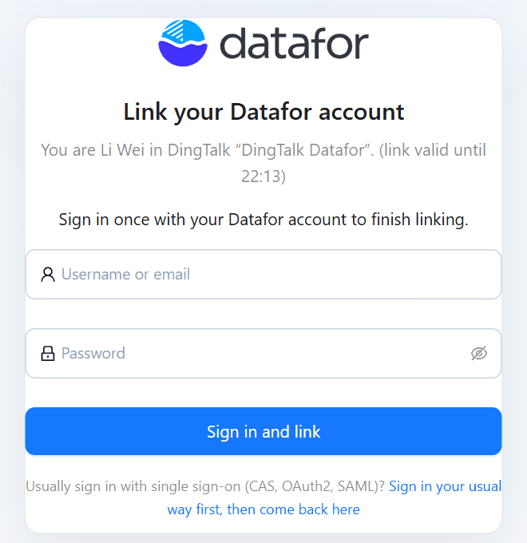
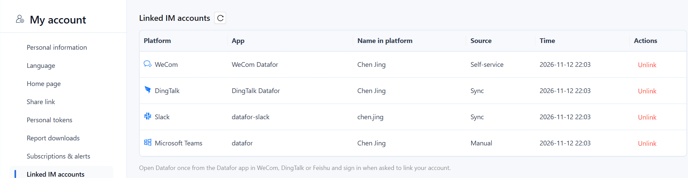

# Using Datafor in IM Apps

When an administrator has connected a WeCom, DingTalk, Feishu, Slack or Microsoft Teams app to Datafor (see [IM Platforms](/documentation/System/IM-Platforms/)), you can receive subscriptions and alerts there as direct messages, open Datafor from the app and, except in Teams, ask the AI assistant questions in chat.

## Link your account

Datafor has to know which IM account is yours. Often there is nothing to do: the administrator's directory sync links you, and in Slack and Teams you are matched by the email address in your Datafor profile. Otherwise:

- **WeCom, DingTalk, Feishu.** Open the Datafor app in the IM's workbench. The first time, Datafor shows **Link your Datafor account**. Sign in with your Datafor user name and password and click **Sign in and link**. From then on, opening the app signs you in to Datafor directly.
- **Slack.** Send the Datafor bot a direct message. If your account is not linked, the bot replies with a link to the same page.

If you usually sign in through single sign-on (CAS, OAuth2 or SAML) and have no Datafor password, click **Sign in your usual way first, then come back here**, sign in, and confirm with **Link to current account**.

The link page is valid for 10 minutes and works once. If it says **Link not valid**, go back to the IM app and open Datafor again. If it says the platform account is already linked to another Datafor user, ask your administrator.

## Receive subscriptions and alerts

Under **My account › Subscriptions & alerts › How I receive**, tick the app's direct-message option, such as **DingTalk app message** or **Slack direct message**. Only a linked app can be ticked. Messages arrive as cards with buttons such as **Open report**, and alerts also with **Ask the AI assistant** and **Silence**. See [Managing Your Subscriptions and Alerts](/documentation/Subscriptions-and-Alerts/Managing-Subscriptions-and-Alerts/).

## Ask questions

Send your question to the app as you would type it in the AI assistant, for example *What were net sales in East China last month?*

| Platform | Where you can ask |
| --- | --- |
| WeCom | In a direct message to the app |
| DingTalk, Feishu | In a direct message to the bot, or in a group by @-mentioning the bot |
| Slack | In a direct message to the bot, or in a channel by @-mentioning it; the answer comes in a thread |
| Microsoft Teams | Not available; the Teams app only sends messages |

The app first replies *Analysing, please wait…*. The answer contains the AI assistant's text, a table with the first 10 rows and 5 columns of the result, a line saying whose permissions it was calculated with, and **Open in Datafor**, which opens the full answer in the AI Agent.

- **Follow-up questions.** Reply within 30 minutes to build on the previous answer, for example *Break it down by product*.
- **Clarifications.** When the assistant needs more information, it lists the options; reply with the number or the name.
- **Permissions.** Answers always use your permissions. In a group, everyone in the group sees the answer to your question.
- **Limits.** Questions count against your daily AI quota. After 2 minutes without a result, the app tells you to check the result in Datafor later. You can send up to 10 messages per minute.

If the app replies that data questions are not enabled, the administrator has turned asking off for that app or for all apps.

## Chat commands

These commands work in the same places as questions, also when asking is turned off. Each command takes the name of one of your subscriptions or alerts.

| Command | Effect |
| --- | --- |
| `my subscriptions` | Lists your subscriptions, with paused ones marked |
| `my alerts` | Lists your alerts, with paused, in-alarm and silenced ones marked |
| `pause subscription NAME`, `resume subscription NAME` | Stops or restarts a subscription |
| `silence alert NAME [hours]` | Silences an alert, for 24 hours unless you give the hours |
| `unsilence alert NAME` | Ends the silence |
| `pause alert NAME`, `resume alert NAME` | Turns an alert off or on |

If a name is not found, send `my subscriptions` or `my alerts` to see the exact names. All commands also work in Chinese, and the two list commands in the other interface languages as well.

## Linked IM accounts

**My account › Linked IM accounts** lists the apps your user is linked to, with your name in the platform, how the link was made (**Sync**, **Self-service** or **Manual**) and when.

**Unlink** removes a link. You then stop getting direct messages from that app, and you have to link again the next time you open Datafor from it.

## Related topics

- [IM Platforms](/documentation/System/IM-Platforms/)
- [Managing Your Subscriptions and Alerts](/documentation/Subscriptions-and-Alerts/Managing-Subscriptions-and-Alerts/)
- [AI Operations and Quotas](/documentation/AI-Agent/AI-Operations-and-Quotas/)
