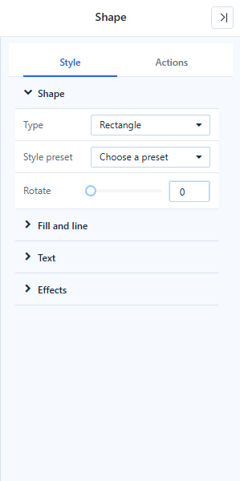
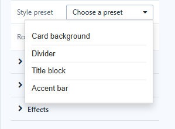
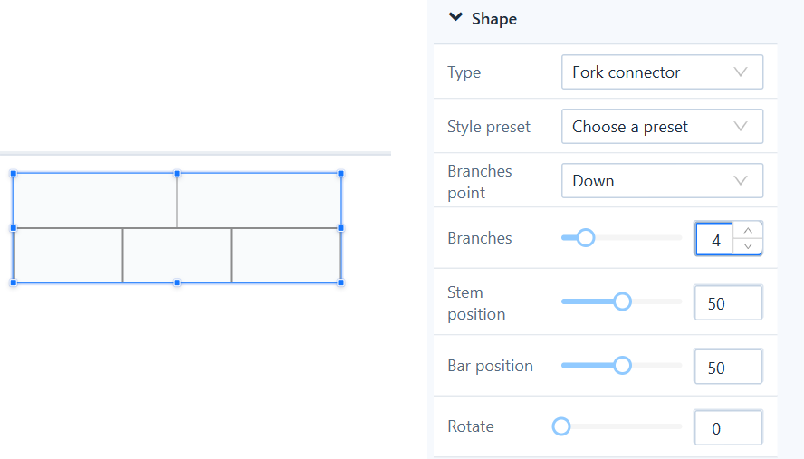

# Shapes

**Shape** draws background panels, title blocks, dividers, arrows, connectors and callouts. It replaces the separate Rectangle, Line and Ellipse components. **Components › Assists** has two entries for it: **Shape**, which starts as a 160 × 100 rectangle, and **Line**, which starts as a 200 × 12 horizontal line. Both create the same component; only the starting type and size differ.

## Style → Shape

| Setting | Options |
| --- | --- |
| **Type** | Rectangle (default), Rounded rectangle, Ellipse, Line, Arrow, Double arrow, **Elbow connector**, **Elbow arrow**, **Fork connector**, Triangle, Right triangle, Diamond, Pentagon, Hexagon, Star, Callout |
| **Style preset** | **Card background**, **Divider**, **Title block**, **Accent bar**: sets type, fill and line in one step |
| **Direction** | Straight lines and arrows: Horizontal, Vertical, Top left to bottom right, Bottom left to top right |
| **Pointer** | Callouts: Top, Bottom (default), Left, Right |
| **Corner radius** | Rounded rectangle and callout, 0–100 px |
| **Rotate** | 0–360° |

### Common shapes

Add a shape with **Components → Assists → Shape** and a click on the canvas, then:

| Shape | Steps |
| --- | --- |
| Line or arrow | Add **Line** from the palette, or set **Type → Line**, **Arrow** or **Double arrow** (the **Divider** preset gives a thin grey line), then a **Direction**. Resize the component to change the length and angle. |
| Connector with two bends | **Type → Elbow connector** or **Elbow arrow**; see [Connectors](#connectors). |
| One box linked to a row of boxes | **Type → Fork connector**; see [Connectors](#connectors). |
| Circle or ellipse | **Type → Ellipse**. Give the component the same width and height for a circle. |
| Panel or card | **Type → Rectangle** or **Rounded rectangle**, or the **Card background** or **Title block** preset. Put it behind the charts with **Move layer → Move to bottom** in the toolbar or the right-click menu. |

## Connectors

Connectors link boxes in trees, flow charts and metric breakdowns, such as a DuPont analysis. They are drawn inside the component's box and do not follow the boxes they connect: place the boxes first, then size the connector to fit between them.

**Elbow connector** and **Elbow arrow** run from one corner of the box to the opposite corner with two right-angle bends:

| Setting | Options |
| --- | --- |
| **Route** | **Horizontal first** (across, down, across; usual in flow charts) or **Vertical first** (down, across, down; usual in trees) |
| **From / to** | **Top left to bottom right** or **Bottom left to top right**: which two corners of the box the connector joins |
| **Bend position** | Where the middle segment sits, 0–100%; default 50% |
| **Bend radius** | Rounds the two bends; 0 keeps them square |

**Fork connector** draws one stem that splits into evenly spaced branches, the usual way to link a parent box to a row of child boxes with one component:

| Setting | Options |
| --- | --- |
| **Branches point** | **Down**, **Up**, **Right** or **Left**; the stem is on the opposite side |
| **Branches** | 2–12. The first and last branch sit at the two ends of the box, the rest are evenly spaced, so make the component as wide as the distance between the outer child boxes |
| **Stem position** | Where the stem meets the bar, 0–100%; default 50% |
| **Bar position** | How far the bar is from the stem end, 0–100%; default 50% |

Children that are not evenly spaced need several straight lines or elbow connectors instead. Width, color, line style and line ends are set under **Fill and line**, as for straight lines. Connectors are exported in PDF and images like other shapes; in the automatic mobile layout they are stacked like any component, so keep diagram pages for the desktop layout.

## Style → Fill and line

**Fill**: None, Solid (default) or Gradient, with **Fill color** and **End color**. **Line width** (0 = no outline), **Line color**, **Line style** (Solid, Dashed, Dotted), **Line ends** for lines (Flat, Round, Square) and **Shadow**.

## Style → Text

Type a **Text** to show inside the shape; it wraps inside the shape. Set **Font**, **Align**, **Vertical alignment** and **Padding**. **Insert dynamic value** adds a value such as `{{filter.Region}}` at the end of the text. See [Dynamic Values](/documentation/Visualization/Dynamic-Values/).

**Style → Effects** has **Opacity** and **Hover effect**.

## Actions

- **Click action** turns the shape into a button: **Go to report**, **Open link**, **Switch tab**, **Reset filters**, **Clear filters**, **Refresh data**, **Export PDF**, **Full screen**, **Open AI insight**.
- **Visibility** and a **Click script** under **Events**.
- A shape with no action and no script lets clicks through to the components below, so a background panel does not block the charts on it.

See [Click Actions and Visibility](/documentation/Visualization/Click-Actions-and-Visibility/).

## Convert old shapes

Rectangle, Line and Ellipse components from earlier versions still work. Select one and click **Style → Shape → Convert to shape → Convert** to replace it with a Shape that keeps its position, size, style, click action and visibility.

Related: [Assist Components](/documentation/Visualization/Assist-Components/)
