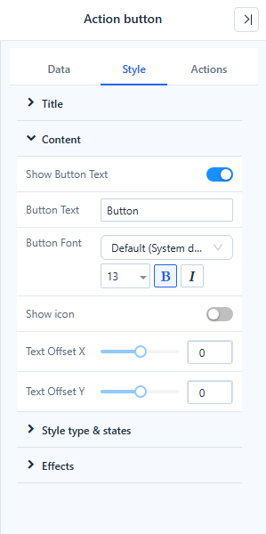
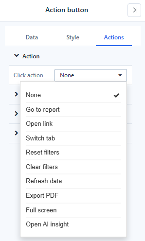

# Action button

An **Action button** is a button that does one thing when clicked: open a report page, open a link, switch a tab, reset filters, export the page and more. It needs no data. The data-bound *Image Button* of earlier versions is now the [Data button (legacy)](#data-button-legacy).

## Add a button

1. In **Components → Assists**, click **Action button**, then click the canvas. A new button is 120 × 36 px with the text *Button*.
2. On **Style → Content**, set the **Button text**, font and an optional icon.
3. On **Actions → Click action**, choose the action and fill its settings.
4. Click the button to try it, also in the editor: report pages and links open in a new tab there; **Reset filters** and **Clear filters** work in Preview or when viewing the report.

## Style

| Group | Settings |
| --- | --- |
| **Content** | **Button text** with **Insert dynamic value** (`{{filter.Region}}`, `{{param.Year}}`, `{{date}}`, `{{user.name}}`, see [Dynamic Values](/documentation/Visualization/Dynamic-Values/)), **Font**, **Show icon**, **Icon** (from the icon library), **Icon position** (Left, Right, Top, Bottom), **Icon size** |
| **Appearance** | **Style type**: **Fill**, **Outline**, **Text** or **Image**. **Main color** is the fill, or the text and border of Outline and Text buttons; new buttons take the first colour of the report palette. With **Auto colors** on, the hover, pressed and disabled colours are derived from it. Turn it off to set **Background**, **Text color** and **Border** for each **State**: Default, Hover, Pressed, Disabled. The Image type adds **Button image** (file, fit, opacity), **Show text** and **Text offset X/Y**. |
| **Effects** | Background, border, corner radius, shadow, Opacity, Hover effect |

## Actions

| Group | Settings |
| --- | --- |
| **Click action** | None, Go to report, Open link, Switch tab, Reset filters, Clear filters, Refresh data, Export PDF, Full screen, Open AI insight |
| **Disable condition** | **Never**, **By report parameter** |
| **Visibility** | Always, Hidden in preview, by report parameter, user or role |
| **Custom script** | **Run script on click**: runs on click; return `false` to cancel the action |

Details of each action and rule: [Click Actions and Visibility](/documentation/Visualization/Click-Actions-and-Visibility/).

## Pass filters to the target report

**Go to report → Jump settings** opens the target report page with the current selections of the page's filters and the report parameters:

- **Pass filters by matching field names** (on by default): every filter on the page is passed to the field with the same name in the target report, so a target that uses the same analysis model needs no mapping. For another model, pick the **target field** for each **page filter** in the table, or choose **Do not pass**.
- **Pass report parameters** (on by default): the current values of the report parameters go to the parameters with the same names in the target report.
- Date filters pass their start and end; hierarchy tree filters with several selected paths, numeric ranges and advanced filter expressions are not passed.

## Data button (legacy)

Buttons that were bound to an analysis model field in earlier versions keep working as **Data button (legacy)**: the button text shows the first value of the field, the value can be mapped to an image and is passed to the target report through the field's drill-through settings. The legacy button is no longer in the palette. A legacy button without data binding can be switched to the new component with **Style → Content → Convert to Action button**; its style and actions are kept. To show a value from the model on a clickable tile, use a **Dimension card** (Charts → Cards & KPI) with drill-through instead.
