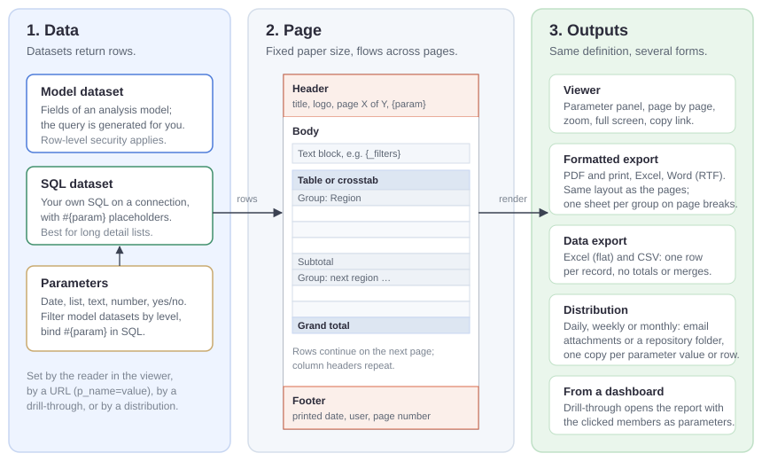
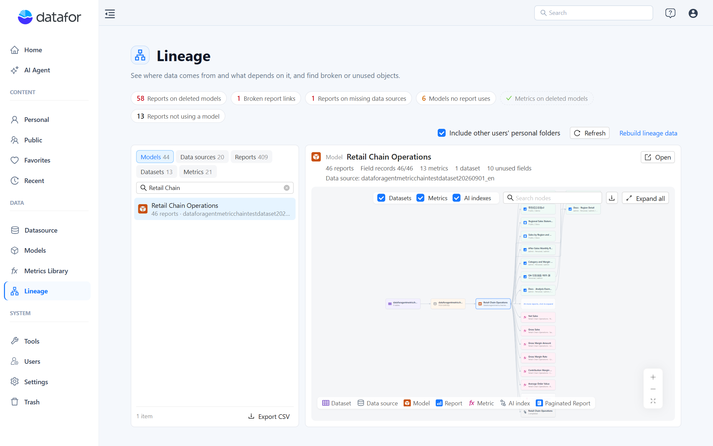

# **v10.01 Release Notes**

10.01 is the first release after **10.00** (October 22, 2026). This note covers every change since 10.00.

10.01 adds **paginated reports**, a new kind of report laid out on paper pages for printing, exporting and scheduled delivery, and a **Lineage** page that shows what depends on what across models, data sources and reports, and what breaks before you change something. In dashboard reports, the **Action button** becomes a plain button that passes the page's filters to the report it opens, relative dates can count from a Date component and pick the latest period that has data, and several problems reported after 10.00 are fixed.

Read [Upgrade notes](#upgrade-notes) before you upgrade.

## Highlights

### 1. Paginated reports

A **paginated report** (`.pagereport`) is a document: a fixed paper size, a header and footer on every page, and one table or crosstab that runs across as many pages as its rows need. Use it for monthly statements, long listings and signed-off PDFs, where a dashboard report is made for exploring on screen.

- **Create** with **New › Paginated report** in a console folder. A wizard builds a detail table, a grouped report or a crosstab in two steps; drag model fields to rows, columns and values.
- **Data** from an analysis model (row-level security applies) or your own SQL on a connection, with `#{parameter}` placeholders bound as query parameters. Writing SQL needs raw SQL permission on the connection.
- **Parameters** that readers set before the report runs: typed in, chosen from a list, taken from a global parameter or the signed-in user, defaulting to a relative date such as *first day of last month*, and cascading. A date parameter can be a date range.
- **Tables and crosstabs** with groups, subtotals, grand totals and the same style templates as dashboard tables; header and footer bands with text, images, page numbers and field values in a 3 × 3 grid.
- **Viewer and exports**: page through the report in the console or a new tab, print it, or export it to PDF, Excel, Word (RTF), flat Excel and CSV. Large exports run in the background and wait under **My account › Report downloads**.
- **Distribution**: run a report on a schedule or on demand, one copy per recipient or parameter value, and email it or save it to a repository folder.
- **Drill through** from a dashboard chart to a paginated report: the clicked members are mapped to the report's parameters.

Paginated reports are an optional plugin. See [Limits in this release](/documentation/Paginated-Reports/Understanding-Paginated-Reports/#limits-in-this-release).

[Understanding Paginated Reports](/documentation/Paginated-Reports/Understanding-Paginated-Reports/) · [Creating a Paginated Report](/documentation/Paginated-Reports/Creating-a-Paginated-Report/) · [Viewing, Pagination and Export](/documentation/Paginated-Reports/Viewing-Pagination-and-Export/) · [Distribution](/documentation/Paginated-Reports/Distribution/)

### 2. Lineage

- **Data › Lineage** (new page) lists every model, data source, report, dataset and metric you can see. A health bar flags reports on deleted models, paginated reports on missing data sources, broken drill-through links, models no report uses and metrics on deleted models; click a chip to list the affected objects. Select an object for its details and a lineage graph centred on it. Lists export to CSV and graphs to PNG.
- **Clean up from the page**: move a report that uses a deleted model to Trash, or list all reports of a deleted model and move them to Trash one by one.
- **Field-level usage**: the modeler's **Usage** section shows which reports use a measure, level or calculated member, and delete or change confirmations list what will break.
- **Report lineage** in the report toolbar opens the graph of the open report. Graphs now include datasets, metrics, AI indexes and paginated reports.
- **Rebuild lineage data** (administrators): reports saved before the upgrade have no field-level record until it is run once.

[Understanding Lineage](/documentation/Lineage/Understanding-Lineage/) · [The Lineage Page](/documentation/Lineage/Lineage-Page/) · [Usage and Impact Analysis](/documentation/Lineage/Usage-and-Impact-Analysis/)

### 3. Action button and Go to report

- **Action button** is now a plain button without data binding: Fill, Outline, Text or Image style with Default, Hover, Pressed and Disabled states and icons, text with dynamic values, a **Disable condition**, and click actions such as opening a report page or link, switching tabs, resetting or clearing filters, exporting PDF, full screen and **Open AI insight**. Its click also runs in the editor, so you can try it while you design.
- **Go to report** on Text, Image, Icon, Shape and Action button passes the page's filters, the members clicked in charts and the report parameters to the target report: by matching field names, or with a target field (or **Do not pass**) for each page filter. This also works when the target opens in the current tab.
- **Insert dynamic value** is a **{x}** button at the end of the text box with a grouped menu, and inserts at the cursor. `{{filter.Field}}` shows the members clicked in charts when no filter, or a filter set to All, covers that field.

[Action button](/documentation/Visualization/Action-Button/) · [Click Actions and Visibility](/documentation/Visualization/Click-Actions-and-Visibility/)

### 4. Relative dates

- **Relative component filters that follow a Date component.** A chart's **Relative** filter (**Data → Filters**) can count from today or from a Date component on the page: all of its range (the default), its start or its end. **Include reference time** keeps the window exactly N units long, calendar units add **Include current period** (for example the last 12 months including this one), and a month selected at Month granularity gives the same results as the same days selected as a range.
- **Latest period.** Dropdown, List box, Button group and Radio/Checkbox on a year, quarter, month, week or day field, and a single-period Date that filters by a field, can default to **Latest period**: the most recent period that has data, rather than the period that contains today. Periods that the date table holds in advance are skipped. It is looked up each time the report opens and on **Refresh**, so newly loaded data is picked up.
- **Dates that travel across time zones.** Fixed dates of a Date component are saved as calendar dates, so readers in other time zones see the dates the author chose.

[Relative component filters](/documentation/Analysis/Relative-Date-Filtering/#relative-component-filters) · [Latest period in list filters](/documentation/Visualization/List-Box/#latest-period) · [Latest period in the Date component](/documentation/Visualization/Datepicker/#latest-period)

## Report editor

- **Drill through**: choosing the target report maps fields with the same name automatically; target fields are labelled *Dimension › Hierarchy › Field*. **OK** is blocked with a message when drill through is on but no report is chosen, a link has no address, or a pop-up has no size. Drill-through pop-ups open at a sensible default size.
- **Pie charts** at their default size are larger: outer labels get room by their actual angle and wrap to two lines before they are dropped.
- **Switching tabs** in reports with many components is faster.
- Measure filters accept `${parameter}` as the threshold again, with a separate message when the parameter does not exist.

## Console, modeling and data sources

- **Trash**: restoring and emptying report a clear result. A file you cannot see is no longer reported as deleted, and permanently deleting a Trash item checks that it is yours to delete.
- **Deleting a model** is refused while reports you cannot see still use it.
- The **Models** list shows who created and who last modified each model; models from earlier versions show the last modifier as creator.
- **SQL views** in the modeler show the run result (rows, fields with types, sample rows) and errors inside the dialog. Editing an SQL view updates it in place instead of dropping and recreating it, which used to remove its joins, dimensions and measure groups; if the new SQL drops a column that is in use, you are asked first.
- File imports that fail say which file and why.
- Error messages are worded consistently and no longer show low-level technical details.
- The update notice no longer shows a fixed brand name or download site.

## AI Agent

- Changing or deleting **Frequently asked questions** refreshes the welcome card at once.
- On Windows, the AI Agent starts from one launcher for all of its roles.

## Upgrade notes

- **Action buttons bound to a model field** in earlier reports keep working as **Data button (legacy)**, which is no longer in the palette. An Action button without a bound field can be converted with **Convert to Action button**.
- **Relative component filters** may return a slightly different period: **Include reference time** covers exactly N units (one day fewer than before); a calendar unit is no longer moved by an include setting that was hidden for calendar units; a count of 0 counts as 1; and a filter that referenced a range Date without choosing its start or end now counts from the whole range.
- **Fixed Date defaults** saved in another time zone open on the dates the author chose instead of a day earlier or later. Save the report once to store them in the new format.
- **List filters on a time field that defaulted to Last** now show **Latest period** and pick the most recent period that has data, also when the field is sorted in descending order or by a measure. Earlier they picked the last member of the date table, which could be a month the date table holds in advance.
- **Lineage**: run **Data › Lineage › Rebuild lineage data** once as an administrator after the upgrade, so reports saved earlier take part in usage and impact lists.
- **AI Agent shared secret**: Datafor now reads it from `ai-agent/.env` (or `ai-agent/instance-secrets.env`) next to `bi-server`, not from `<agent-secret>` in the modeler plugin's `settings.xml`. Upgrade the modeler plugin and the AI Agent launch scripts together. If the AI Agent runs on another machine, set `DATAFOR_AGENT_SECRET` as an environment variable or `-Ddatafor.agent.secret` for the Datafor server, then restart it; otherwise models configured in Datafor fail for non-administrators.

## Important bug fixes

- A shared link no longer fails with *no permission* after a report it drills into or embeds is renamed or moved.
- Filtering a level on an integer column by name no longer fails.
- Clicking a field under **Data → Filters** works again after you switched to another component while a filter's details were open.
- A Hierarchy table filter's header alignment applies at once instead of after saving and reopening the report.
- Action scripts run again: **Before data fetch** on Dynamic image, chart click scripts on the new standard components, and the cell click script on Hierarchy table filters.
